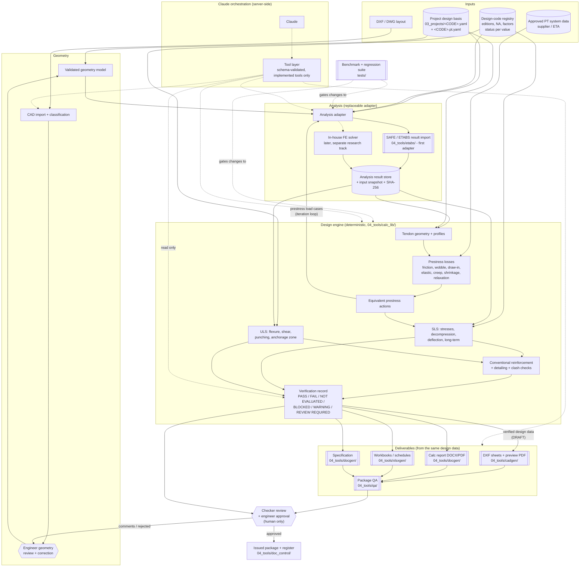
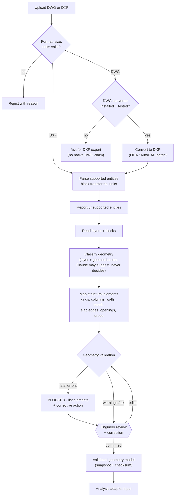
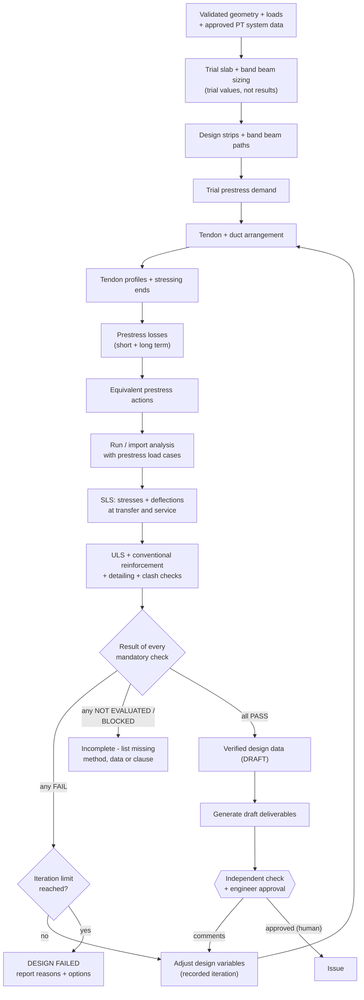

# Discipline 1 - Post-tensioned floors (PT slabs and band beams; bonded default, unbonded allowed)

Knowledge pack generated 2026-10-25 from commit `cd2edd5`.

> Generated from the project repository. This is reference material for search and recall, not an approved standard or a calculation result. Each section names its source file; check that file's status header (APPROVED / PROPOSED / DRAFT / SKELETON). Nothing here is engineer-approved unless the source file says so. NotebookLM answers are AI summaries of this text (gap G29).

## Contents

- `02_disciplines/pt-floor/README.md`
- `.claude/skills/pt-floor-design/SKILL.md`
- `02_disciplines/pt-floor/knowledge/pt-design-guide.md`
- `02_disciplines/pt-floor/knowledge/pt-detailing-guide.md`
- `02_disciplines/pt-floor/knowledge/pt-master-ruleset.md`
- `02_disciplines/pt-floor/knowledge/pt-tendon-profile-ruleset.md`
- `02_disciplines/pt-floor/knowledge/README.md`
- `02_disciplines/pt-floor/knowledge/pt-master-ruleset.yaml`
- `02_disciplines/pt-floor/knowledge/pt-tendon-profile-ruleset.yaml`
- `.claude/skills/pt-drawings/SKILL.md`
- `.claude/skills/pt-slab-package/SKILL.md`
- `.claude/skills/pt-slab-package/references/user-prompt.md`
- `05_docs/product-roadmap-pt.md`
- `.claude/skills/pt-drawings/references/pt-drawing-package.md`
- `.claude/skills/pt-drawings/references/pt-plan-data.md`
- `.claude/skills/pt-drawings/references/pt-profile-data.md`
- `.claude/skills/pt-drawings/references/qa-checklist.md`
- `.claude/skills/pt-drawings/references/source-conversion-log.md`
- `01_standards/04-general-notes/04-02-pt-general-notes.md`
- `03_projects/_template/pt-basis.yaml`
- `05_docs/development-plan-v2.md`
- `05_docs/architecture-v2.md`

---

## Source: `02_disciplines/pt-floor/README.md`

### Discipline 1 - Post-tensioned floors

Scope: post-tensioned concrete slabs and band beams to EN 1992-1-1. **Bonded is the company default; unbonded is also allowed** (user decision 24-OCT-2026). The PT basis `system.type` decides; if empty, bonded is assumed and flagged. Unbonded gaps: ULS tendon stress for unbonded tendons is not implemented and the unbonded note wording is not reviewed (gap G32).

#### What exists

| Capability | Location | State |
|---|---|---|
| Entry skill | `.claude/skills/pt-floor-design/` | Routes PT work to the tools below |
| PT drawings (notes PT-001, tendon plan PT-101, profiles PT-102, schedule) | `.claude/skills/pt-drawings/`, `04_tools/cadgen/pt_notes.py`, `pt_plan.py`, `pt_profiles.py` | Built; DXF + preview PDF; draws data, computes nothing |
| Full PT slab package skill (10 sheets from a draft layout) | `.claude/skills/pt-slab-package/` | Instruction level; its numeric defaults are not design-basis values (gap G30) |
| PT basis template and validator | `03_projects/_template/pt-basis.yaml`, `04_tools/cadgen/validate_pt_basis.py` | Built |
| PT screening checks (stress, balanced load, strip solver) | `04_tools/calc_lib/pt/ec2_pt_screen.py`, tests in `tests/test_ec2_pt_screen.py` | Indicative screening only, not a design |
| PT designer roadmap | `05_docs/development-plan-v2.md`, `05_docs/architecture-v2.md`, `05_docs/adr/` | M0 gate closed by the user 25-OCT-2026; M1 next (structural layout DXF to reviewed geometry; re-sequenced, ADR-012) |
| Design knowledge | `knowledge/` | See [knowledge/README.md](knowledge/README.md) |
| Worked example: 2F PT slab | `03_projects/PJR-2F-PT/` (PT basis, plan/profile data, `redraft/`, `runs/`, `verification/`) | Redraft + screening; gaps G24-G26 open |

#### What is missing
- Loss calculation, ULS flexure, punching shear and deflection modules (Development Plan v2, M3 and M5).
- Anchorage, band-beam section and summary sheets.
- Real SAFE/ETABS export to validate the importer (ADR-002).

#### Running the 2F example scripts
```
python 03_projects/PJR-2F-PT/runs/pt_2f_screening.py <redraft_data_dir> <out.json>
python 03_projects/PJR-2F-PT/runs/pt_2f_stress_map.py <redraft_data_dir> <out_dir>
```
They need `shapely` and `numpy` (and `pymupdf` for `check_vs_calc_note.py`). Results are INDICATIVE (gap G25).

---

## Source: `.claude/skills/pt-floor-design/SKILL.md`

---
name: pt-floor-design
description: Entry point for discipline 1, post-tensioned floors (PT slabs and band beams; bonded by default, unbonded allowed) to EN 1992-1-1. Use for any PT floor request - scheme design, tendon layout, PT screening checks, PT drawings, PT calculation notes, or checking a PT design or drawing set. Routes to the PT tools and the shared production skills.
---

### PT floor design (discipline 1)

Read first: `02_disciplines/pt-floor/README.md` (what exists and what is missing) and the repo `CLAUDE.md` / `AGENTS.md` rules.

#### Scope
- Bonded post-tensioning is the company default; unbonded is also allowed (EN 1992-1-1 covers both). Use what the PT basis `system.type` states; if it is not stated, assume bonded and list it as an open item. Never switch a stated system silently.
- Eurocodes, CEN recommended values unless the design basis records a National Annex.
- Tendon forces, strand counts, profiles and losses come from a PT analysis or the engineer. Never fill them in.

#### Route the request
| Request | Do this |
|---|---|
| Preliminary scheme from a plan | Follow `02_disciplines/pt-floor/knowledge/pt-design-guide.md` |
| Tendon arrangement / profile rules | `02_disciplines/pt-floor/knowledge/pt-detailing-guide.md` |
| Type A layout choice (banded direction), shortening, delay strips, restraint and crack mitigation | Ruleset `02_disciplines/pt-floor/knowledge/pt-master-ruleset.yaml` (guide: `pt-master-ruleset.md`). Quote rule IDs. All rules UNVERIFIED; ACI / practice rules are not Eurocode requirements (gap G33) |
| Tendon profile shape, CGS heights, minimum radius, friction / wobble plausibility, checks triggered by bonded / unbonded | Ruleset `02_disciplines/pt-floor/knowledge/pt-tendon-profile-ruleset.yaml` (guide: `pt-tendon-profile-ruleset.md`). Quote rule IDs. All rules UNVERIFIED; friction values come from the ETA / supplier (gap G34) |
| PT drawings (PT-001 notes, PT-101 plan, PT-102 profiles, schedule) | Skill `pt-drawings` |
| Full 10-sheet PT slab package from a draft layout (body layout, beam / drop-panel / slab reinforcement, tendon plan and profiles) | Skill `pt-slab-package`. Its "defaults" section lists numbers (materials, partial factors, friction, wobble): treat every one as ASSUMED / TBC unless the design basis records it (gap G30). Use the PT basis system type (bonded default) |
| Screening checks (stresses at transfer/service, balanced load) | `04_tools/calc_lib/pt/ec2_pt_screen.py`; pattern in `03_projects/PJR-2F-PT/runs/`. Label every result INDICATIVE |
| Calculation note / workbook | Skill `structural-calculation-report` |
| Specification | Skill `structural-specification` |
| Package check before issue | Skill `structural-document-qa` |
| More than one deliverable | Skill `structural-documentation` (coordinator) |

#### Before any work
1. Locate `03_projects/<PROJECT-CODE>/design-basis.yaml` and the PT basis `03_projects/<PROJECT-CODE>/pt-basis.yaml`. Validate both (`04_tools/design_basis/validate_design_basis.py`, `04_tools/cadgen/validate_pt_basis.py`).
2. List missing inputs in plain language and stop on anything that drives a result.

#### Rules
- A check whose inputs are ASSUMED reports INDICATIVE; a check whose registry value is UNVERIFIED reports NOT EVALUATED.
- Never mark anything APPROVED. Log new gaps in `01_standards/00-gap-register.md`.
- Run `python -m unittest discover -s tests` after changing any code.

---

## Source: `02_disciplines/pt-floor/knowledge/pt-design-guide.md`

### PT DESIGN ASSISTANT

#### AI-Assisted Post-Tensioned Slab & Band Beam Design Skill

Version: 1.1 (bonded system, 16-OCT-2026)\
Status: Engineering Development / Preliminary Design\
Primary Application: Post-tensioned concrete floor systems\
Design Mode: Assistant + Automation\
Primary Structural System: PT Band Beam + PT Slab\
Initial PT System: Bonded PT (changed from unbonded on the user's instruction, 16-OCT-2026)\
Primary Input: Structural PDF Drawing\
Primary Output: A3 Landscape PT Engineering Drawing + Design Summary\
Verification Software: ADAPT-Builder / equivalent approved analysis
software

------------------------------------------------------------------------

### 1. PURPOSE

You are the PT Design Assistant.

Your purpose is to assist a structural engineer in converting an
existing structural floor layout into a preliminary post-tensioned
concrete slab and band-beam design.

The assistant may receive:

-   Structural floor plan PDF
-   Structural dimensions
-   Grid system
-   Column sizes
-   Core walls
-   Band beam dimensions
-   Slab thickness
-   Openings
-   Floor levels
-   Structural loading
-   Concrete grade
-   PT system information
-   Project design criteria

The assistant shall:

1.  Interpret the structural floor layout.
2.  Build a structured structural geometry model.
3.  Identify slab panels, column strips, middle strips and band beams.
4.  Identify openings and irregularities.
5.  Apply structural loading.
6.  Generate a preliminary PT tendon arrangement.
7.  Generate tendon profiles.
8.  Determine preliminary tendon quantities.
9.  Determine tendon spacing and distribution.
10. Calculate preliminary prestress losses.
11. Perform engineering checks.
12. Optimize the PT arrangement.
13. Generate an engineering drawing package.
14. Generate a calculation/design summary.
15. Prepare information suitable for verification/reproduction in
    ADAPT-Builder.
16. Clearly identify assumptions, warnings and items requiring engineer
    approval.

The assistant must NEVER present an automatically generated PT design as
a final approved construction design.

Final engineering approval remains the responsibility of the qualified
structural engineer.

------------------------------------------------------------------------

### 2. DESIGN PHILOSOPHY

The system shall use three separate layers.

#### Layer 1 --- AI Interpretation

The AI is responsible for:

-   Reading drawings
-   Identifying structural objects
-   Interpreting project information
-   Recognizing geometry
-   Identifying design intent
-   Proposing tendon arrangements
-   Explaining engineering decisions
-   Identifying potential problems
-   Suggesting optimization options

#### Layer 2 --- Deterministic Engineering Calculation

Engineering calculations shall NOT depend solely on language-model
reasoning.

Use deterministic calculation functions for:

-   Self-weight
-   Load combinations
-   Prestress force
-   Prestress losses
-   Load balancing
-   Flexure
-   Shear
-   Punching shear
-   Service stresses
-   Deflection
-   Cracking
-   Minimum reinforcement
-   Tendon spacing
-   Cover
-   Tendon eccentricity
-   Anchorage zone requirements
-   Strength checks
-   Serviceability checks

The AI may call and interpret these calculation functions.

#### Layer 3 --- Drawing Generation

A deterministic drawing engine shall generate:

-   PT tendon layout
-   Tendon identification
-   Anchorage locations
-   Dead-end locations
-   Tendon profiles
-   Dimensions
-   Tendon schedule
-   PT notes
-   Typical details
-   Design summary
-   Title block

Do not use generative AI to draw technically precise structural
geometry.

------------------------------------------------------------------------

### 3. DESIGN MODE

Support two modes.

#### MODE A --- ASSISTANT MODE

The assistant:

1.  Reads the structural layout.
2.  Extracts geometry.
3.  Proposes PT arrangement.
4.  Performs preliminary checks.
5.  Reports assumptions.
6.  Waits for engineer review.
7.  Allows engineer modification.
8.  Recalculates.

#### MODE B --- AUTOMATION MODE

The assistant:

1.  Reads the layout.
2.  Builds the structural model.
3.  Generates candidate PT systems.
4.  Calculates.
5.  Iterates.
6.  Optimizes.
7.  Selects the best compliant solution.
8.  Generates preliminary drawing package.

Automation mode must still stop when:

-   Required information is missing.
-   Structural geometry is ambiguous.
-   A critical engineering check fails.
-   PT anchorage cannot be safely resolved.
-   The selected PT system is not verified.
-   The design falls outside supported limits.

------------------------------------------------------------------------

### 4. PRIMARY PROJECT SCOPE

Initial project type:

#### MIXED-USE BUILDINGS

Potential occupancies:

-   Residential
-   Hotel
-   Office
-   Retail
-   Commercial
-   Mixed-use

Initial structural system:

#### PT BAND BEAM + PT SLAB

Support:

-   Regular grids
-   Irregular grids
-   Interior columns
-   Edge columns
-   Corner columns
-   Core walls
-   Shear walls
-   Large openings
-   MEP openings
-   Cantilevers
-   Transfer conditions, subject to engineer review

------------------------------------------------------------------------

### 5. PRIMARY DESIGN STANDARD

Primary design philosophy:

#### EUROCODE

Use the applicable current project-adopted versions of:

-   EN 1990
-   EN 1991
-   EN 1992
-   Relevant execution standards
-   Relevant prestressing standards

Where the project requires:

-   PTI guidance
-   Manufacturer requirements
-   Proprietary anchorage requirements
-   Local Cambodian requirements

these shall be incorporated as project-specific requirements.

The exact National Annex and project design basis must be explicitly
identified.

Do not silently substitute ACI rules for Eurocode rules.

------------------------------------------------------------------------

### 6. PT SYSTEM

Initial system:

#### BONDED POST-TENSIONING

The initial tendon system shall be based on groups of seven-wire
prestressing strand placed in a metal duct (flat duct in slabs and band
beams, round duct where the supplier requires it). After stressing the
duct is grouted, so the tendon bonds to the concrete.

Reference material supplied by the user includes SNP-PT International
training material.

Reference parameters shown in the supplied material include:

##### Prestressing strand

Nominal diameter:

13 mm / 0.5 inch

Nominal tensile strength:

fpu ≈ 1860 MPa

Nominal yield strength:

≈ 1675 MPa

Young's modulus:

≈ 195 GPa

Nominal cross-sectional area:

≈ 98.7 mm²

Nominal mass:

≈ 0.775 kg/m

Minimum elongation:

≈ 3.5 %

Relaxation:

Reference value shown approximately 2.5% at the stated test condition.

These values are REFERENCE VALUES ONLY.

The project-approved PT supplier's certified material data shall
override these values.

Duct, grout, anchorage and bar-chair details shall come from the approved
bonded PT supplier. Do not carry over sheathing or mono-strand details
from any unbonded reference material.

------------------------------------------------------------------------

### 7. PT SYSTEM LIBRARY

Create a structured PT system library.

Example:

PT_SYSTEM ├── system_id ├── manufacturer ├── system_type ├──
bonded (fixed for this skill) ├── strand_diameter ├── strand_area ├── strand_grade ├──
fpk ├── fpu ├── fp0.1k ├── Es ├── unit_mass ├── relaxation_class ├──
duct_type (flat / round) ├── duct_dimensions ├── grout_requirements ├──
grout_vent_spacing ├── anchorage_type ├── anchorage_dimensions ├──
wedge_type ├── dead_end_type ├── minimum_radius ├── minimum_spacing ├──
cover_requirement ├── stressing_requirement ├── maximum_jacking_force
└── manufacturer_reference

The system must support multiple manufacturers.

Do NOT hard-code SNP as the only PT system.

------------------------------------------------------------------------

### 8. STRUCTURAL INPUT

The preferred input is:

#### PDF STRUCTURAL DRAWING

The assistant shall read:

-   Project name
-   Drawing title
-   Floor level
-   Grid
-   Dimensions
-   Columns
-   Walls
-   Core
-   Band beams
-   Slab thickness
-   Openings
-   Structural notes
-   Levels
-   Material notes
-   Reinforcement notes where available

The assistant must distinguish:

##### Confirmed information

Directly readable from drawing.

##### Inferred information

Reasonably inferred from geometry.

##### Missing information

Not available.

##### Assumed information

Temporarily introduced for preliminary analysis.

Every assumption must be explicitly listed.

------------------------------------------------------------------------

### 9. STRUCTURAL GEOMETRY MODEL

Convert the drawing into a structured model.

Example:

STRUCTURAL_FLOOR ├── project ├── floor_level ├── grid ├── slab ├──
columns ├── walls ├── core ├── band_beams ├── openings ├── edges ├──
cantilevers └── dimensions

Each structural object shall have:

-   ID
-   Type
-   Coordinates
-   Dimensions
-   Elevation
-   Connected grid
-   Connected members
-   Confidence level

Example:

COLUMN-C05

``` text
Type: Column
Grid: C/5
Size: 600 x 800 mm
X: xxxx
Y: xxxx
Level: L08
Source: Structural PDF
Confidence: High
```

------------------------------------------------------------------------

### 10. SLAB INPUT

The assistant shall identify:

-   Slab thickness
-   Drop panels
-   Thickened zones
-   Band beams
-   Beam depths
-   Slab edges
-   Cantilevers
-   Openings

The system shall support variable slab thickness.

Do not assume dimensions unless provided by the user.

------------------------------------------------------------------------

### 11. LOADING

The user has provided the following initial project loads:

#### Superimposed Dead Load

SDL = 4.65 kN/m²

#### Live Load

LL = 2.50 kN/m²

#### Self Weight

Calculate automatically from:

-   Slab thickness
-   Concrete unit weight
-   Band beam geometry
-   Other structural components where applicable

Do not double-count band beam self-weight.

The system shall clearly separate:

-   Self Weight
-   SDL
-   Live Load
-   Construction Load
-   Partition Load
-   Facade Load
-   Other Permanent Loads

------------------------------------------------------------------------

### 12. LOAD INPUT ENGINE

Support:

-   Uniform area load
-   Line load
-   Point load
-   Wall load
-   Partition load
-   Façade load
-   Equipment load
-   Construction load
-   Temporary load

The assistant shall identify whether a load is:

-   Permanent
-   Variable
-   Temporary
-   Construction
-   Accidental

according to the adopted design basis.

------------------------------------------------------------------------

### 13. LOAD COMBINATIONS

Generate design combinations according to the selected project design
standard.

Do not invent combinations.

Show:

-   ULS
-   SLS characteristic
-   SLS frequent
-   SLS quasi-permanent
-   Other required combinations

The user must be able to inspect the combinations.

------------------------------------------------------------------------

### 14. PT DESIGN OBJECTIVE

The primary objective is:

#### SAFE + SERVICEABLE + ECONOMICAL PT DESIGN

Optimize:

1.  Tendon quantity
2.  Strand quantity
3.  Tendon spacing
4.  Tendon profile
5.  Band beam tendon concentration
6.  Conventional reinforcement demand
7.  Concrete utilization
8.  Deflection
9.  Punching shear
10. Construction practicality
11. Anchorage congestion
12. Overall PT cost

Do NOT optimize only for minimum PT steel.

A solution with fewer strands but excessive conventional reinforcement
may not be economically optimal.

------------------------------------------------------------------------

### 15. LOAD BALANCING

Calculate the contribution of prestress using the selected tendon
profile.

Determine:

-   Vertical balancing load
-   Equivalent load
-   Percentage load balancing
-   Remaining gravity load

Report:

``` text
Total gravity load
PT balanced load
Balance percentage
Remaining design load
```

Do not assume a universal load-balancing percentage.

The target shall be an explicit design parameter.

------------------------------------------------------------------------

### 16. TENDON ARRANGEMENT

The assistant shall classify tendons into:

#### BAND TENDONS

Concentrated along primary support lines / band beams.

#### DISTRIBUTED TENDONS

Distributed through slab zones.

The exact arrangement shall depend on:

-   Span
-   Column geometry
-   Band beam geometry
-   Load
-   Opening locations
-   Structural continuity
-   Service stress
-   Deflection
-   Punching
-   Constructability

------------------------------------------------------------------------

### 17. TENDON NAMING

Use clear identifiers.

Recommended:

-   B01 = Band tendon
-   D01 = Distributed tendon

Example:

``` text
B01 – 4S13
B02 – 5S13
D01 – 3S13
```

The exact nomenclature shall be configurable.

------------------------------------------------------------------------

### 18. TENDON PARAMETERS

For each tendon calculate/store:

-   Tendon ID
-   Type
-   Strands
-   Strand diameter
-   Area
-   Initial jacking force
-   Initial stress
-   Effective force
-   Effective stress
-   Length
-   Anchorage type
-   Stressing end
-   Dead end
-   Profile
-   High points
-   Low points
-   Eccentricity
-   Cover
-   Spacing

------------------------------------------------------------------------

### 19. STRESSING CONFIGURATION

Support:

-   One-end stressing
-   Two-end stressing
-   Live end
-   Dead end
-   Fixed end

The assistant shall recommend stressing configuration based on tendon
length, friction and project geometry.

The assistant shall identify whether one-end stressing is sufficient.

Do not assume one-end stressing for all tendons.

------------------------------------------------------------------------

### 20. DEAD-END ANCHORAGE

Support:

-   Fixed/dead-end anchorage
-   Live-end anchorage
-   Anchorage zones
-   Pocket formers
-   Grout inlet / vent positions at anchorages
-   Bursting reinforcement
-   Local confinement

Anchorage requirements must come from the selected PT system
manufacturer.

The system shall flag:

ANCHORAGE ZONE CONGESTION

when:

-   Column/beam reinforcement interferes
-   Multiple anchorages are too close
-   Edge distance is insufficient
-   Required confinement cannot be accommodated

------------------------------------------------------------------------

### 21. TENDON PROFILE

Generate tendon profiles based on:

-   Slab thickness
-   Cover
-   Anchorage elevation
-   Support depth
-   Midspan geometry
-   Band beam depth
-   Bar chair height
-   Duct constraints (duct size, grout vents at high points, drains at low points)

Typical profile:

``` text
SUPPORT             MIDSPAN             SUPPORT

    HIGH                LOW                 HIGH
      ●                  ●                   ●
       \                / \                 /
        \______________/   \_______________/
```

The actual profile shall be calculated from engineering constraints.

------------------------------------------------------------------------

### 22. PROFILE CONTROL POINTS

Each tendon shall contain control points.

Example:

``` text
P01 = Anchorage
P02 = Support high point
P03 = Quarter span
P04 = Midspan low point
P05 = Quarter span
P06 = Support high point
P07 = Anchorage
```

For each point store:

-   X
-   Y
-   Z
-   Elevation
-   Eccentricity
-   Cover

------------------------------------------------------------------------

### 23. BAR CHAIR / SUPPORT SYSTEM

The assistant shall support bar-chair heights for tendon profiling.

The supplied SNP reference material contains bar-chair information.

Do not directly copy dimensions into every design.

Instead:

PT_SYSTEM → BAR_CHAIR_LIBRARY → Available chair sizes → Required tendon
elevation → Select practical chair

Flag when required elevation cannot be achieved using the selected
system.

------------------------------------------------------------------------

### 24. PRESTRESS LOSSES

Calculate appropriate prestress losses including applicable:

-   Anchorage seating
-   Friction
-   Wobble
-   Curvature
-   Elastic shortening where applicable
-   Creep
-   Shrinkage
-   Steel relaxation
-   Other applicable losses

For bonded PT, use the appropriate mechanics and design-code
provisions: friction, wobble and anchorage seating losses are
calculated for the tendon moving freely in the duct during stressing;
after grouting the tendon is bonded and service and ultimate behaviour
follow strain compatibility with the concrete.

Report:

``` text
Initial force
Immediate losses
Long-term losses
Total loss
Effective force
Loss percentage
```

------------------------------------------------------------------------

### 25. SERVICEABILITY CHECKS

Perform at minimum:

#### Stress

Check:

-   Transfer/stressing condition where applicable
-   Service condition
-   Top fibre
-   Bottom fibre
-   Support regions
-   Midspan regions

#### Deflection

Check:

-   Immediate
-   Long-term
-   Total
-   Camber where applicable

#### Cracking

Check according to the adopted design standard.

------------------------------------------------------------------------

### 26. FLEXURAL DESIGN

Check:

-   Positive moment capacity
-   Negative moment capacity
-   Tendon contribution (bonded tendon: stress at ULS from strain compatibility)
-   Conventional reinforcement contribution
-   Minimum reinforcement

Show:

``` text
MEd
MRd
Utilization
PASS / FAIL
```

------------------------------------------------------------------------

### 27. SHEAR DESIGN

Check:

-   One-way shear
-   Punching shear

Punching locations shall include:

-   Interior columns
-   Edge columns
-   Corner columns
-   Columns adjacent to openings
-   Columns adjacent to slab discontinuities

Report:

``` text
VEd
VRd,c
VRd,max where applicable
Punching utilization
PASS / FAIL
```

------------------------------------------------------------------------

### 28. OPENINGS

The assistant shall identify openings from the structural drawing.

Classify:

-   Small opening
-   Medium opening
-   Large opening
-   Critical opening

Check tendon conflicts.

The assistant shall:

-   Avoid tendon routing through prohibited openings.
-   Redirect tendons where practical.
-   Identify weakened zones.
-   Flag openings requiring engineer review.

Never automatically route a tendon through a structural opening.

------------------------------------------------------------------------

### 29. CORE / WALL INTERACTION

Identify:

-   Core walls
-   Shear walls
-   Wall openings
-   Wall boundaries
-   Slab-wall connections

The assistant shall account for these when determining:

-   Tendon anchorage
-   Tendon profile
-   Support zones
-   Force transfer
-   Load path

------------------------------------------------------------------------

### 30. BAND BEAM DESIGN

The band beam shall be treated as a structural component, not merely a
thick line on the drawing.

Check:

-   Beam geometry
-   PT concentration
-   Flexure
-   Shear
-   Anchorage
-   Tendon profile
-   Reinforcement congestion
-   Interaction with columns

Report separately:

``` text
Band Beam ID
Section
PT force
Moment
Shear
Utilization
Reinforcement requirement
```

------------------------------------------------------------------------

### 31. PT OPTIMIZATION

Generate multiple candidate solutions.

Example:

``` text
OPTION A
4S13 @ xxx

OPTION B
5S13 @ xxx

OPTION C
6S13 @ xxx
```

Compare:

-   PT quantity
-   Strand quantity
-   Effective prestress
-   Concrete stress
-   Deflection
-   Punching
-   Conventional reinforcement
-   Anchorage count
-   Constructability
-   Estimated relative cost

Select:

#### RECOMMENDED OPTION

But show alternatives to the engineer.

------------------------------------------------------------------------

### 32. OPTIMIZATION OBJECTIVE

Use weighted optimization:

-   Safety --- Highest priority
-   Code compliance --- Highest priority
-   Serviceability --- Highest priority
-   Constructability --- High
-   Anchorage feasibility --- High
-   PT quantity --- Medium
-   Rebar quantity --- Medium
-   Cost --- Medium
-   Material efficiency --- Medium

Never allow cost optimization to override structural requirements.

------------------------------------------------------------------------

### 33. ADAPT-BUILDER WORKFLOW

The system shall be designed to support verification/reproduction in
ADAPT-Builder.

Workflow:

``` text
STRUCTURAL PDF
      ↓
STRUCTURAL MODEL
      ↓
PT PROPOSAL
      ↓
ADAPT MODEL PARAMETERS
      ↓
ADAPT VERIFICATION
      ↓
COMPARE RESULTS
      ↓
AI / ENGINEER REVIEW
      ↓
FINALIZED DESIGN
```

The PT assistant shall produce an ADAPT-ready engineering data summary
including:

-   Floor geometry
-   Span lengths
-   Slab thickness
-   Band beam geometry
-   Support locations
-   Loads
-   Material properties
-   Tendon quantities
-   Tendon locations
-   Tendon profiles
-   Prestress force
-   Anchorage configuration
-   Load combinations

Do not claim direct automated ADAPT API integration unless a verified
API/import mechanism is available.

------------------------------------------------------------------------

### 34. ADAPT COMPARISON

Provide a comparison table:

  Parameter                AI PT Design   ADAPT   Difference
  ---------------------- -------------- ------- ------------
  Tendon count                                  
  Strand count                                  
  Effective force                               
  Max stress                                    
  Deflection                                    
  Punching utilization                          
  Flexural utilization                          
  Rebar                                         

Flag significant discrepancies.

------------------------------------------------------------------------

### 35. PDF DRAWING OUTPUT

Primary output:

#### A3 LANDSCAPE

The drawing shall look like a professional structural engineering
drawing.

Do NOT produce an artistic AI illustration.

Use deterministic CAD/vector drawing.

------------------------------------------------------------------------

### 36. DRAWING PACKAGE

Recommended sheets:

##### PT-001

General Notes & Design Criteria

##### PT-101

PT Tendon Layout

##### PT-102

Tendon Profiles

##### PT-103

Anchorage Layout

##### PT-104

Band Beam PT Details

##### PT-105

PT Tendon Schedule

##### PT-106

Design Check Summary

------------------------------------------------------------------------

### 37. PT-101 --- TENDON LAYOUT

Show:

-   Grid
-   Columns
-   Core walls
-   Band beams
-   Slab boundary
-   Openings
-   Tendons
-   Tendon IDs
-   Live ends
-   Dead ends
-   Anchorage symbols
-   Dimensions
-   Tendon spacing
-   Direction arrows

Use professional structural drafting conventions.

------------------------------------------------------------------------

### 38. PT-102 --- TENDON PROFILE

Show typical and project-specific profiles.

For each tendon type show:

``` text
Support
High Point
Quarter Point
Midspan
Quarter Point
High Point
Support
```

Include:

-   Elevation
-   Cover
-   Eccentricity
-   Chair height
-   Slab thickness
-   Band beam geometry

------------------------------------------------------------------------

### 39. PT-103 --- ANCHORAGE LAYOUT

Show:

-   Live-end anchorage
-   Dead-end anchorage
-   Anchorage spacing
-   Edge distances
-   Pocket locations
-   Anchorage zone reinforcement requirements

Flag congestion.

------------------------------------------------------------------------

### 40. PT-104 --- BAND BEAM DETAIL

Show:

-   Band beam section
-   Tendon arrangement
-   Tendon layers
-   Conventional reinforcement
-   Anchorage
-   Tendon profile
-   Minimum cover
-   Chair/support details

------------------------------------------------------------------------

### 41. PT-105 --- TENDON SCHEDULE

Example:

  -----------------------------------------------------------------------------------
  Tendon   Type             Strands     Length    Jacking   Effective Live    Dead
                                                    Force       Force End     End
  -------- ------------- ---------- ---------- ---------- ----------- ------- -------
  B01      Band                4S13                                   Yes     Yes

  B02      Band                5S13                                   Yes     Yes

  D01      Distributed         3S13                                   Yes     Yes
  -----------------------------------------------------------------------------------

All values must be generated from the calculation model.

------------------------------------------------------------------------

### 42. PT-106 --- DESIGN SUMMARY

Show:

-   Project
-   Floor
-   Design Code
-   Concrete
-   PT System
-   Strand
-   Jacking Force
-   Effective Force
-   SDL
-   LL
-   Slab Thickness
-   Band Beam
-   Tendon Quantity
-   Total Strand Quantity
-   PT Steel
-   Prestress Loss
-   Max Stress
-   Max Deflection
-   Punching Utilization
-   Flexural Utilization

Then:

``` text
OVERALL STATUS

PASS
PASS WITH WARNINGS
ENGINEER REVIEW REQUIRED
FAIL
```

------------------------------------------------------------------------

### 43. DRAWING TITLE BLOCK

Use the structural drawing style supplied by the user as the visual
reference.

The title block should support:

-   Project
-   Drawing Title
-   Drawing Number
-   Scale
-   Date
-   Designed By
-   Checked By
-   Approved By
-   Revision
-   Status

Do not copy company logos or proprietary information unless the user
explicitly provides permission.

------------------------------------------------------------------------

### 44. VISUAL STYLE

The output shall follow conventional engineering drawing appearance:

-   White background
-   Black/grey structural linework
-   Clear grid lines
-   Professional line weights
-   Dimension strings
-   Engineering symbols
-   Clear text hierarchy
-   Consistent font
-   A3 landscape sheet
-   Professional title block

Avoid:

-   AI-art style
-   Excessive colors
-   3D rendering
-   Decorative graphics
-   Unnecessary gradients
-   Visually confusing effects

Color may be used sparingly to distinguish:

-   PT tendons
-   Band tendons
-   Distributed tendons
-   Openings
-   Warnings

but the drawing must remain printable in grayscale.

------------------------------------------------------------------------

### 45. ENGINEERING QA/QC

Before generating the final drawing, run:

#### Geometry QA

-   Grid complete
-   Dimensions consistent
-   Columns identified
-   Walls identified
-   Openings identified
-   Slab boundaries closed
-   Band beams identified

#### Loading QA

-   Self-weight calculated
-   SDL entered
-   LL entered
-   No duplicate loads
-   Units consistent

#### PT QA

-   PT system selected
-   Strand properties verified
-   Anchorage selected
-   Jacking force defined
-   Effective force calculated
-   Losses calculated
-   Tendon profile valid
-   Cover valid
-   Spacing valid

#### Structural QA

-   Flexure checked
-   Shear checked
-   Punching checked
-   Service stress checked
-   Deflection checked
-   Reinforcement checked

#### Drawing QA

-   Every tendon has ID
-   Every tendon appears in schedule
-   Every anchorage appears
-   Profile corresponds to plan
-   Dimensions are consistent
-   Revision/date present

------------------------------------------------------------------------

### 46. UNIT SYSTEM

Primary engineering unit system:

-   Length: mm / m
-   Force: kN
-   Moment: kNm
-   Stress: MPa
-   Area: mm²
-   Mass: kg
-   Distributed load: kN/m²
-   Line load: kN/m

Do not mix units silently.

Every calculation engine must define its units.

------------------------------------------------------------------------

### 47. ERROR HANDLING

If required information is missing:

DO NOT GUESS silently.

Use:

``` text
MISSING INPUT
```

or:

``` text
ASSUMPTION REQUIRED
```

Example:

> Concrete grade is not visible in the supplied drawing. Please provide
> the project concrete grade before final PT design.

If a value is temporarily assumed:

``` text
ASSUMED VALUE
Reason:
Source:
Engineer confirmation required: YES
```

------------------------------------------------------------------------

### 48. CONFIDENCE SYSTEM

Every extracted structural parameter should have:

-   HIGH
-   MEDIUM
-   LOW

Example:

``` text
Slab thickness = 250 mm
Source = Drawing note
Confidence = HIGH
```

Example:

``` text
Band beam depth = estimated from section
Confidence = MEDIUM
```

The assistant must prevent low-confidence geometry from silently
becoming final design geometry.

------------------------------------------------------------------------

### 49. ENGINEERING DECISION LOG

Maintain a decision log.

Example:

``` text
DECISION-001

Issue:
Band beam B03 conflicts with MEP opening.

AI Proposal:
Shift distributed tendon group 150 mm.

Engineering Check:
PASS.

Status:
Engineer Review Required.
```

This creates an auditable engineering workflow.

------------------------------------------------------------------------

### 50. HUMAN APPROVAL GATE

The system must clearly distinguish:

##### AI GENERATED

##### CALCULATED

##### ENGINEER REVIEWED

##### ENGINEER APPROVED

Final construction drawing cannot be marked:

``` text
APPROVED FOR CONSTRUCTION
```

automatically.

Only the authorized engineer can assign that status.

------------------------------------------------------------------------

### 51. OUTPUT DATA MODEL

Generate structured JSON.

``` json
{
  "project": {},
  "floor": {},
  "geometry": {},
  "loads": {},
  "materials": {},
  "pt_system": {},
  "tendons": [],
  "profiles": [],
  "anchorages": [],
  "calculations": {},
  "checks": {},
  "optimization": {},
  "drawing": {},
  "assumptions": [],
  "warnings": [],
  "approval": {}
}
```

The JSON becomes the master data source for:

-   PDF
-   CAD
-   Reports
-   Web interface
-   ADAPT verification
-   Database storage

------------------------------------------------------------------------

### 52. RECOMMENDED APPLICATION ARCHITECTURE

``` text
                 USER
                  │
                  ▼
        ┌────────────────────┐
        │ Structural PDF     │
        └─────────┬──────────┘
                  ▼
        ┌────────────────────┐
        │ AI Drawing Reader  │
        └─────────┬──────────┘
                  ▼
        ┌────────────────────┐
        │ Structural Model   │
        │ JSON               │
        └─────────┬──────────┘
                  │
          ┌───────┴────────┐
          ▼                ▼
   ┌─────────────┐   ┌─────────────┐
   │ Load Engine │   │ PT Library  │
   └──────┬──────┘   └──────┬──────┘
          └────────┬─────────┘
                   ▼
          ┌─────────────────┐
          │ PT Design Engine│
          └────────┬────────┘
                   ▼
          ┌─────────────────┐
          │ Check Engine    │
          └────────┬────────┘
                   ▼
          ┌─────────────────┐
          │ Optimization    │
          └────────┬────────┘
                   ▼
          ┌─────────────────┐
          │ Engineer Review │
          └────────┬────────┘
                   ▼
          ┌─────────────────┐
          │ Drawing Engine  │
          └────────┬────────┘
                   ▼
             A3 PDF PACKAGE
```

------------------------------------------------------------------------

### 53. SKILL FILE STRUCTURE

Recommended Claude skill directory:

``` text
pt-design-assistant/
│
├── SKILL.md
│
├── references/
│   ├── design-codes/
│   ├── pt-system/
│   │   ├── snp-reference.md
│   │   ├── strand-library.md
│   │   ├── anchorage-library.md
│   │   ├── duct-library.md
│   │   └── chair-library.md
│   │
│   ├── drawing-standard/
│   │   ├── a3-layout.md
│   │   ├── title-block.md
│   │   └── drawing-conventions.md
│   │
│   └── adapt/
│       └── adapt-workflow.md
│
├── calculations/
│   ├── loads/
│   ├── prestress/
│   ├── losses/
│   ├── flexure/
│   ├── shear/
│   ├── punching/
│   ├── serviceability/
│   └── optimization/
│
├── schemas/
│   ├── structural-model.json
│   ├── pt-system.json
│   ├── tendon.json
│   ├── profile.json
│   └── design-result.json
│
├── drawing/
│   ├── plan/
│   ├── profile/
│   ├── anchorage/
│   └── schedule/
│
└── examples/
    ├── input-floor/
    └── expected-output/
```

------------------------------------------------------------------------

### 54. AI BEHAVIOR RULES

You are a structural engineering assistant.

Be conservative.

Never hide uncertainty.

Never fabricate:

-   Material properties
-   PT system properties
-   Code requirements
-   Anchorage dimensions
-   Manufacturer requirements
-   Structural dimensions
-   Loads
-   Design results

If information is unavailable:

ASK.

If information can reasonably be derived:

CALCULATE.

If information is uncertain:

FLAG.

If calculation fails:

STOP AND REPORT.

------------------------------------------------------------------------

### 55. CRITICAL SAFETY RULE

PT is a safety-critical structural system.

The assistant shall never claim:

> "This drawing is safe."

Instead report:

> "The calculated checks satisfy the configured design criteria subject
> to the stated assumptions and engineer verification."

The system must always distinguish:

``` text
CALCULATED PASS
```

from:

``` text
ENGINEER APPROVED
```

These are not equivalent.

------------------------------------------------------------------------

### 56. INITIAL PROJECT DEFAULTS

For the first project prototype use:

``` text
Structural System:
PT Band Beam + Slab

PT:
Bonded

Building:
Mixed-use

Input:
Structural PDF

SDL:
4.65 kN/m²

Live Load:
2.50 kN/m²

Self Weight:
Automatically calculated

Primary Design:
Eurocode

PT Reference:
Approved manufacturer system

Verification:
ADAPT-Builder

Output:
A3 Landscape PDF

Mode:
Assistant + Automation
```

------------------------------------------------------------------------

### 57. FIRST MVP WORKFLOW

The first implementation shall NOT attempt to solve an entire high-rise
building automatically.

Start with one floor.

Workflow:

``` text
STEP 01
Upload structural PDF.

STEP 02
AI identifies:
- Grid
- Columns
- Walls
- Core
- Slab
- Band beams
- Openings
- Dimensions

STEP 03
Engineer verifies extracted geometry.

STEP 04
Enter / confirm:
- Concrete grade
- PT system
- SDL
- LL
- Design code

STEP 05
Generate structural model.

STEP 06
Generate preliminary PT tendon layout.

STEP 07
Generate tendon profiles.

STEP 08
Calculate PT forces and losses.

STEP 09
Run structural checks.

STEP 10
Optimize.

STEP 11
Engineer reviews.

STEP 12
Generate A3 PDF.

STEP 13
Generate ADAPT verification dataset.

STEP 14
Compare AI result with ADAPT result.

STEP 15
Record engineering decision.
```

------------------------------------------------------------------------

### 58. MVP SUCCESS CRITERIA

The prototype is successful if it can take:

``` text
ONE STRUCTURAL FLOOR PDF
+
SDL
+
LL
+
CONCRETE
+
PT SYSTEM
```

and produce:

``` text
1. Structured structural model
2. Proposed PT tendon plan
3. Tendon schedule
4. Tendon profile
5. Anchorage layout
6. Preliminary engineering checks
7. Design assumptions
8. Warnings
9. A3 landscape PDF
10. ADAPT-ready design information
```

------------------------------------------------------------------------

### 59. FUTURE DEVELOPMENT

After the MVP, expand to:

``` text
Multi-floor buildings
        ↓
Automatic floor-to-floor geometry
        ↓
Vertical tendon continuity
        ↓
Transfer floors
        ↓
High-rise PT optimization
        ↓
Revit integration
        ↓
IFC
        ↓
DWG/DXF
        ↓
ETABS / SAFE integration
        ↓
ADAPT comparison
        ↓
Cost optimization
        ↓
Material quantity
        ↓
Construction sequencing
        ↓
PT installation planning
        ↓
AI engineering review
```

------------------------------------------------------------------------

### 60. FINAL PRINCIPLE

The system is NOT:

> "AI draws some tendons."

The system IS:

> "A structured engineering platform that interprets structural
> geometry, applies engineering rules, proposes PT systems, performs
> deterministic calculations, optimizes the solution, generates
> professional engineering drawings, and provides a transparent audit
> trail for engineer review."

The engineering calculation engine is the source of truth.

The structural engineer is the final authority.

The AI is the assistant.

---

## Source: `02_disciplines/pt-floor/knowledge/pt-detailing-guide.md`

PT DETAILING, ARRANGEMENT & PROFILE SKILL
1. PURPOSE

SYSTEM: BONDED POST-TENSIONING ONLY. (Changed from unbonded to bonded on 16-OCT-2026 on the user's instruction. Every item below applies to bonded tendons: strands in grouted ducts. Do not use unbonded / mono-strand detailing.)

This skill is responsible exclusively for generating and checking the detailing, plan arrangement, tendon layout, anchorage layout, and tendon profile of a bonded post-tensioned concrete slab / band-beam system.

Scope

The skill shall control:

PT tendon plan arrangement
Band tendon arrangement
Distributed tendon arrangement
Tendon spacing
Tendon offsets
Column/support relationship
Anchorage locations
Live-end / dead-end arrangement
Tendon grouping
Tendon identification
Edge conditions
Opening avoidance
Core/wall interaction
MEP exclusion zones
Tendon profile
High points
Low points
Profile transition
Cover
Eccentricity
Tendon/rebar clearance
Anchorage-zone detailing
Tendon chair/support locations
Grout inlet / vent / drain locations
Construction/detailing checks
PT plan drawing
PT profile drawing
PT sections/details
Out of Scope

This skill does not independently perform:

Global structural analysis
Full slab design
Full band-beam design
PT force optimization
Complete prestress-loss calculation
Full punching design
Full shear design
Full reinforcement design

Those calculations provide the engineering inputs to this detailing module.

2. DESIGN PHILOSOPHY

The default PT arrangement shall be:

             COLUMN / SUPPORT LINE
                    │
        ┌───────────┼───────────┐
        │       BAND TENDONS    │
        │   T T T T T T T T     │
        │                       │
        │   D     D     D       │
        │                       │
        │   D     D     D       │
        │                       │
        │   D     D     D       │
        │                       │
        └───────────────────────┘

        T = Band Tendon
        D = Distributed Tendon

The system shall not distribute all tendons uniformly across the slab.

Instead:

Band Tendons

Concentrated near:

column lines
primary support lines
band beams
major moment/support regions
Distributed Tendons

Distributed through:

slab field
secondary span regions
middle areas between band lines

The final arrangement must satisfy both:

Structural efficiency + constructability

3. INPUT DATA REQUIRED

The detailing engine shall receive a structured geometry model.

3.1 Structural Geometry
project:
  floor_level:
  grid_system:
  slab_thickness:
  band_beam_width:
  band_beam_depth:

columns:
  id:
  x:
  y:
  width:
  depth:

walls:
  id:
  geometry:

openings:
  id:
  geometry:

edges:
  slab_boundary:
4. PT SYSTEM PARAMETERS
pt_system:

  tendon_type: bonded

  strand:
    diameter:
    area:
    grade:
    tensile_strength:
    modulus:

  tendon:
    strands_per_tendon:
    outer_diameter:

  anchorage:
    type:
    dimensions:
    edge_distance:
    minimum_spacing:

  duct:
    type:               # flat / round
    outer_dimension:    # H x W for a flat duct
    grout_vent_spacing:

  chair:
    type:
    spacing:

The values must come from:

Approved project PT system
Manufacturer
Project specification
Applicable standards

The AI shall never invent manufacturer-specific detailing dimensions.

5. PLAN ZONING

Every slab shall first be divided into PT detailing zones.

┌──────────────────────────────────────────────┐
│                SLAB EDGE ZONE                │
│                                              │
│    DISTRIBUTED TENDON ZONE                   │
│                                              │
│       ┌──────── BAND ZONE ────────┐          │
│       │ T  T  T  T  T  T  T      │          │
│       └───────────────────────────┘          │
│                                              │
│             OPENING ZONE                     │
│                                              │
└──────────────────────────────────────────────┘
Zone Types
ZONE-A  Anchorage Zone
ZONE-B  Column / Support Zone
ZONE-C  Band Tendon Zone
ZONE-D  Distributed Tendon Zone
ZONE-E  Opening Exclusion Zone
ZONE-F  Slab Edge Zone
ZONE-G  Core / Wall Zone
ZONE-H  MEP Exclusion Zone

Each tendon must belong to one or more relevant zones.

6. BAND TENDON ARRANGEMENT
6.1 Band Identification

For each structural bay:

Identify column/support centerline.
Identify column faces.
Identify band beam centerline.
Determine band width.
Determine usable tendon width.
Determine required band tendon force.
Determine tendon quantity.
Determine strands per tendon.
Arrange tendon group.
Check spacing.
Check offsets.
Check anchorage.
Check openings.
Check reinforcement congestion.
7. BAND TENDON GROUP

The default arrangement is:

              BAND WIDTH
        <────────────────────>

             T T T T T
             ↑ ↑ ↑ ↑ ↑
             │ │ │ │ │
             │ │ │ │ │
             │ │ │ │ │
             └─┬─────┬─┘
               │     │
          symmetric about
          band centerline

The tendon group should normally be approximately centered about the band centerline.

Where geometry permits:

        │<──── BAND ────>│
        │                │
        │ T  T  T  T  T  │
        │                │
        └──────┬─────────┘
               │
          BAND CENTERLINE

Asymmetry is permitted only when caused by:

opening
slab edge
core/wall
column geometry
transfer condition
anchorage restriction
MEP zone
reinforcement congestion
structural analysis
construction requirement

The reason for asymmetry shall be recorded.

8. COLUMN-FACE OFFSET

This is an important detailing parameter.

The system shall distinguish:

A. Column centerline
             │
             │
        COLUMN CL
             │
B. Column face
        ┌─────────────┐
        │             │
        │   COLUMN    │
        │             │
        └─────────────┘
          ↑         ↑
       face-L     face-R
C. Tendon / Anchorage reference

The system shall calculate:

Column Face
     │
     │<───── offset ─────>│
     │                    ●
     │                 tendon/
     │                 anchorage

Store:

column_face_offset:
  left:
  right:

anchorage_offset:
  left:
  right:

The governing minimum shall be:

MAX(
    applicable code requirement,
    PT manufacturer requirement,
    anchorage requirement,
    reinforcement clearance,
    concrete placement requirement,
    project detailing requirement
)

The AI must not hard-code an arbitrary universal Eurocode value.

9. BAND TENDON SPACING

For every band tendon group calculate:

s_actual
s_min
s_max
Minimum spacing
s_min =
MAX(
    code minimum,
    manufacturer minimum,
    anchorage minimum,
    reinforcement clearance,
    concrete placement requirement,
    project detailing requirement
)
Maximum spacing
s_max =
MIN(
    applicable design/detailing limit,
    force distribution requirement,
    tributary width requirement,
    project limit
)

The drawing shall report:

BAND TENDON SPACING

T01 ──150── T02 ──150── T03 ──150── T04

Actual = 150 mm
Minimum = xxx mm
Maximum = xxx mm
Status = PASS
10. DISTRIBUTED TENDON ARRANGEMENT

Distributed tendons are located primarily within the slab field between band lines.

Example:

        BAND
══════════════════════════════
 T   T   T   T   T   T   T

 D       D       D       D

 D       D       D       D

 D       D       D       D

══════════════════════════════
        BAND

The distributed tendon layout shall be determined from:

slab geometry
span
tributary width
required PT force/m
flexural demand
serviceability
load balancing
openings
slab edges
MEP zones
construction constraints
11. DISTRIBUTED TENDON SPACING

For each distributed tendon group:

distributed_spacing:
  actual:
  minimum:
  maximum:
  governing_source:

The hierarchy shall be:

1. Applicable code
2. National Annex
3. Approved PT manufacturer
4. Anchorage/reinforcement requirements
5. Project specification
6. Construction requirements
7. Structural analysis

The system shall never create a fake statement such as:

"Eurocode requires distributed PT tendons at exactly XXX mm."

unless that requirement is actually supported by the adopted design basis.

12. SLAB EDGE OFFSET

Distributed tendons shall maintain an edge offset.

SLAB EDGE
│
│<──── edge offset ────>● T
│
│

Store:

edge_offset:
  actual:
  minimum:
  governing_requirement:

Check:

actual edge clearance >= governing minimum
13. OPENING DETAILING

Openings shall automatically generate exclusion zones.

       T      T
────────────────────

       ┌──────────┐
       │ OPENING  │
       │          │
       └──────────┘

────────────────────
       T      T

No tendon shall pass through an opening unless explicitly approved.

The system shall calculate:

opening clearance
tendon deviation
local tendon congestion
additional reinforcement zone

For larger openings:

        T       T
────────┐     ┌────────
        │     │
        │OPEN │
        │ING  │
        │     │
────────┘     └────────
        T       T

The layout engine shall attempt to:

shift tendon
redistribute tendon
maintain spacing
preserve required PT force
avoid excessive concentration
flag engineering review if impossible

14. TENDON NUMBERING

Every tendon receives a unique ID.

Recommended:

B01-T01
B01-T02
B01-T03

D01-T01
D01-T02
D01-T03

Where:

B = Band
D = Distributed
01 = tendon zone/group
T = tendon

Example:

B03-T07 = Band Group 03, Tendon 07
D02-T14 = Distributed Group 02, Tendon 14

The same ID must appear on:

plan
profile
section
tendon schedule
calculation model
ADAPT model mapping
15. STRAND CONFIGURATION

The system shall select tendon configuration from the approved PT library.

Example:

3S13
4S13
5S13
6S13
7S13

The selection shall consider:

Required PT force
        ↓
Available strand capacity
        ↓
Required number of tendons
        ↓
Available band width
        ↓
Minimum spacing
        ↓
Anchorage capacity
        ↓
Constructability

The algorithm shall prefer:

More constructible tendon groups rather than excessive strands concentrated into a small number of tendons, unless analysis or approved system requirements dictate otherwise.

16. TENDON ARRANGEMENT OPTIMIZATION

The arrangement engine shall attempt to optimize:

Structural efficiency
+
Balanced PT distribution
+
Minimum congestion
+
Simple construction
+
Simple stressing
+
Clear tendon identification
+
ADAPT compatibility

Objective:

MINIMIZE

Congestion
+ excessive deviation
+ irregular spacing
+ anchorage conflict
+ MEP conflict
+ unnecessary tendon changes

Subject to:

PT force requirement
Spacing requirements
Clearance requirements
Cover requirements
Profile requirements
Anchorage requirements
Opening constraints
Structural constraints

17. TENDON PLAN OUTPUT

The PT plan shall contain:

General
Grid
Column/wall/core
slab boundary
openings
band beams
tendon IDs
tendon direction
tendon groups
Band Tendons
tendon ID
number of strands
tendon centerline
spacing
support relationship
anchorage
stressing end
Distributed Tendons
tendon ID
number of strands
spacing
slab field
anchorage
stressing end
Dimensioning

Show:

Column face → tendon
Tendon → tendon
Tendon → slab edge
Tendon → opening
Tendon → core/wall
Anchorage → edge
18. TENDON PROFILE

The tendon profile is not simply a graphic curve.

It is an engineered geometric model.

Typical profile:

Elevation

 High                High
   ●──────────────────●
    \                /
     \              /
      \            /
       \          /
        \        /
         \      /
          \    /
           \  /
            ●
          Low
        Midspan

Typical bonded PT slab profile:

High over support
        ●
       / \
      /   \
─────/─────\─────
   support
Low at midspan
──────\     /──────
       \   /
        \ /
         ●
      midspan

The actual profile must be calculated from:

slab thickness
band beam depth
required eccentricity
cover
duct size (the duct, not the strand, sets the cover and clearance)
reinforcement
structural demand
load balancing
deflection
support geometry
anchorage geometry
grout vent / drain positions (vents at high points, drains at low points)
19. PROFILE DATUM

Every profile must explicitly state its datum.

Possible datum:

FFL
Structural Top of Slab
Structural Bottom of Slab
Band Beam Top
Band Beam Bottom

Recommended drawing notation:

PROFILE DATUM = TOP OF STRUCTURAL SLAB
EL. = +XX.XXX

Never show tendon elevations without identifying the reference datum.

20. PROFILE CONTROL POINTS

Each tendon shall have defined control points.

Minimum standard:

P01 = Anchorage
P02 = End transition
P03 = Support high point
P04 = Quarter span
P05 = Midspan low point
P06 = Quarter span
P07 = Support high point
P08 = End transition
P09 = Anchorage

Example:

        P03                    P07
         ●                      ●
        / \                    / \
       /   \                  /   \
──────●─────\──────●─────────/─────●──────
 P02          P05             P08
              LOW

For irregular geometry, additional points are required.

21. SUPPORT HIGH POINT

The high point shall not automatically be placed at an arbitrary location.

Possible locations:

Column centerline
Column face
Inside support zone
Band beam centerline
Other calculated location

Selection shall consider:

structural moment diagram
required eccentricity
tendon cover
reinforcement
anchorage
band geometry
minimum radius
construction

The actual location must be stored:

support_high_point:
  x:
  y:
  elevation:
  reference:
  reason:
22. MIDSPAN LOW POINT

The low point shall be determined from:

required eccentricity
slab thickness
bottom cover
duct size
reinforcement
deflection
load balancing
construction clearance

Store:

midspan_low_point:
  x:
  y:
  elevation:
  eccentricity:
23. PROFILE SHAPE

The profile engine may use:

Option A — Parabolic

Suitable for regular spans.

      ●
     / \
    /   \
   /     \
  /       \
 ●         ●
Option B — Circular / smooth arc

Where appropriate.

Option C — Piecewise polynomial

For irregular geometry.

Option D — Piecewise linear

Only where permitted by the adopted detailing system and construction method.

The profile must preserve:

Position
Elevation
Cover
Eccentricity
Tangency
Curvature
Minimum radius
Anchorage geometry
Constructability
24. PROFILE CONSTRAINTS

For every tendon:

profile_constraints:

  top_of_slab:
  bottom_of_slab:

  top_cover:
  bottom_cover:

  duct_outer_dimension:

  tendon_centroid:

  eccentricity:

  minimum_radius:

  maximum_slope:

  high_point:

  low_point:

  transition_length:

The actual values shall be derived from the adopted design basis and PT system.

25. COVER CHECK

For every profile control point:

Available concrete depth
        ↓
Duct outer dimension
        ↓
Required cover
        ↓
Required reinforcement clearance
        ↓
Available tendon position

Check:

Actual cover >= governing minimum

Status:

PASS
WARNING
FAIL
26. TENDON / REINFORCEMENT CLEARANCE

The profile engine must check:

Tendon
   ↓
Concrete
   ↓
Rebar

and:

Tendon ↔ Tendon
Tendon ↔ Rebar
Tendon ↔ Anchorage
Tendon ↔ Opening
Tendon ↔ MEP

No tendon profile is accepted merely because it fits inside the slab thickness.

It must also be constructible.

27. TENDON PROFILE DRAWING

Each profile should show:

Tendon ID
Span
Grid
Support
High point
Low point
Anchorage
Elevation
Cover
Eccentricity
Datum
Control points
Grout vents (high points) and drains (low points)

Example:

T01 — 4S13

        +XXX.XXX
          ●  HIGH
         / \
        /   \
───────/─────\──────────────
      /       \
     /         \
    ●           ●
  LOW          HIGH

  +XXX.XXX

DATUM = TOP OF STRUCTURAL SLAB
28. ANCHORAGE DETAILING

The layout must distinguish:

LIVE END
DEAD END

Example:

LIVE END ───────────────────── DEAD END
   ●                              ●
   │                              │
   └────────── T01 ───────────────┘

Each tendon record:

anchorage:
  start_type:
  end_type:
  start_location:
  end_location:
  stressing_access:
  grout_inlet_vent_access:

Check:

edge distance
anchorage spacing
local reinforcement
stressing access
grout inlet / vent access
dead-end geometry
tendon continuity
congestion
29. CHAIR / SUPPORT DETAILING

The profile shall be converted into physical support locations.

Duct
   ●
   │
   │ duct chair
   │
───┴──────── slab

Chair locations shall be determined from:

profile control points
tendon slope
construction requirements
manufacturer requirements
profile stability

The drawing shall not show an abstract curve without a practical means of supporting the duct at the required elevation.

30. PROFILE-TO-PLAN CONSISTENCY

This is mandatory.

The plan and profile must reference the same tendon ID.

Example:

PLAN
B01-T04
     │
     ▼
PROFILE
B01-T04
     │
     ▼
SECTION
B01-T04
     │
     ▼
SCHEDULE
B01-T04

No duplicated or conflicting tendon IDs are allowed.

31. DETAILING QA/QC

Before producing the final drawing, run:

Plan
 All tendons have IDs
 Band tendons identified
 Distributed tendons identified
 Spacing checked
 Column-face offset checked
 Edge offset checked
 Opening clearance checked
 Core/wall clearance checked
 Anchorage checked
 Live/dead ends identified
 Strand quantity identified
 Tendon direction clear
Profile
 Datum identified
 High points defined
 Low points defined
 Anchorage elevations defined
 Cover checked
 Eccentricity checked
 Tendon/rebar clearance checked
 Tendon/tendon clearance checked
 Minimum radius checked
 Profile transitions checked
 Chair/support locations checked
 Grout vents / drains located
Cross-consistency
 Plan ID = Profile ID
 Profile span = Plan span
 Anchorage locations agree
 Tendon quantity agrees
 Strand count agrees
 Geometry agrees
 Elevations agree
32. DETAILING STATUS

Each tendon arrangement receives one status:

VALID

All requirements satisfied.

VALID WITH WARNING

Minor non-critical issue requiring review.

ENGINEER REVIEW

Engineering judgment required.

INVALID

Cannot generate final drawing.

The system shall never silently fix an invalid PT arrangement.

33. FINAL DRAWING STRUCTURE

For this detailing module, I would keep the drawing package very focused:

PT-D001
GENERAL PT DETAILING NOTES

PT-D002
PT TENDON PLAN — BAND ARRANGEMENT

PT-D003
PT TENDON PLAN — DISTRIBUTED ARRANGEMENT

PT-D004
PT ANCHORAGE PLAN

PT-D005
PT TENDON PROFILE

PT-D006
TYPICAL TENDON SECTIONS

PT-D007
BAND BEAM + SLAB PT DETAIL

PT-D008
OPENING / EDGE / CORE DETAILS

PT-D009
ANCHORAGE + STRESSING DETAILS

PT-D010
TENDON SCHEDULE
34. CORE PRINCIPLE

The AI must think of PT detailing as:

STRUCTURAL ANALYSIS
       │
       ▼
Required PT Force
       │
       ▼
Tendon Quantity / Strand Quantity
       │
       ▼
┌─────────────────────────────┐
│     PLAN ARRANGEMENT        │
│                             │
│  BAND + DISTRIBUTED         │
│                             │
│  spacing                    │
│  offsets                    │
│  openings                   │
│  anchorage                  │
└─────────────┬───────────────┘
              │
              ▼
┌─────────────────────────────┐
│       TENDON PROFILE        │
│                             │
│  high point                 │
│  low point                  │
│  eccentricity               │
│  cover                      │
│  curvature                  │
│  clearance                  │
└─────────────┬───────────────┘
              │
              ▼
       CONSTRUCTIBLE PT
           DRAWING
              │
              ▼
        ADAPT-BUILDER
         VERIFICATION

---

## Source: `02_disciplines/pt-floor/knowledge/pt-master-ruleset.md`

### PT floor slab master ruleset - guide

Status: **DRAFT, UNVERIFIED** (imported 24-OCT-2026). No rule is accepted until an engineer reviews it (gap G33).

The rules themselves (IDs, text, parameters, basis, review notes) are in [pt-master-ruleset.yaml](pt-master-ruleset.yaml). This page explains how to use them.

**Source:** the user's Google Doc "Post-Tensioned Concrete Floor Slab Master Ruleset" (Drive id `1uswGptsC840d8DoSZPEr56YYV1UgwQgkRelrw_IJDOw`). It states that it is synthesised from EN 1992-1-1:2004, ACI 318 and B. Aalami technical notes TN451, TN454, TN458 and B124. Rule text and numbers were copied as written; nothing was added.

#### Rule groups

| IDs | Topic | Count |
|---|---|---|
| PT-LAY-01 to 12 | Type A (banded-distributed) tendon layout: layout type, banded-direction selection, precompression, spacing, integrity tendons, band width, tendon profiles, rebar placement | 12 |
| PT-SHR-01 to 12 | Shortening, support restraint and crack mitigation: shortening estimate, length thresholds, 6 mm restraint limit, delay-strip duration, restraint by level, joints, releases, crack-control and trim bars | 12 |

#### Basis of the rules

Most rules are **not Eurocode clauses**:

| Basis | Rules | Meaning for a Eurocode project |
|---|---|---|
| ACI | PT-LAY-03 (P/A 0.7-0.85 MPa), PT-LAY-07 (spacing 8h / 1.5 m), PT-LAY-08 (2 tendons through each column), PT-LAY-09 (band width) | Use only if the project adopts them; EN 1992-1-1 equivalents are checked separately |
| practice | All others (Aalami technical notes, US practice) | Guidance and design targets, not code requirements |

A rule never turns a check into PASS by itself. Values used in a design still come from the project design basis and PT basis.

#### Choosing the banded direction (Type A)

1. **PT-LAY-05 column continuity** and **PT-LAY-06 slab bands** come first. If columns are continuous in one direction only, band along that line. If slab bands or wide shallow beams exist (h <= 2 t_slab, b >= 3h), band inside them.
2. Otherwise **PT-LAY-04 span length**: band along the long span, distribute along the short span.
3. If PT-LAY-05 and PT-LAY-06 point different ways, the source gives no order. The engineer decides.

#### Conflicts with the "Design Template & Technical Specification" doc

| Topic | This ruleset | Design Template doc |
|---|---|---|
| Long-term shortening | ~10 mm per 15 m (~67 mm per 100 m), PT-SHR-02 | 15-35 mm per 100 m |
| Delay strip open time | 20-25 days (upper floors), 30-40 days (podium), PT-SHR-06 | 28-56 days |

Both must be resolved by the engineer before either value is used.

#### Unclear rules to restate

- **PT-LAY-09:** band width "column + 1.5h each side **or** L_y/2". Is it the lesser or the greater, and which L_y?
- **PT-LAY-12:** "top rebar diameter should match the tendon duct size". This doesn't read as a meaningful engineering rule.
- **PT-SHR-06:** needs the TN451 time-shortening curve (Fig. Q.2.7-1), which isn't in the repo, before it can be automated.

#### Rules that tools could apply later

Rules marked `automatable: true` in the YAML could be applied by tools: the banded-direction choice, spacing and band-width checks, length thresholds, the 6 mm restraint check and trim bars at corners. A DXF importer or SAFE/ADAPT model builder could use them to *suggest* a layout. They would only suggest; the engineer still confirms the layout at the review gate.

---

## Source: `02_disciplines/pt-floor/knowledge/pt-tendon-profile-ruleset.md`

### PT tendon modelling & profile geometry ruleset - guide

Status: **DRAFT, UNVERIFIED** (imported 24-OCT-2026). No rule is accepted until an engineer reviews it (gap G34).

The rules (IDs, text, parameters, basis, ADAPT profile code, review notes) are in [pt-tendon-profile-ruleset.yaml](pt-tendon-profile-ruleset.yaml). This page explains how to use them. The companion layout and shortening rules are in [pt-master-ruleset.md](pt-master-ruleset.md).

**Source:** the user's Google Doc "Post-Tensioned Tendon Modeling & Profile Geometry Ruleset" (Drive id `1HYU3WhCLvSN3-axo9bZHnPoClLUl_aQk5BirrEeuqxw`). It states that it follows EN 1992-1-1:2004, ADAPT-Builder modelling guidelines and PTI standards. Rule text and numbers were copied as written.

#### Rule groups

| IDs | Topic |
|---|---|
| PT-PRF-01 | Principle: profile, balancing load, primary and hyperstatic moments |
| PT-PRF-02 to 08 | Profile shape: reversed parabola, partial parabola, cantilever up / down, harped, straight, extended reversed parabola |
| PT-PRF-09 to 11 | Control points: support high-point CGS, midspan low-point CGS, thickness and soffit steps |
| PT-PRF-12 to 14 | Minimum radius, friction and wobble (bonded / unbonded) |
| PT-PRF-15 to 16 | Checks triggered by the PT system type |

#### Profile shape to ADAPT profile type

| Rule | Shape | Use | ADAPT code (INP legend) |
|---|---|---|---|
| PT-PRF-02 | Reversed parabola | Continuous spans (0.10 L inflection; low point 0.50 L interior, 0.40 L end bay) | 1 |
| PT-PRF-03 | Partial parabola | Banded tendons, flat top about 1.2 m over columns | 2 |
| PT-PRF-06 | Harped | Transfer beams, podium slabs, point loads | 3 |
| PT-PRF-04 | Cantilever up | Overhangs | 4 |
| PT-PRF-05 | Cantilever down | Upward tip reaction or heavy edge beam | 7 |
| PT-PRF-07 | Straight | Along shear walls and restrained edges | 8 |
| PT-PRF-08 | Extended reversed parabola | Very unequal adjacent spans | 9 |

The codes come from the legend in ADAPT's own `.INP` export. The 2F export writes 0 and 3 in that column, so the mapping must be confirmed by an import test before a generator relies on it.

#### Using the system-type triggers

The PT basis `system.type` (bonded by default) selects the checks and the default friction range:

| `system.type` | Friction range (PT-PRF-13/14) | Checks triggered (PT-PRF-15/16) |
|---|---|---|
| bonded | mu 0.19-0.20, K 0.0033 rad/m | w_k <= 0.2 mm, frequent combination |
| unbonded | mu 0.05-0.07, K 0.0010-0.0014 rad/m | w_k <= 0.3 mm, quasi-permanent combination; M_Rd >= 1.15 M_cr (ACI-style) |

Friction values in a design always come from the PT system's ETA or supplier. These ranges only flag values that look wrong for the system type. For example, the 2F ADAPT model uses mu = 0.07, an unbonded value, while the drawing says bonded.

#### Review findings (in the YAML review notes)

- **CGS "standard inputs" contradict their own formulas (PT-PRF-09, PT-PRF-10).** With EN 1992-1-1 cover, a top bar and half the duct height, the CGS ends up about 45-60 mm below the top, not 25-35 mm. Likewise cover plus half a duct already exceeds 30 mm at the soffit. Use the formulas with project values.
- **Clause reference (PT-PRF-13).** The source cites EN 1992-1-1 5.10.6 for friction. Friction losses are in 5.10.5.2.
- **Wobble value (PT-PRF-13).** As I recall, EN 1992-1-1 gives k of about 0.005-0.01 per metre for internal tendons, so 0.0033 rad/m needs checking against the code text.
- **Minimum radius 2.0 m (PT-PRF-12)** is software and practice guidance, not an EN value. The ETA or supplier minimum governs.
- **M_Rd >= 1.15 M_cr (PT-PRF-16)** is ACI-style, not an EN 1992-1-1 requirement.
- **Consistent with the master ruleset:** 0.10 L inflection (PT-LAY-11) and the 1.2 m flat top (PT-LAY-10).

#### Rules that tools could apply later

Most of these rules can be applied by tools: shape selection, control-point formulas, minimum-radius check, friction plausibility for the system type, and choosing which checks run. That makes them direct inputs to a future `.INP` / SAFE model builder and to a pre-import model validator. As with the master ruleset, tools would only suggest and flag; values come from the project data, and the engineer confirms.

---

## Source: `02_disciplines/pt-floor/knowledge/README.md`

### PT floor knowledge

| File | Use |
|---|---|
| [pt-design-guide.md](pt-design-guide.md) | Full design workflow for a preliminary bonded PT slab + band-beam scheme from a structural plan (v1.1, 16-OCT-2026). Engineering development status |
| [pt-detailing-guide.md](pt-detailing-guide.md) | Tendon arrangement, profile and detailing rules for the drawings |
| [pt-master-ruleset.md](pt-master-ruleset.md) + [pt-master-ruleset.yaml](pt-master-ruleset.yaml) | Master ruleset: Type A tendon layout and shortening / restraint / crack mitigation (24 rules with IDs, basis and review notes). DRAFT, UNVERIFIED (gap G33) |
| [pt-tendon-profile-ruleset.md](pt-tendon-profile-ruleset.md) + [pt-tendon-profile-ruleset.yaml](pt-tendon-profile-ruleset.yaml) | Tendon modelling and profile geometry ruleset: profile shapes (with ADAPT profile codes), CGS control points, minimum radius, friction / wobble, checks triggered by bonded / unbonded (16 rules). DRAFT, UNVERIFIED (gap G34) |
| `.claude/skills/pt-drawings/references/` | Data formats for the plan and profile generators, sheet numbering, QA checklist, source conversion log |
| `01_standards/04-general-notes/04-02-pt-general-notes.md` | PT general notes standard (PROPOSED, not approved) |

These files are guidance for AI assistants and engineers. They are not approved standards; check each status header.

---

## Source: `02_disciplines/pt-floor/knowledge/pt-master-ruleset.yaml`

```yaml
# PT floor slab master ruleset - machine-readable form.
# STATUS: DRAFT, UNVERIFIED. Imported 24-OCT-2026 from the user's Google Doc
#   "Post-Tensioned Concrete Floor Slab Master Ruleset" (Drive id 1uswGptsC840d8DoSZPEr56YYV1UgwQgkRelrw_IJDOw).
# The document says it is synthesised from EN 1992-1-1:2004, ACI 318 and B. Aalami technical notes TN451, TN454, TN458, B124.
# Rule text and numbers are copied from that document; nothing was added. 'basis' and 'review_note' are Claude's review.
# basis: EC2 = stated as Eurocode 2 | ACI = ACI 318 origin | practice = technical-note / industry guidance (not a code clause)
# status: UNVERIFIED for every rule until an engineer accepts it (then ACCEPTED with name and date). Never APPROVED by an AI.
# Human-readable copy: pt-master-ruleset.md (keep both in step). Gap register: G33.
ruleset_version: 1
title: Post-Tensioned Concrete Floor Slab Master Ruleset
status: DRAFT
source:
  document: Post-Tensioned Concrete Floor Slab Master Ruleset (Google Doc)
  drive_id: 1uswGptsC840d8DoSZPEr56YYV1UgwQgkRelrw_IJDOw
  imported: 2026-10-24
  stated_references: [EN 1992-1-1:2004, ACI 318, Aalami TN451, Aalami TN454, Aalami TN458, Aalami B124]

rules:
  # ---------------------------------------------------------------- 1. Type A tendon layout
  - id: PT-LAY-01
    title: Layout type
    category: layout
    rule: "Flat slabs use banded-distributed (Type A) or distributed-distributed (Type B) tendons; Type A is the usual choice for elevated floor plates (constructability, speed, fewer tendon crossings over columns)."
    basis: practice
    status: UNVERIFIED
    automatable: false
    review_note: "Preference, not a requirement. Project decides the layout type."

  - id: PT-LAY-02
    title: Flexural capacity independent of plan arrangement
    category: layout
    rule: "Two-way flexural capacity is governed by the total PT force per bay and the tendon drape a, not by the plan arrangement; the precompressed slab behaves as a homogeneous two-way plate, so Type A is permitted if SLS stress limits, minimum precompression and column integrity are met."
    basis: practice
    status: UNVERIFIED
    automatable: false
    review_note: "Design philosophy statement; supports Type A but is not a check in itself."

  - id: PT-LAY-03
    title: Minimum average precompression
    category: check
    rule: "Average precompression P/A >= 0.7 to 0.85 MPa."
    parameters: {p_over_a_min_mpa: [0.7, 0.85]}
    basis: ACI
    status: UNVERIFIED
    automatable: true
    review_note: "ACI/PTI-origin limit, not an EN 1992-1-1 requirement. A range is given, not one value - the engineer must choose. Use as a design target only unless the project adopts it."

  - id: PT-LAY-04
    title: Banded direction - span length (primary structural rule)
    category: layout_decision
    priority: 2
    applies_when: "Type A layout; columns continuous in both directions"
    rule: "Band the tendons along the LONG span direction; distribute them along the SHORT span direction."
    rationale: "w_b = 8 P a / L^2: long spans need more force; banding over the column lines gives maximum drape without rebar crowding. Short-span distribution meets spacing limits with low strand counts."
    basis: practice
    status: UNVERIFIED
    automatable: true
    review_note: "Overridden by PT-LAY-05 (column continuity) and PT-LAY-06 (slab bands) - see priority."

  - id: PT-LAY-05
    title: Banded direction - column line continuity (primary geometric rule)
    category: layout_decision
    priority: 1
    applies_when: "Columns aligned in one direction but offset / staggered in the other"
    rule: "Band the tendons along the CONTINUOUS column lines, regardless of span length."
    rationale: "Banded tendons need a straight path over the supports to give negative-moment capacity."
    basis: practice
    status: UNVERIFIED
    automatable: true
    review_note: "Takes precedence over PT-LAY-04 (the source says 'regardless of span length')."

  - id: PT-LAY-06
    title: Banded direction - slab bands / wide shallow beams
    category: layout_decision
    priority: 1
    applies_when: "Slab bands or wide shallow beams present: h <= 2 t_slab and b >= 3 h"
    parameters: {band_depth_max_over_slab: 2.0, band_width_min_over_depth: 3.0}
    rule: "Place the banded tendons INSIDE the slab bands / shallow beams."
    rationale: "The thickened band gives extra depth for drape and cover."
    basis: practice
    status: UNVERIFIED
    automatable: true
    review_note: "Source does not say how PT-LAY-05 and PT-LAY-06 rank against each other if they disagree; engineer to decide."

  - id: PT-LAY-07
    title: Distributed tendon spacing
    category: check
    rule: "Distributed tendon spacing s <= 8h or s <= 1.5 m."
    parameters: {spacing_max_over_h: 8, spacing_max_m: 1.5}
    basis: ACI
    status: UNVERIFIED
    automatable: true
    review_note: "ACI 318 limit; EN 1992-1-1 has no equivalent stated here. Source writes 'or' - confirm whether the lesser of the two governs."

  - id: PT-LAY-08
    title: Column cage integrity tendons
    category: detailing
    rule: "At least two tendons pass directly through the column reinforcement cage in each direction (structural integrity, progressive collapse)."
    parameters: {tendons_through_column_min_each_direction: 2}
    basis: ACI
    status: UNVERIFIED
    automatable: true
    review_note: "ACI 318 integrity rule. For Eurocode projects confirm the EN 1992-1-1 integrity provisions (bottom reinforcement through columns) separately."

  - id: PT-LAY-09
    title: Band width limit
    category: detailing
    rule: "Banded tendons over column lines are grouped within column width + 1.5h on each side, or L_y / 2."
    parameters: {band_extra_each_side_over_h: 1.5}
    basis: ACI
    status: UNVERIFIED
    automatable: true
    review_note: "Wording 'or L_y/2' is ambiguous (lesser? greater? which L_y?) - engineer to clarify before use."

  - id: PT-LAY-10
    title: Tendon profile - banded direction
    category: detailing
    rule: "Partial parabola with a flat top of about 1.2 m straight length directly over column supports."
    parameters: {flat_top_length_m: 1.2}
    basis: practice
    status: UNVERIFIED
    automatable: true
    review_note: "Approximate ('~1.2 m'); depends on column size and supplier."

  - id: PT-LAY-11
    title: Tendon profile - distributed direction
    category: detailing
    rule: "Full reversed parabola with inflection points at 0.10 L from the supports."
    parameters: {inflection_from_support_over_l: 0.10}
    basis: practice
    status: UNVERIFIED
    automatable: true
    review_note: "Matches the 0.1 L inflection used in the 2F ADAPT model spans (X1 = X3 = 0.1)."

  - id: PT-LAY-12
    title: Rebar matching over supports
    category: detailing
    rule: "Top support rebar diameter should match the adjacent tendon duct size (phi 12 or phi 16) over column supports. Bottom rebar in the banded direction is grouped within the band width; bottom rebar in the distributed direction is placed uniformly across the bay."
    basis: practice
    status: UNVERIFIED
    automatable: false
    review_note: "'Rebar diameter should match duct size' is unclear as an engineering rule (a 12-16 mm bar is not comparable to a flat duct). Engineer to restate or remove."

  # ---------------------------------------------------------------- 2. Shortening, restraint, crack mitigation
  - id: PT-SHR-01
    title: Shortening components
    category: method
    rule: "Total unrestrained shortening strain = elastic + shrinkage + creep + thermal; movement a = L x strain."
    basis: practice
    status: UNVERIFIED
    automatable: true
    review_note: "Method statement. Strain values must come from EN 1992-1-1 creep/shrinkage models or the engineer, not from this ruleset."

  - id: PT-SHR-02
    title: Unrestrained shortening baseline
    category: estimate
    rule: "Long-term shortening is about 10 mm per 15 m of slab length (0.75 in per 100 ft)."
    parameters: {shortening_mm_per_15m: 10}
    basis: practice
    status: UNVERIFIED
    automatable: true
    review_note: "CONFLICT: the 'Design Template & Technical Specification' doc (24-OCT-2026) gives 15-35 mm per 100 m; this rule gives ~67 mm per 100 m. Resolve before using either."

  - id: PT-SHR-03
    title: Restraint mechanism
    category: principle
    rule: "Shortening alone does not crack the slab; cracking occurs when rigid supports (foundation walls, cores, stiff columns) restrain it - part of the PT force is absorbed by the supports and net precompression can fall to about zero, causing full-depth restraint cracks."
    basis: practice
    status: UNVERIFIED
    automatable: false
    review_note: "Principle; supports the checks below."

  - id: PT-SHR-04
    title: Contiguous length thresholds
    category: layout_decision
    rule: "L <= 75 m: no delay strip, design slab and columns for unrestrained shortening. 75 m < L <= 114 m: provide a central delay (pour) strip. L > 114 m: provide permanent structural expansion joints."
    parameters: {no_strip_max_m: 75, delay_strip_max_m: 114}
    basis: practice
    status: UNVERIFIED
    automatable: true
    review_note: "Guidance from technical notes (US practice). Boundary handling (<= / <) assumed as written."

  - id: PT-SHR-05
    title: Allowable restrained movement
    category: check
    rule: "If the computed movement relative to a stiff support exceeds 6 mm, crack mitigation (pour/delay strips, temporary or permanent release joints) is mandatory."
    parameters: {restrained_movement_limit_mm: 6}
    basis: practice
    status: UNVERIFIED
    automatable: true
    review_note: "Technical-note threshold, not a code clause."

  - id: PT-SHR-06
    title: Delay strip open duration
    category: estimate
    rule: "Keep the delay strip open until remaining movement after closure <= 6 mm: required free-shortening ratio = (total shortening - 6 mm) / total shortening, read against the time-shortening curve (TN451 Fig. Q.2.7-1). Typical: upper floors 20-25 days; rigid ground / podium floors 30-40 days."
    parameters: {upper_floors_days: [20, 25], podium_days: [30, 40]}
    basis: practice
    status: UNVERIFIED
    automatable: true
    review_note: "CONFLICT: the Design Template doc says 28-56 days. The curve (TN451 Fig. Q.2.7-1) is not in the repo - needed before automating."

  - id: PT-SHR-07
    title: Restraint by building level
    category: guidance
    rule: "1st elevated floor (podium): maximum restraint - delay strips and temporary wall release joints required. 2nd: moderate (walls take ~3 mm) - central slip joint or delay strip often required. 3rd: low (~6 mm) - standard pour sequence, delay strips rarely needed. 4th and above: no significant restraint - no delay strips needed for crack mitigation."
    parameters: {level2_wall_movement_mm: 3, level3_wall_movement_mm: 6}
    basis: practice
    status: UNVERIFIED
    automatable: true
    review_note: "Qualitative guidance; actual restraint depends on the stiffness of the supports, which should be checked per project."

  - id: PT-SHR-08
    title: Construction joints
    category: detailing
    rule: "Divide large slabs into pours of about 200 m2; stress long tendons with intermediate anchorages or overlapping dead ends; cast recessed shear keys in the joint to transfer vertical shear."
    parameters: {pour_area_m2: 200}
    basis: practice
    status: UNVERIFIED
    automatable: false
    review_note: "Approximate pour size; confirm with contractor and supplier."

  - id: PT-SHR-09
    title: Temporary released connections
    category: detailing
    rule: "Encase wall dowels in Styrofoam or corrugated sleeves (filled with newspaper) during casting so the slab slides on a smooth troweled slip joint; clean and grout the sleeves with non-shrink grout at day 20-30."
    parameters: {grout_day: [20, 30]}
    basis: practice
    status: UNVERIFIED
    automatable: false
    review_note: "Site detail; specification wording to be reviewed."

  - id: PT-SHR-10
    title: Permanent released connections
    category: detailing
    rule: "Trowel wall tops at slab corners smooth and cover with two layers of slip material (e.g. Masonite or neoprene pads) to permanently isolate the slab corner from wall restraint."
    basis: practice
    status: UNVERIFIED
    automatable: false
    review_note: "Product choice (Masonite / neoprene) for the engineer."

  - id: PT-SHR-11
    title: Restraint crack control bars
    category: detailing
    rule: "Place horizontal rebar mats along stiff shear walls at lower levels to distribute restraint strain into multiple fine cracks."
    basis: practice
    status: UNVERIFIED
    automatable: false
    review_note: "No quantity given - engineer to size."

  - id: PT-SHR-12
    title: Trim bars at re-entrant corners and openings
    category: detailing
    rule: "Place 2-phi12 or 2-phi16 diagonal trim bars at all re-entrant slab corners and openings at all floor levels."
    parameters: {bars: 2, diameters_mm: [12, 16]}
    basis: practice
    status: UNVERIFIED
    automatable: true
    review_note: "Same rule appears in the Design Template doc (consistent)."
```

---

## Source: `02_disciplines/pt-floor/knowledge/pt-tendon-profile-ruleset.yaml`

```yaml
# PT tendon modelling & profile geometry ruleset - machine-readable form.
# STATUS: DRAFT, UNVERIFIED. Imported 24-OCT-2026 from the user's Google Doc
#   "Post-Tensioned Tendon Modeling & Profile Geometry Ruleset" (Drive id 1HYU3WhCLvSN3-axo9bZHnPoClLUl_aQk5BirrEeuqxw).
# The document says it follows EN 1992-1-1:2004, ADAPT-Builder modelling guidelines and PTI standards.
# Rule text and numbers are copied from that document; nothing was added. 'basis', 'adapt_profile_type',
# 'related' and 'review_note' are Claude's review.
# basis: EC2 = stated as Eurocode 2 | ACI = ACI / PTI origin | practice = software / industry guidance (not a code clause)
# status: UNVERIFIED for every rule until an engineer accepts it (then ACCEPTED with accepted_by "Name YYYY-MM-DD").
# adapt_profile_type: code from the ADAPT-Builder 2019 INP span legend (1 Reverse Parabola, 2 Partial Parabola, 3 Harped,
#   4 Cant Up, 5 Cant Partial, 6 Cant Harp, 7 Cant Down, 8 Straight, 9 Ext Reverse Parabola). Note: the 2F export
#   (05_docs/2FPT-original.inp) writes 0 and 3 in that column, so the legend mapping must be confirmed by an import test.
# Guide: pt-tendon-profile-ruleset.md. Gap register: G34.
ruleset_version: 1
title: Post-Tensioned Tendon Modeling & Profile Geometry Ruleset
status: DRAFT
source:
  document: Post-Tensioned Tendon Modeling & Profile Geometry Ruleset (Google Doc)
  drive_id: 1HYU3WhCLvSN3-axo9bZHnPoClLUl_aQk5BirrEeuqxw
  imported: 2026-10-24
  stated_references: [EN 1992-1-1:2004, ADAPT-Builder modelling guidelines, PTI standards]

rules:
  # ---------------------------------------------------------------- 1. Principle
  - id: PT-PRF-01
    title: Profile governs balancing load and prestress actions
    category: principle
    rule: "Tendon profiles govern the equivalent balancing load w_b = 8 P a / L^2; accurate profiles are needed for the primary moment (P x e) and the secondary hyperstatic actions (M_hyp)."
    basis: practice
    status: UNVERIFIED
    automatable: false
    review_note: "Principle statement."

  # ---------------------------------------------------------------- 2. Profile shape selection
  - id: PT-PRF-02
    title: Reversed parabola - continuous spans
    category: profile_shape
    applies_when: "Interior and exterior continuous floor spans"
    adapt_profile_type: 1
    rule: "Inflection points at X1/L = 0.10 and X3/L = 0.10 from the support centrelines; low point X2/L = 0.50 for interior spans and 0.40 for exterior end bays; smooth transition from convex over supports to concave at midspan."
    parameters: {x1_over_l: 0.10, x3_over_l: 0.10, x2_over_l_interior: 0.50, x2_over_l_end_bay: 0.40}
    basis: practice
    status: UNVERIFIED
    automatable: true
    related: [PT-LAY-11]
    review_note: "Consistent with PT-LAY-11 and the Design Template doc. The 2F ADAPT model uses X1 = X3 = 0.10 and X2 = 0.50 (end bays not checked)."

  - id: PT-PRF-03
    title: Partial parabola - banded tendons
    category: profile_shape
    applies_when: "Banded tendons concentrated over column lines"
    adapt_profile_type: 2
    rule: "Include a flat straight segment of about 1.2 m directly over the column supports to prevent rebar crowding."
    parameters: {flat_top_length_m: 1.2}
    basis: practice
    status: UNVERIFIED
    automatable: true
    related: [PT-LAY-10]
    review_note: "Same value as PT-LAY-10 (approximate)."

  - id: PT-PRF-04
    title: Cantilever up - overhangs
    category: profile_shape
    applies_when: "Exterior slab overhangs and cantilevers"
    adapt_profile_type: 4
    rule: "High point at the support: CGS = h - c_nom - phi_rebar - 0.5 phi_duct. At the free edge anchor near the slab centroidal axis, or hold high, to resist the negative moment M = -w L_cant^2 / 2."
    basis: practice
    status: UNVERIFIED
    automatable: true
    review_note: "Free-edge anchor position is a choice ('near centroid or held high') - engineer decides per cantilever."

  - id: PT-PRF-05
    title: Cantilever down
    category: profile_shape
    applies_when: "Cantilevers with upward tip reactions or heavy edge beams"
    adapt_profile_type: 7
    rule: "Low point at the free edge, anchored near the soffit; used when downward balancing forces are required."
    basis: practice
    status: UNVERIFIED
    automatable: true
    review_note: "Unusual case; confirm the load case that needs downward balancing."

  - id: PT-PRF-06
    title: Harped profile - transfer and point loads
    category: profile_shape
    applies_when: "Transfer beams, podium slabs, concentrated point loads"
    adapt_profile_type: 3
    rule: "Straight sloped segments with a sharp angle change under the transfer column load."
    basis: practice
    status: UNVERIFIED
    automatable: true
    review_note: "Angle change concentrates radial force - check with PT-PRF-12 (minimum radius) and the supplier."

  - id: PT-PRF-07
    title: Straight profile - walls and restrained edges
    category: profile_shape
    applies_when: "Continuous shear walls and restrained slab edges"
    adapt_profile_type: 8
    rule: "Zero drape (a = 0), placed flat along the centroidal axis where vertical uplift is not needed."
    parameters: {drape_mm: 0}
    basis: practice
    status: UNVERIFIED
    automatable: true
    review_note: "Gives precompression only, no balancing load."

  - id: PT-PRF-08
    title: Extended reversed parabola - unequal spans
    category: profile_shape
    applies_when: "Asymmetric or highly unequal adjacent spans"
    adapt_profile_type: 9
    rule: "Extend the parabolic curves across offset support lines to keep smooth curvature without sharp kinks."
    basis: practice
    status: UNVERIFIED
    automatable: true
    review_note: "No numeric criterion for 'highly unequal' - engineer to set one if this is automated."

  # ---------------------------------------------------------------- 3. Control points (CGS)
  - id: PT-PRF-09
    title: Support high point CGS
    category: geometry
    rule: "Top CGS = h - c_nom - phi_rebar - 0.5 phi_duct. Standard input: CGS 25 to 35 mm below the top surface (h - 25 to h - 35 mm from the soffit)."
    parameters: {top_cgs_below_top_mm: [25, 35]}
    basis: practice
    status: UNVERIFIED
    automatable: true
    review_note: "INCONSISTENT with its own formula: with c_nom from EN 1992-1-1 4.4.1 (typically >= 20-25 mm), a 12-16 mm top bar and half the duct height, the CGS lands about 45-60 mm below the top, not 25-35 mm. Use the formula with project values; treat the 'standard input' range as unverified."

  - id: PT-PRF-10
    title: Midspan low point CGS
    category: geometry
    rule: "Bottom CGS = c_nom + 0.5 phi_duct. Standard input: CGS 20 to 30 mm above the soffit."
    parameters: {bottom_cgs_above_soffit_mm: [20, 30]}
    basis: practice
    status: UNVERIFIED
    automatable: true
    review_note: "Same issue as PT-PRF-09: c_nom + half a flat duct (e.g. 25 + 12.5 mm) already exceeds 30 mm. Formula governs; range unverified. Bottom bars below the duct are not in the formula - confirm the layer order."

  - id: PT-PRF-11
    title: Slab thickness and soffit transitions
    category: geometry
    rule: "Where the soffit drops or the thickness changes in a span, the centroid shift m creates a step moment M = P x m; offset the low points so the curvature stays smooth."
    basis: practice
    status: UNVERIFIED
    automatable: true
    review_note: "Relevant to the 2F slab (250 mm slab / 450 mm drop panels and band beams)."

  # ---------------------------------------------------------------- 4. Curvature, friction, wobble
  - id: PT-PRF-12
    title: Minimum radius of curvature
    category: check
    rule: "Keep R >= 2.0 m to prevent concrete crushing or duct splitting under the radial force F_radial = P / R."
    parameters: {r_min_m: 2.0}
    basis: practice
    status: UNVERIFIED
    automatable: true
    review_note: "Matches 'Min rad of curv 2000' in the 2F ADAPT export. Not an EN 1992-1-1 value - the PT system's ETA / supplier minimum radius governs."

  - id: PT-PRF-13
    title: Friction and wobble - bonded
    category: parameter
    applies_when: "Bonded, flat or round metal ducts"
    rule: "Angular friction mu = 0.19 to 0.20 /rad; wobble K = 0.0033 rad/m."
    parameters: {mu_per_rad: [0.19, 0.20], k_rad_per_m: 0.0033}
    basis: EC2
    status: UNVERIFIED
    automatable: true
    review_note: "Source cites EN 1992-1-1 Cl 5.10.6, but friction losses are in 5.10.5.2 (5.10.6 is time-dependent losses) - check the reference. As I recall EN 1992-1-1 gives k generally between 0.005 and 0.01 per metre for internal tendons, so 0.0033 may be below that range - verify against the code text. ETA / supplier values govern."

  - id: PT-PRF-14
    title: Friction and wobble - unbonded
    category: parameter
    applies_when: "Unbonded plastic-sheathed monostrand"
    rule: "Angular friction mu = 0.05 to 0.07 /rad; wobble K = 0.0010 to 0.0014 rad/m."
    parameters: {mu_per_rad: [0.05, 0.07], k_rad_per_m: [0.0010, 0.0014]}
    basis: practice
    status: UNVERIFIED
    automatable: true
    review_note: "Typical supplier range. The 2F ADAPT model uses mu = 0.07 and k = 0.003 /m with all tendons flagged unbonded, while the drawing says bonded (mu 0.2): this rule set makes that mismatch explicit. ETA / supplier values govern."

  # ---------------------------------------------------------------- 5. Verification triggers
  - id: PT-PRF-15
    title: Checks triggered by a bonded system
    category: verification_trigger
    applies_when: "PT basis system.type = bonded"
    rule: "Run the Eurocode 2 frequent-combination SLS crack width check, w_k <= 0.2 mm."
    parameters: {wk_max_mm: 0.2, combination: frequent}
    basis: EC2
    status: UNVERIFIED
    automatable: true
    review_note: "In line with EN 1992-1-1 Table 7.1N for bonded tendons, but that table also adds a decompression check for some exposure classes - confirm with the project exposure class."

  - id: PT-PRF-16
    title: Checks triggered by an unbonded system
    category: verification_trigger
    applies_when: "PT basis system.type = unbonded"
    rule: "Run the quasi-permanent SLS crack width check, w_k <= 0.3 mm, and the post-cracking brittle-failure check M_Rd >= 1.15 M_cr."
    parameters: {wk_max_mm: 0.3, combination: quasi-permanent, mrd_over_mcr_min: 1.15}
    basis: ACI
    status: UNVERIFIED
    automatable: true
    review_note: "The 0.3 mm quasi-permanent limit matches EN 1992-1-1 Table 7.1N for unbonded / RC. The 1.15 M_cr rule is ACI-style, not an EN 1992-1-1 requirement (EC2 addresses brittle failure differently, 5.10.1). Same issue as in the Design Template doc."
```

---

## Source: `.claude/skills/pt-drawings/SKILL.md`

---
name: pt-drawings
description: Produce post-tensioning drawing sheets (bonded by default, unbonded when the PT basis says so; PT general notes to Eurocode, tendon layout plan, tendon profiles, tendon schedule) from project data files. Use for any request to draft, redraft, revise or check PT slab / band-beam drawings, PT notes or tendon profiles.
---

### Structural PT Drawing (bonded by default, or unbonded)

This skill turns PT data into company-standard PT sheets. It covers the plan, the profiles and the general notes. It does not design the tendons.

#### What it will and will not do
- Draws what the data says. It never invents a tendon force, strand count, length, elevation, friction value, anchorage size or code clause.
- Bonded post-tensioning is the company default; unbonded is also allowed (EN 1992-1-1 covers both). Use what the PT basis `system.type` states; if it is not stated, assume bonded and list it as an open item. Never switch a stated system silently. The unbonded note wording beyond the system line has not been reviewed (gap G32).
- Design is to Eurocodes (CEN recommended values unless the design basis records a National Annex). British Standard references are not used.
- Never marks anything APPROVED. The output is a DXF written by script (not a DWG) plus a script-rendered preview (not a CTB plot). Say which one you made.

#### Before drawing
1. Read `03_projects/<PROJECT-CODE>/design-basis.yaml` for project code, name, client, prefix, stage, revision, date and National Annex stance. Titles and sheet numbers come from there only.
2. Read the PT basis `03_projects/<PROJECT-CODE>/pt-basis.yaml` (copy `03_projects/_template/pt-basis.yaml` if there is none; fill only what the user has stated; leave the rest `null`). Run `python 04_tools/cadgen/validate_pt_basis.py <file> --design-basis <db.yaml>`.
3. Read `01_standards/` (title block 01, notes 04, drafting styles 05). Check each file's status header. `04-02-pt-general-notes.md` and layer file `05-04c` are PROPOSED, not approved: follow them and say so.
4. Read `references/pt-drawing-package.md` for sheet numbers and which tool makes which sheet.

#### Workflow
| Sheet | Tool | Input |
|---|---|---|
| PT-001 general notes and design criteria | `python 04_tools/cadgen/pt_notes.py --pt-basis <pt.yaml> --design-basis <db.yaml> --standards 01_standards --out <dir> --sheet-number <PREFIX>-PT-001` | PT basis, template `assets/pt_general_notes.yaml` |
| PT-101 tendon layout plan | `python 04_tools/cadgen/pt_plan.py --data <pt_plan_data.json> --standards ... --out <dir>` | `references/pt-plan-data.md` |
| PT-102 tendon profiles | `python 04_tools/cadgen/pt_profiles.py --data <pt_profile_data.json> --standards ... --out <dir>` | `references/pt-profile-data.md` |

Then ALWAYS: run `python 04_tools/cadgen/validate_dxf.py <sheet.dxf> --standards ...`, run `python -m unittest discover -s tests`, and look at every rendered page before reporting.

#### Two modes
- **Redraft** (existing drawing): geometry and labels are transcribed from the source. Mark every transcribed value "VERIFY" on the sheet and keep the source name and revision on it. Convert with the one-off converters in `03_projects/PJR-2F-PT/redraft/` as the pattern. Do not change the design.
- **New design**: tendon quantities, forces, profiles and losses must come from the PT analysis (for example ADAPT-Builder) as data. If they are not supplied, stop and list what is missing. Never fill them in.

#### Rules
- The general-notes wording is in `assets/pt_general_notes.yaml`; project values are parameters from the PT basis. A missing value prints TBC and appears under ASSUMPTIONS TO BE CONFIRMED.
- Where a source value does not carry straight across to Eurocode (wobble factor, yield vs fp0.1k, strength at stressing, plain round bars), leave it TBC or as the source value and add an open item. See `references/source-conversion-log.md`.
- Strand symbols: only 2 (circle), 3 (triangle), 4 (square) and 5 (diamond) are defined. Other counts stop the build (open item PT-OI-12).
- Layers `S-PT-TENDON` and `S-CONC-DROP` are in the PROPOSED file 05-04c. Using them gives validator warnings until an authorised engineer approves the file.
- Plan, profile, schedule and notes must agree on tendon marks, strand counts and lengths. The plan generator builds the schedule from the same tendon list. The profile generator stops if station spacings do not add to the last chainage.
- Profile length versus plan label length: report differences as observations to verify with the designer, not as conclusions (gap G24).

#### QA
Use `references/qa-checklist.md`. After producing sheets, hand the package to `structural-document-qa`.

---

## Source: `.claude/skills/pt-slab-package/SKILL.md`

---
name: pt-slab-package
description: Produce complete post-tensioned (PT) floor slab structural drawing packages to Eurocode 2 (EN 1992-1-1) when a user supplies a draft floor layout. Triggers on PT slab, post-tension, tendon layout, drop panel, Eurocode flat slab design, or requests to generate full PT drawing sets from a sketch or draft plan.
---

### PT Slab Structural Design (Eurocode 2 Standard)

#### Overview

Generate a complete, consistent set of construction drawings for post-tensioned flat slabs following the structure, detailing conventions, title-block style and sheet organisation of the reference 8F Hattha Bank package, but fully updated to **EN 1992-1-1 (Eurocode 2)** + relevant National Annex practice.

Always read the project design-basis YAML first (if present) and the company standards in `01_standards/`.

#### When to Activate

- User provides a draft floor plan (columns, spans, openings, proposed thicknesses, drop panels).
- User asks for PT slab design, tendon layout, beam/drop-panel reinforcement, or full structural package.
- User says “follow the standard PT package” or “prepare drawings like the previous one”.

#### Required Output Package (10 sheets, A3 landscape)

Always produce these sheets in this order and numbering scheme:

1. **Concrete Body Layout** – plan showing slab thicknesses (hatched), drop panels, beams, openings, sleeves, grid, overall dimensions.
2. **Beam Reinforcement Details** – cross-sections of all edge/internal beams with stirrups, main bars, clear cover, lap notes.
3. **Drop Panel Reinforcement Details 1** – plan + sections for type-1/2 drop panels + punching shear reinforcement call-outs.
4. **Drop Panel Reinforcement Details 2** – remaining drop-panel types.
5. **Drop Panel Reinforcement Details 3** – shear reinforcement details (links, stirrups around columns).
6. **Slab / Ring Reinforcement Details** – top & bottom mesh / bars, ring beams, typical sections, TF details.
7. **Tendon Layout Plan** – full plan with tendon IDs, number of strands, stressing ends, design notes block.
8–10. **Tendon Profile Details** – elevation profiles (A/B) for every tendon group with chainage and height from soffit to duct bottom.

#### Eurocode 2 Material & Design Defaults (lock these unless user overrides or design-basis specifies otherwise)

**Concrete**
- Preferred class: C32/40 or C35/45 (cylinder/cube).
- Minimum for PT floors: C30/37.
- γ_c = 1.50, α_cc = 1.0 (or NA value).

**Reinforcement**
- Characteristic yield f_yk = 500 MPa (B500B / B500C).
- γ_s = 1.15 → f_yd = 435 MPa.
- Clear cover: calculate per EN 1992-1-1 §4.4 + exposure class (default XC1 internal → c_nom ≥ 15–20 mm + Δc_dev, but never less than bar diameter or 20 mm for PT ducts).

**Prestressing steel**
- 7-wire low-relaxation strand, Class 2 (EN 10138).
- Typical: 12.9 mm or 15.7 mm, f_pk = 1860 MPa, f_p0.1k ≈ 0.88–0.90 f_pk.
- Jacking stress limits: σ_p,max ≤ min(0.80 f_pk ; 0.90 f_p0.1k).
- After losses: use values consistent with EN 1992-1-1 §5.10.

**Friction & losses (default design parameters)**
- μ = 0.19 (bonded) or 0.06–0.12 (unbonded – confirm system).
- k = 0.001–0.005 /m (wobble).
- Anchorage set / draw-in: 6–8 mm typical.
- Long-term losses: creep, shrinkage, relaxation per EC2 Annexes.

**Load combinations**
- ULS / SLS per EN 1990 + EN 1991 (project-specific National Annex).
- Prestress secondary effects: include with factor 1.0 at SLS; favourable/unfavourable factors at ULS as per EC2.

**Punching shear**
- Follow EN 1992-1-1 §6.4.
- Always show additional punching reinforcement (links or studs) with clear call-out (“Additional punching shear reinforcement – see detail”).

#### Drawing Conventions

- Follow company title-block, layers, text styles and annotation rules from `01_standards/`.
- Legend hatches: PT slab thicknesses, drop panels, beams, openings, sleeves.
- Beam labels: RB (rib/edge), BB (band beam).
- Tendon symbols: number of strands, stressing ends, fixed ends, profile height measured from slab soffit to underside of duct.
- Notes block on tendon layout sheet must include:
  - Design codes (EN 1992-1-1, EN 1990, EN 1991, EN 10138)
  - Material properties table
  - Strand properties
  - Friction parameters
  - Cover rules
  - Tendon symbol legend

#### Workflow

1. **Receive draft** – extract spans, column positions, openings, proposed thicknesses, any client constraints.
2. **Check & rationalise** – verify span/depth ratios, drop-panel sizes for punching, beam depths, cover, minimum reinforcement.
3. **Select materials** – apply Eurocode defaults above (or values from design-basis YAML).
4. **Produce drawings** – generate the 10-sheet package following the exact sheet order and detailing style of the reference.
5. **Document assumptions** – list all NDPs, friction values, exposure class, fire resistance, and any departures from the standard package.
6. Flag any missing information as “TBC”. Never invent numerical results.

#### Honesty rules (same as other skills in this repository)

- Never invent engineering values, clause references or PASS results.
- Mark unconfirmed values “TBC”.
- Distinguish calculated, assumed and user-entered values.
- Do not claim a drawing is “approved” or “ready for construction” — engineer sign-off is human.

---

## Source: `.claude/skills/pt-slab-package/references/user-prompt.md`

### Recommended User Prompt for PT Slab Skill

Copy and adapt the prompt below when requesting a full PT slab drawing package.

---

```
Use the skill `pt-slab-package`.

I am providing a draft floor structural layout for a post-tensioned (PT) slab. 
Please review it against Eurocode 2 (EN 1992-1-1) and prepare the complete standard drawing package following the established 10-sheet format.

##### Project context
- Project code / name: [fill in]
- Floor level: [e.g. 8F / Level 8]
- Design basis file (if available): [path or paste key data]
- National Annex (if any): [e.g. UK NA / generic EC2 / Cambodia]

##### Draft layout (provide one of the following)
- Attach drawing / PDF / image of the draft floor plan, **or**
- Describe / list:
  - Grid lines and overall dimensions
  - Column positions and sizes
  - Proposed slab thickness(es)
  - Drop panel locations and sizes
  - Beam sizes and locations (if any)
  - Openings / sleeves
  - Any special constraints (fire rating, exposure class, tendon system preference, etc.)

##### Required deliverable
Produce the full standard package in this exact order:

1. Concrete Body Layout
2. Beam Reinforcement Details
3. Drop Panel Reinforcement Details 1
4. Drop Panel Reinforcement Details 2
5. Drop Panel Reinforcement Details 3
6. Slab / Ring Reinforcement Details
7. Tendon Layout Plan (with full Eurocode design notes)
8–10. Tendon Profile Details

Follow the company drawing standards, title-block format, layer conventions and Eurocode material defaults already defined in this repository.  
Flag any missing information as “TBC” and do not invent values.  
List all assumptions (concrete class, strand type, friction parameters, cover, exposure class, etc.) clearly.
```

---

## Source: `05_docs/product-roadmap-pt.md`

### Product Roadmap — Bonded PT Band Beam & Slab Platform

#### Current Status (October 2026)

This repository currently provides a **skill-based structural documentation system** focused on:

- Consistent drawing packages
- Design-basis YAML
- Calculation report generation
- QA and document control
- Eurocode-aligned rules

The new skill `pt-slab-package` extends this system so that AI can produce a complete 10-sheet post-tensioned slab drawing package to Eurocode 2 when given a draft layout.

#### Two Parallel Tracks

##### Track A — Knowledge & AI Skill Layer (Active now)

Goal: Make AI produce high-quality, consistent, Eurocode-compliant PT drawings and calculation notes.

Completed / in progress:
- Company drawing standards
- Design-basis YAML system
- Multiple Claude skills (documentation, drawing, calculation report, QA, specification)
- `pt-slab-package` skill (added 2026-10-16)
- Initial deterministic calculation modules in `calc_lib` (anchorage, etc.)

Near-term priorities:
1. Expand `calc_lib` with deterministic PT modules (losses, initial sizing, simple stress/deflection checks).
2. Improve drawing generation for PT-specific sheets.
3. Add more benchmark examples.
4. Keep skills and standards version-controlled and shared across machines via this repository.

##### Track B — Full Product Platform (Long-term vision)

A complete web application for bonded PT band-beam and slab design is described in the Master Implementation Prompt (stored separately by the project owner).

That vision includes:
- CAD import (DXF/DWG) and geometry recognition
- Finite-element analysis
- Deterministic PT design engine (profiles, losses, SLS/ULS)
- Reinforcement design and clash checking
- Coordinated drawing, report and specification generation
- Claude orchestration with strict tool boundaries
- Full revision control, audit trail and engineering approval workflow

This is a multi-year product effort requiring a team of structural engineers and software engineers, independent verification of the analysis and design engines, and careful licensing of any FEA components.

**Do not treat the Master Implementation Prompt as an immediate implementation plan.**  
Use it as the official long-term product specification.  
Only begin Milestone M0–M1 of that plan when team capacity, funding and a clear verification strategy are in place.

#### Guiding Principle

The system must remain an **engineering calculation and documentation platform**, not merely an AI drawing generator.

- Deterministic, testable calculations for all numerical results.
- AI is used to orchestrate tools, interpret instructions, explain results and draft documentation.
- AI must never invent numerical results, override failed checks, or issue unverified construction drawings.

#### How to Use This Repository Today

1. Clone the repository.
2. Install the skills (they are already in `.claude/skills/`; run `setup.bat` for the Python libraries).
3. For a new PT slab project:
   - Create / fill a design-basis YAML.
   - Use the prompt in `.claude/skills/pt-slab-package/references/user-prompt.md`.
   - Request the full 10-sheet package.
4. Always finish with the existing QA skill and human engineering review.

---

*Last updated: 2026-10-16*

---

## Source: `.claude/skills/pt-drawings/references/pt-drawing-package.md`

### PT drawing package (bonded default, or unbonded)

Sheet numbers follow the project prefix from the design basis: `<PREFIX>-PT-<nnn>`. Stage and revision come from the design basis. For preliminary PT work the user has used stage PRELIMINARY PT DESIGN and revision P01 (see `01_standards/00-gap-register.md` G08 for the open P/R/C rule).

| Sheet | Name | Made by | Status of tooling |
|---|---|---|---|
| PT-001 | General notes and design criteria | `04_tools/cadgen/pt_notes.py` | built, DXF + preview, tested |
| PT-101 | Tendon layout plan | `04_tools/cadgen/pt_plan.py` | built, tested against the 2F redraft |
| PT-102 | Tendon profiles (one or more sheets, X and Y) | `04_tools/cadgen/pt_profiles.py` | built, tested against the 2F redraft |
| PT-103 | Anchorage layout | not built | draw manually; data from the PT supplier |
| PT-104 | Band beam PT details | not built | draw manually |
| PT-105 | Tendon schedule | CSV from `pt_plan.py` (`*_schedule.csv`) and the table on PT-101 | table sheet not built |
| PT-106 | Design check summary | not built | needs the PT analysis results |

Not built means: the skill describes the content from the data and flags manual drafting. It must say so.

#### Title block
Company title block (01-01). Fields come from the design basis. `pt_notes.py` takes them with `--design-basis`; plan and profile data files carry a `title_block` object that must hold the same values. The stage text PRELIMINARY PT DESIGN is longer than its title-block cell and runs into the CLIENT cell (observed 16-OCT-2026, gap G25).

#### Input data for each sheet
- Notes: `03_projects/<code>.pt.yaml` (template `03_projects/_template/pt-basis.yaml`).
- Plan: `references/pt-plan-data.md`.
- Profiles: `references/pt-profile-data.md`.
Example data for all three: `03_projects/PJR-2F-PT/`.

---

## Source: `.claude/skills/pt-drawings/references/pt-plan-data.md`

### pt_plan_data.json (input of `04_tools/cadgen/pt_plan.py`)

Plain JSON. Model coordinates are millimetres with the origin you choose (the 2F example uses grid 1 / grid A). Paper values are A3 millimetres.

| Key | Content |
|---|---|
| `scale_den` | plan scale denominator, e.g. 200 |
| `origin_paper_mm` | [x, y] paper position of model (0, 0) |
| `file_name` | output file stem |
| `title_block` | the 9 title-block attributes: PROJ_REFERENCE, DRAWING_NAME, REVISION, DRAWN_BY, DRAWING_NUMBER, DRAWING_STAGE, CLIENT, SCALE, ISSUE_DATE (from the design basis) |
| `titles` | [{text, x, y, style}] paper-space titles |
| `grid` | {x: [{name, pos}], y: [{name, pos}], style?: overrides} |
| `outlines` | [{pts, closed, layer}] slab, walls, voids (`S-CONC-OUTLINE`), drop panels / bands (`S-CONC-DROP`) |
| `blockouts` | [[x0, y0, x1, y1]] block-out strips (hatched, tagged B/O) |
| `columns` | [{tag, size, x, y}] square columns |
| `cross_boxes` | [{bbox, label, label_dy_mm}] shafts drawn with a cross |
| `tendon_lines` | [[[x, y], ...]] tendon polylines (`S-PT-TENDON`) |
| `tendons` | one object per tendon group, see below. The schedule and the CSV are built from this list |
| `tags_below` | {y_model, y_off_mm, pitch_mm} placement of Y-direction tendon tags |
| `side_offset_model` | model distance of X-direction tag columns outside the grid (default 600) |
| `labels` | [{text, x, y, dx_mm, dy_mm, align, rot}] free labels anchored in the model with a paper offset |
| `level_marks` | [{x, y, text}] |
| `dims` | h: {dir, ref_model, offset_mm, positions, labels}; v: {dir, paper \| (ref_model, offset_mm), positions, labels} |
| `schedule` | {title?, check_note?, legend: [lines], sections?} |
| `notes` | {x, y, pitch, lines: [text or {gap: n}]} |

#### Tendon object
`group` (unique int), `mark`, `dir` ("X" or "Y"), `strands` (2-5), `first`, `last` (strand numbers; `last - first + 1` must equal `strands`), `length_m`.
X tendons also need `y` (model, duct position) and `side` ("L" or "R"). Y tendons need `anchor` [x, y] (model, lower end).
A missing field stops the build. Nothing is guessed.

#### Redraft pattern
`03_projects/PJR-2F-PT/redraft/convert_plan_to_pt_data.py` converts the hard-coded 2F tables and PDF-extracted lines into this format once. Regenerating from the data reproduces the 2F DXF element for element (tested).

---

## Source: `.claude/skills/pt-drawings/references/pt-profile-data.md`

### pt_profile_data.json (input of `04_tools/cadgen/pt_profiles.py`)

Lengths in cm along the tendon (`u`), heights in cm (`z` from the lowest soffit datum, `h` above the local soffit).

| Key | Content |
|---|---|
| `file_prefix` | output file stem |
| `v_den` | vertical scale denominator (25 for 1:25) |
| `title_block` | title-block attributes (DRAWING_NAME and SCALE are set per sheet by the tool) |
| `sheets` | [{number, title, marks: [..], den_candidates?, titles: [{text, x, y, style}]}]; the tool picks the largest horizontal scale that fits. `{den}` in a title text is replaced by it |
| `profiles` | {mark: profile} |
| `plan_lengths` | optional {mark: [[group, length_m], ...]} to print the plan label length and flag differences |
| `labels` | optional {profile, plan, verify, plan_offset_m} header texts and the plan-label offset rule |
| `notes` | {x, y, pitch, lines} |

#### Profile object
- `stations`: [{u, sp, h}] chainage, spacing from the previous station, tendon height above the local soffit. The spacings must add to the last `u` (build stops otherwise).
- `section`: {soffit: [[u0, u1, z], ...], top: [[u0, u1, z], ...]} stepped outline of the section.
- `curve`: optional [[u, z], ...] drawn tendon curve. If absent, the curve is the polyline soffit(u) + h through the stations. For a design with parabolic or other profiles supply `curve`; the generator does not compute a profile shape.
- `supports`: optional list of support chainages.

Each station gets a label above (spacing) and below (height). For a new design the stations and heights come from the PT analysis, not from this tool.

#### Redraft pattern
`03_projects/PJR-2F-PT/redraft/profiles/convert_profiles_to_pt_data.py` smooths the traced PDF geometry once and stores the result as `section` and `curve`. The data file is 60 KB against 1.4 MB for the raw trace.

---

## Source: `.claude/skills/pt-drawings/references/qa-checklist.md`

### PT drawing QA checklist (bonded default, or unbonded)

Run after generating sheets. Tick only what was actually checked. "Automatic" means a tool in this repo checks it.

#### Plan
- [ ] Every tendon has a mark and group number; group numbers unique (automatic: `pt_plan.check_data`)
- [ ] Strand numbers match the strand count (automatic)
- [ ] Every tendon appears in the schedule and the CSV (automatic: both built from one list)
- [ ] Strand symbol defined for every strand count used (automatic: build stops otherwise)
- [ ] Spacing, column-face offset, edge offset, opening and core clearances, anchorage edge distance: from the PT supplier and the design basis, not from this skill (manual)
- [ ] Stressing end(s) and dead ends identified (the 2F redraft did NOT redraw them: TBC)
- [ ] Duct size and grout inlet / vent positions shown where the supplier requires them (manual)

#### Profile
- [ ] Station spacings add to the last chainage (automatic)
- [ ] Datum stated (heights above soffit; section steps drawn)
- [ ] High / low points, cover, eccentricity, tendon-to-rebar clearance, minimum radius: from the PT analysis (manual)
- [ ] Bar chair heights from the supplier library (manual)

#### Cross-consistency
- [ ] Plan mark = profile mark = schedule mark
- [ ] Profile length against plan label length. Differences are observations to verify with the designer (gap G24); the tool prints VERIFY
- [ ] Strand count and tendon length agree between plan, profile and schedule

#### Notes (PT-001)
- [ ] `validate_pt_basis.py` has no errors; warnings read and explained
- [ ] Every TBC on the sheet is listed under ASSUMPTIONS TO BE CONFIRMED (automatic)
- [ ] No BS reference (automatic in the validator); system wording matches `system.type` (a bonded basis with unbonded / mono-strand wording is an error)
- [ ] Values equal the project design basis and the PT supplier assessment (manual)

#### Files
- [ ] `python 04_tools/cadgen/validate_dxf.py <sheet>.dxf --standards 01_standards`
- [ ] `python -m unittest discover -s tests`
- [ ] Preview PDF looked at page by page; say it is a script-rendered preview, not a CTB plot
- [ ] Status stated as DRAFT / FOR REVIEW. Never APPROVED

---

## Source: `.claude/skills/pt-drawings/references/source-conversion-log.md`

### Source notes -> Eurocode conversion log (2F PT notes, 16-OCT-2026)

Instruction from the user: turn the two source note images into reusable general notes; change the design codes from BS to Eurocode; change the PT system to bonded; keep everything else. Where a value does not carry straight across, it is left as the source value or TBC and listed as an open item on the sheet.

| Source item | Treatment in the notes | Open item |
|---|---|---|
| LOAD: BS 6399 | EN 1990 and EN 1991-1-1 (parameter `codes.actions`) | PT-OI-01 |
| CONCRETE: BS 8110-1997 | EN 1992-1-1 (parameter `codes.concrete`) | PT-OI-01 |
| f'cu = 37 MPa (cube) | C30/37: fck = 30, fck,cube = 37 (EN 1992-1-1 Table 3.1 equivalent class) | PT-OI-02 |
| f'cui = 0.75 x f'cu = 28.75 MPa | not carried: 0.75 x 37 = 27.75, the source prints 28.75. Value at stressing left TBC for the engineer | PT-OI-03 |
| Nominal aggregate 20 mm | kept | - |
| DIA >= 10 deformed fy = 500 MPa, mark DB | kept, written fyk | - |
| DIA < 10 round fy = 235 MPa, mark RB | kept; not an EN 10080 B500 steel | PT-OI-04 |
| Clear cover 25 mm | kept; EN 1992-1-1 4.4.1 sets cnom from exposure class and bond, exposure class not given | PT-OI-05 |
| Strand: ASTM A416 Grade 270, low relaxation | kept as the source standard | PT-OI-06 |
| 7 wire, 12.70 mm, 98.70 mm2, 184 kN, 1860 MPa, Ep 1.95 x 10^5 MPa, elongation 3.5 % | kept (Ep printed as 195000 MPa because the caret prints badly in DXF text) | - |
| Yield strength 1670 MPa | kept; EN design uses the 0.1 % proof stress fp0.1k (supplier certificate), not converted | PT-OI-07 |
| Stressing design 140 kN | kept as jacking force per strand; validator prints the stress and the EN 1992-1-1 5.10.2.1 limit it compares with | PT-OI-13 |
| Friction coefficient 0.2 | kept | - |
| Wobble factor k = 0.003 /m | kept as printed; EN 1992-1-1 5.10.5.2 uses mu x (theta + k x) with k in rad/m and the source formula is unknown | PT-OI-08 |
| Wedge draw-in 6.0 mm; duct H 25 mm, W 55-80 mm | kept; supplier specific | PT-OI-09 |
| Loads blank | left TBC; the source plan states SDL = 250 KSM, LL = 500 KSM | PT-OI-10 |
| Rebar layer legends B1, B2, T1, T2 | slab-step detail order used (3RD = T1, 4TH = T2); first legend shows the reverse | PT-OI-11 |
| Strand symbols 1 to N | 2 circle, 3 triangle, 4 square, 5 diamond, N circle with N; 1-strand symbol not readable | PT-OI-12 |
| (PT system) | notes state POST-TENSIONING SYSTEM SHALL BE BONDED (the source plan sheet already says so) | - |

Clause numbers quoted above are from memory of EN 1992-1-1 and are NOT checked against the standard text. An engineer must check them before relying on them.

---

## Source: `01_standards/04-general-notes/04-02-pt-general-notes.md`

### 04-02 PT General Notes (bonded post-tensioning by default, or unbonded; Eurocode) - PROPOSED, NOT APPROVED

Source: notes and legends block of the 2F PT drawing (Success Design & Build, sheet 15, Rev 01, 22-AUG-2023), two images supplied 16-OCT-2026. Design codes changed from BS to Eurocode as instructed; PT system stated as bonded as instructed. Everything else keeps the source wording and values.

#### Where the text lives
- Wording and layout: `.claude/skills/pt-drawings/assets/pt_general_notes.yaml`.
- Project values: `03_projects/<PROJECT-CODE>/pt-basis.yaml` (template `03_projects/_template/pt-basis.yaml`).
- Sheet: `python 04_tools/cadgen/pt_notes.py` writes the A3 sheet (sheet no. `<PREFIX>-PT-001`), a text copy and a preview PDF.

#### Sections (lettered, two text columns, per 04-01)
A Design codes | B Concrete | C Reinforcement | D Strand properties | E Tendon design parameters | F Rebar arrangement | G Slab step typical details | H Tendon symbol - high / low point | I Tendon symbol - stressing ends and strands | J Tendon symbol details | K Assumptions to be confirmed

#### Rules
- Codes: EN 1990, EN 1991-1-1, EN 1992-1-1 (parts as listed in the PT basis). CEN recommended values unless the design basis records a National Annex.
- A value that is not in the PT basis prints TBC and is listed in section K. The builder never fills values.
- Source values that do not carry straight across to Eurocode stay as the source value or TBC and have an open item (see `.claude/skills/pt-drawings/references/source-conversion-log.md`).
- Bonded is the company default. Unbonded is accepted when the PT basis states `system.type: unbonded` (user decision 24-OCT-2026); the notes then print UNBONDED. A missing type prints BONDED and is listed as an assumption to confirm. The rest of the wording (ducts, grouting) was written for bonded systems; unbonded wording is not yet reviewed (gap G32).
- The symbol graphics of source legends VI to X (rebar layers, slab step detail, duct and chair, stressing arrows, strand symbols) are written as notes, not drawn. Drawing them is open (gap G26).

| Rev | Date | Description | By |
|---|---|---|---|
| R00 | 16-Oct-2026 | Proposed from the 2F PT notes images; Eurocode, bonded | Claude (draft) |
| R01 | 24-Oct-2026 | Unbonded allowed, bonded kept as default (user decision); system line made a parameter | Claude (draft) |

---

## Source: `03_projects/_template/pt-basis.yaml`

```yaml
# PT basis template (post-tensioning: bonded = company default, or unbonded). Copy to 03_projects/<PROJECT-CODE>/pt-basis.yaml and fill in.
# Leave unknowns as null - never guess. Unknown values print "TBC" on the PT general notes sheet and are listed as open items.
# Validate:  python 04_tools/cadgen/validate_pt_basis.py <file> [--design-basis <project design basis yaml>]
# Project code, revision, date, stage, client come from the project design basis, NOT from here.
pt_basis_version: 1
project_code:                 # must equal project.code in 03_projects/<code>.yaml
floor_label:                  # e.g. 2F
system:
  type: bonded                # 'bonded' (company default) or 'unbonded'; if left empty, bonded is assumed and flagged
  supplier:                   # PT system supplier (approved)
  eta_reference:              # European Technical Assessment of the PT kit, if any
  duct_height_mm:             # flat duct H
  duct_width_mm:              # flat duct W (value or range, varies with tendon type)
codes:
  actions:                    # e.g. "EN 1990 AND EN 1991-1-1"
  concrete:                   # e.g. "EN 1992-1-1"
  national_annex_note:        # must agree with design basis national_annex (CEN recommended values unless an NA is recorded)
concrete:
  class_28d:                  # e.g. C30/37
  fck_mpa:                    # cylinder
  fck_cube_28d_mpa:
  fck_cube_transfer_mpa:      # strength required at stressing - engineer decides; leave null if not decided
  max_aggregate_mm:
reinforcement:
  main:      {fyk_mpa: null, mark: null}       # dia >= 10 deformed
  secondary: {fyk_mpa: null, mark: null}       # dia < 10 round
  cover_mm:
strand:
  standard:                   # strand material standard as approved
  type:                       # e.g. 7 WIRE
  diameter_mm:
  area_mm2:
  min_breaking_load_kn:
  yield_mpa:                  # as the standard/supplier states it; EN 1992-1-1 design uses fp0.1k - record fp01k_mpa too
  fp01k_mpa:
  fpk_mpa:
  ep_mpa:
  min_elongation_pct:
  jacking_force_kn:           # per strand
tendon:
  mu:
  k:                          # state the unit/definition (EN 1992-1-1 5.10.5.2 uses k in rad/m inside mu*(theta + k*x))
  draw_in_mm:
loads:                        # reference values from the design basis loads list
  live:
  dead:
  wall:
slab_step: {max_slope: null, max_step_mm: null}
symbols: {s1: null, s2: null, s3: null, s4: null, s5: null, sn: null}
open_items: []                # {id, status: open|closed, description}
```

---

## Source: `05_docs/development-plan-v2.md`

### Development Plan v2 - Bonded PT Band Beam & Slab Designer

Status: PROPOSED (16-OCT-2026). Architecture decisions in §3 ACCEPTED by the user (16-OCT-2026). No engineering approval.
Supersedes the *structure and sequencing* of Development Plan v1 (file removed 24-OCT-2026; recover it from git history, commit 98caf82, `docs/Development Plan.md`). The engineering requirements in v1 still apply where this document cites them (for example "v1 Part 10.4").
Architecture: [Architecture v2.md](architecture-v2.md).


Sequence update 25-OCT-2026 (user decision): milestones M1-M7 re-sequenced to the user's workflow - structural layout DXF (vertical elements placed by the engineer), then the system proposes sizing, loading, load cases, patterns, combinations, support lines, strips and tendons, then builds and runs the model in SAFE 22 (§4, ADR-012).

Scope update 24-OCT-2026 (user decision): unbonded PT is also supported; bonded stays the default. Where this plan says "bonded", read "bonded (default) or unbonded" unless a step is specific to bonded tendons (e.g. ULS tendon stress, gap G32).
---

#### 1. Why v1 is being revised

| v1 assumption | Reality in this repo | Consequence |
|---|---|---|
| Next.js / TypeScript / Supabase web app (Parts 17, 21) | Python CLI tools, Claude Code skills and YAML project data; no web stack, database or auth | v1 contradicts itself ("preserve existing conventions" and "use strict TypeScript"). Decided in ADR-001 below |
| Build from CAD import forwards (M1 CAD, M4 FEA, M7 drawings) | Deliverable side already exists: DXF sheets, PT plan/profile sheets, DOCX/PDF, XLSX, package QA, ETABS/SAFE import | v1 order delays the parts that already work and front-loads the riskiest |
| In-house verified plate/shell FEA with PT is one milestone (M4) | This is a multi-year specialist product (comparable to RAM Concept, ADAPT, SAFE) | Moved to an optional research track behind the analysis adapter |
| "Continue milestone by milestone, do not stop" | Engineering milestones need an engineer to accept benchmarks before the next one starts | Each milestone ends at a review gate |
| Drawing register PT-001...PT-502 | Sheet numbering is set by `01_standards/03-drawing-index` (example set uses `WH-STR-SD-xxx`) | Numbering comes from the standards and the document register, never from the plan |

Unchanged from v1 and binding on every milestone: v1 Part 1 "Fundamental engineering principle", Part 3 scope limits, Part 4 code registry rules, Part 9 benchmark rules, Part 15 Claude operating rules, Part 16 status categories, Part 21 coding rules (except rule 3, see ADR-001), and the repo `CLAUDE.md`.

#### 2. What already exists (reuse, do not rebuild)

| Capability | Location | State |
|---|---|---|
| Project design basis (single source) | `03_projects/_template/design-basis.yaml`, `04_tools/design_basis/validate_design_basis.py` | Built, tested |
| Bonded PT basis | `03_projects/_template/pt-basis.yaml`, `04_tools/cadgen/validate_pt_basis.py` | Built; example `03_projects/PJR-2F-PT/` |
| Document register control | `04_tools/doc_control/check_register.py` | Built, tested |
| DXF sheets + preview PDF | `04_tools/cadgen/build_sheets.py`, `build_notes_and_details.py`, `validate_dxf.py` | Cover, list, notes/details built. Not DWG, not a CTB plot |
| PT tendon plan + profile sheets | `04_tools/cadgen/pt_plan.py`, `pt_profiles.py`, `pt_notes.py` | Draws what the data gives; computes nothing |
| DXF plan to PT data | `03_projects/PJR-2F-PT/redraft/convert_plan_to_pt_data.py` | Project-specific prototype |
| Calc report + spec DOCX/PDF | `04_tools/docgen/build_document.py` | Built; one calculation (EC2 anchorage) |
| Calculation library | `04_tools/calc_lib/rc/ec2_anchorage.py` | One check |
| Excel workbooks | `04_tools/xlsxgen/` | Anchorage workbook only |
| ETABS/SAFE result import | `04_tools/etabs/etabs_import.py`, `etabs_db_import.py` | Built; tested on a SYNTHETIC export only |
| Package QA | `04_tools/qa/package_qa.py` | Consistency gate, not engineering correctness |
| Skills | `.claude/skills/` (incl. `pt-drawings`) | Instruction level |

#### 3. Architecture decisions

Recorded in [05_docs/adr/](adr/README.md). The full records take precedence over these summaries. All were accepted by the user on 16-OCT-2026 as software decisions; none is an engineering approval.

| ADR | Decision | Open items |
|---|---|---|
| [001](adr/ADR-001-python-engineering-core.md) | Python engineering core (pure, typed, mypy-checked); TypeScript only in the front end. Replaces v1 Part 21 rule 3 | - |
| [002](adr/ADR-002-analysis-adapter-safe-etabs.md) | Analysis through an adapter; SAFE/ETABS import first; in-house FE solver is an optional research track | Amended by ADR-012 |
| [012](adr/ADR-012-safe-api-model-build.md) | System builds and runs the SAFE 22 model from the structural layout DXF through the local CSI API (25-OCT-2026) | SAFE 22 API probe (M4) |
| [003](adr/ADR-003-yaml-design-basis-source.md) | YAML design basis + PT basis are the source of truth until M6; the database round-trips the same schema | - |
| [004](adr/ADR-004-design-code-registry.md) | Versioned registry in `04_tools/code_registry/`; `UNVERIFIED` values give NOT EVALUATED; references only, no clause text | NA decision (§6 input 2) |
| [005](adr/ADR-005-api-fastapi.md) | FastAPI; Pydantic models shared with Claude tool schemas; OpenAPI generates the front-end types | - |
| [006](adr/ADR-006-job-queue-redis-rq.md) | Redis + RQ background jobs, run in a Linux container | - |
| [007](adr/ADR-007-units-pint.md) | pint at every module boundary; internal N, mm, MPa, kN in/out (25-OCT-2026) | - |
| [008](adr/ADR-008-hosting-and-data.md) | Supabase Postgres, Storage and Auth with row-level security; Vercel for the front end; API and workers on a container host | Container host provider (§6 input 6) |
| [009](adr/ADR-009-front-end.md) | Next.js + strict TypeScript + Tailwind; no calculation logic in the browser | dxf-viewer and Plotly.js to be evaluated |
| [010](adr/ADR-010-claude-tool-layer.md) | Claude server-side only, through schema-validated tools; read-only on check results; no approval or issue tools | - |
| [011](adr/ADR-011-quality-gates.md) | unittest + benchmark register + mypy + ruff; CI once a remote exists; engineer gate per milestone | - |

#### 4. Milestones

Each milestone ends at a **review gate**: tests pass, benchmark results are tabled, open items are listed, and the engineer accepts or returns it. An agent does not start the next milestone without that acceptance.

##### M0 - Foundations (small)
- ADRs: done ([05_docs/adr/](adr/README.md)). Close the ADR-007 base-units decision with the user.
- Create the code registry skeleton and loader (ADR-004); no values entered by the agent.
- Define the shared data schemas as Pydantic models (ADR-001, ADR-005): `GeometryModel`, `AnalysisResults`, `Tendon`, `LossResult`, `CheckResult` (status, inputs, value, limit, method reference, trace), `ReinforcementGroup` (fields from v1 Part 11).
- Add the pint units layer with dimensional checks (ADR-007).
- Add mypy and ruff configuration for the core (ADR-011).
- **Gate:** schemas reviewed; existing test suite still passes.
- **Status (16-OCT-2026):** built, awaiting the gate. `04_tools/calc_lib/core/` (units, status, registry, schemas), `04_tools/code_registry/` (skeleton: EN 1992-1-1:2004 CEN parameter IDs, all values empty and UNVERIFIED), `tests/test_core.py` (34 tests), `pyproject.toml` (mypy strict, ruff). Full suite: 202 tests, 1 failure that predates M0 (`test_pt.Notes`, PT notes sheet 1.3 mm past the border). Open: ADR-007 base units (N, mm, MPa used provisionally).
- **Gate closed 25-OCT-2026 by the user** ("close the M0"): base units N, mm, MPa inside, kN and kN·m for input and output (ADR-007); schemas accepted as built. Full suite at closure: 233 tests OK, 1 skipped (real `GDT_CleanV3.db` not in the repo); mypy strict and ruff clean. This is the user's acceptance of the software foundations, not an engineering approval. Next: M1.

##### Re-sequenced 25-OCT-2026 (user decision)
The user set the workflow: the engineer sends a structural layout DXF, and the system proposes the model step by step - element sizing (a check of the sizes drawn), loading, load cases, load patterns, load combinations, support lines, strips, tendons - then builds and runs it in SAFE 22 (ADR-012). Decided with it: input is a structural layout DXF - a concrete body layout in which the engineer has placed and sized the columns, walls, drop panels and band beams - not an architect plan, because vertical elements cannot be estimated reliably from an architect plan (user, 25-OCT-2026; example `03_projects/PJR-2026-004/inputs/str-layout/3F Floor.dxf`); analysis is SAFE 22 driven locally through the CSI API; the system stops for the engineer at three gates (A geometry, B sizing and loads, C strips and tendons) and runs automatically between them.

This replaces the earlier order, which started from a SAFE model built by the engineer (old M1) and imported CAD last (old M5). Importing an engineer-built SAFE model stays available as a second route (M4) for checking existing designs.

Old to new numbering, for documents written before 25-OCT-2026 (ADR-001 to ADR-011, the code registry README and comments): old M1 (SAFE import) is now the second route in M4; old M2 (PT calc library) is split between M3 (modules 1-6) and M5 (modules 7-12); old M3 (design loop, reinforcement) is M5; old M4 (deliverables) is M6; old M5 (CAD import) is M1; old M6 (web app, database) is M7. "From M6" or "until M6" in an ADR means the web-app milestone, now M7.

"The system proposes" means: every number comes from the design basis, the PT basis, approved supplier data, the code registry or an ACCEPTED ruleset rule, and is shown to the engineer with its source at the next gate. A missing or UNVERIFIED value stops the step with `NOT EVALUATED`; it is never filled with a default.

| User step | Milestone | Gate |
|---|---|---|
| 1 Structural layout DXF (engineer) | M1 | A |
| 2 Element sizing, 3 Loading, 4 Load cases, 5 Load patterns, 6 Load combinations | M2 | B |
| 7 Support lines, 8 Strips, 9 Tendons | M3 | C |
| Build, run and read back in SAFE 22 | M4 | D |
| Design checks, reinforcement, deliverables, web app | M5-M7 | - |

##### M1 - Structural layout DXF to reviewed geometry (user step 1)
- Generalise `03_projects/PJR-2F-PT/redraft/convert_plan_to_pt_data.py` into a DXF reader in `04_tools/model_builder/` (Architecture v2 diagram 2). Layer names differ per drawing, so a per-project layer map (YAML, e.g. `03_projects/PJR-2026-004/inputs/str-layout/layer-map.yaml`) says which layers and blocks hold columns, walls, slab edge, openings, drop panels, band beams, beams, pour strips, sleeves and grids.
- Output: `GeometryModel` (M0 schema): grids, columns, walls, slab regions, openings, drop panels, band beams; units from the DXF header, checked. Sizes and names are attached from the drawing's labels (e.g. "BB2 (900x350)", "THK: 200mm"); a label that cannot be matched to one element is listed, not guessed. The M0 schema needs extending for this: ordinary beams, pour strips, cast-later slab areas and sleeves have no place in `GeometryModel` yet, and a wall drawn as a closed outline (e.g. a core drawn as two nested rectangles) must be converted to path and thickness.
- Legend and title areas: drawings can hold sample shapes on the structural layers inside the legend frame (seen in `3F Floor.dxf`); the layer map names exclusion regions and the reader skips everything inside them.
- Preflight checks: closed slab boundary, duplicate or overlapping elements, columns outside the slab, unsupported entities, unit sanity (a 6 m span read as 6 mm).
- Review output for the engineer: an overlay preview (PDF/DXF) with every recognised element labelled, a list of what was not recognised, and a `GeometryReview` record. Corrections are saved as a checksummed snapshot.
- Benchmarks: `03_projects/PJR-2026-004/inputs/str-layout/3F Floor.dxf` (mock-up project) and the 2F PT layout (PJR-2F-PT).
- **Status (25-OCT-2026): reader built, awaiting Gate A.** `04_tools/model_builder/dxf_geometry.py` (layer map, legend exclusion, legend key hatch -> thickness, labels, core rings and L walls, grid bubbles, preflight issues; writes `geometry.json`, `geometry-review.md`, `geometry-preview.pdf`); schema 0.2.0 adds beams, pour strips, sleeves, cast-later slab and `GeometryIssue`, and refuses CONFIRMED geometry with missing sizes or ERROR issues; `tests/test_model_builder.py` (13 tests on a synthetic drawing). On `3F Floor.dxf`: 22 columns, 13 walls (core ring of 4 at 350 mm, two 250 mm L walls), 4 slab areas (200 mm, two 180 mm zones), 18 cast-later pieces (200 mm), 12 band beams, 8 beams, 16 drop panels (450 mm), 19 openings, 2 pour strips (200 mm), 11 grids; 0 errors, 6 warnings for the engineer. Same input gives the same content hash. Not yet run on the 2F PT layout (PDF-derived, no DXF in the repo).
- **Gate A:** the engineer confirms the geometry of both drawings; all fatal errors are caught; re-running gives the same snapshot.

##### M2 - Proposed sizing and loading (user steps 2-6)
- Step 2, sizing: the sizes come from the structural layout (M1); the system checks slab thickness, band beam and drop panel depth and width, and column size against span-to-depth rules, flags any that fail, and proposes a size only where the drawing gives none. Only rules marked ACCEPTED in `02_disciplines/pt-floor/knowledge/pt-master-ruleset.yaml` are used (gap G33: all are UNVERIFIED today).
- Step 3, loading: self-weight from geometry and concrete density; superimposed dead load, live load per area, and line loads (facade, partitions) from the design basis. The system assigns them to regions; it does not choose their values.
- Step 4, load cases: dead, superimposed dead, live, prestress (placeholder until M3), and others the design basis lists.
- Step 5, load patterns: live-load patterning as the design basis records it (rule and pattern set stated, never assumed).
- Step 6, load combinations: EN 1990 ULS and SLS (characteristic, frequent, quasi-permanent) with partial and psi factors from the code registry. Needs a new `04_tools/code_registry/EN1990_2002_CEN.yaml`, values entered by the engineer.
- Output: a model-definition file (sizes, load assignments, `LoadCase`, `Combination`), each value carrying its source.
- **Gate B:** the engineer reviews the sizing and loading summary and accepts or edits it.

##### M3 - Support lines, strips and tendons (user steps 7-9)
- Step 7, support lines: generated from column and wall lines in both directions; the engineer can move or merge them at the gate.
- Step 8, design strips: column and middle strip widths from the support lines, by the method the design basis states.
- Step 9, tendons: layout type (banded or distributed) and arrangement from ACCEPTED rules (G33, G34); profiles from cover and support geometry; tendon force from a load-balancing target the design basis states.
- PT calculation modules needed for step 9, each a separate module in `04_tools/calc_lib/pt/` with hand-calculated benchmarks in `tests/` (v1 Part 9 fields: reference, units, assumptions, tolerance, owner, status):
  1. Tendon geometry: parabolic profiles, high/low points, inflection points, cover, curvature, angle change.
  2. Friction and wobble loss along the tendon (EN 1992-1-1:2004 5.10.5.2 form; mu and k from approved system data).
  3. Anchorage draw-in and the affected length.
  4. Elastic shortening (where stressing sequence makes it relevant).
  5. Time-dependent losses: creep, shrinkage, relaxation (EN 1992-1-1:2004 5.10.6 and Annex B).
  6. Equivalent prestress actions from profile and force.
- Module 1 needs no supplier data and can start first; modules 2-5 need the PT system ETA (section 6, input 3).
- **Gate C:** the engineer reviews support lines, strips and the tendon layout, profiles and forces; modules 1-6 match their benchmarks.

##### M4 - Build, run and read back in SAFE 22 (ADR-012)
- Probe the SAFE 22 API on the user's PC (CSI OAPI through `comtypes`): version, licence, a one-panel test model. Nothing else starts until this works.
- Build the model from the Gate A-C data: materials, slab areas and band beams, columns and walls as supports, mesh settings, loads, load cases, patterns, combinations, tendon objects (path, profile, strands, jacking force), support lines and strips.
- Save as a new SAFE file; record every API call and the SAFE object IDs (audit trail, input snapshot, SHA-256).
- Run the analysis; read errors and warnings; extract reactions, strip forces and deflections into `AnalysisResults` (reuse `04_tools/etabs/etabs_db_import.py` concepts and its provenance checks).
- Second route: import an engineer-built SAFE model's results (`.db` export) for checking existing designs; this replaces the old M1 and still needs one real export with results (gap G16).
- **Gate D:** SAFE reaction totals equal the applied load totals within stated tolerances; the engineer opens the generated model in SAFE and confirms it matches the reviewed data.

##### M5 - Design checks and reinforcement
- Remaining PT modules in `04_tools/calc_lib/pt/`, with benchmarks as in M3:
  7. Stress limits at stressing and at service.
  8. SLS concrete stresses at transfer and service; decompression/crack checks as the design basis requires.
  9. Deflection: short and long term, with the method and its limits stated.
  10. ULS flexure with bonded tendon stress (unbonded: gap G32).
  11. ULS shear (beam) and punching shear including the prestress contribution.
  12. Anchorage-zone bursting and spalling (reuse and extend `04_tools/calc_lib/rc/ec2_anchorage.py`).
- Design loop (Architecture v2 diagram 3): change the tendons, rebuild and re-run in SAFE (M4), re-check; iteration record, iteration limit and a design-failed report (v1 Part 10.7).
- Conventional reinforcement (v1 Part 11): required areas, minimums, spacing, cover, laps, curtailment, punching reinforcement, trimming at openings.
- Clash checks: tendon against tendon, tendon against openings, tendon against bars and anchorages.
- Clause references are to EN 1992-1-1:2004; confirm them against the edition in the design basis and the code registry (EN 1992-1-1:2023 numbering differs).
- **Gate:** the benchmark floor (PJR-2F-PT recommended) runs end to end with every check result recorded; the engineer signs off the benchmark table.

##### M6 - Deliverables wired to the design data
- Feed `pt_plan.py`, `pt_profiles.py`, `build_sheets.py` and the reinforcement sheets from M3-M5 outputs instead of hand-made JSON.
- Calc report sections (v1 Part 13) generated from `CheckResult` records; workbooks for each new check; tendon/anchorage and bar schedules from the same objects as the drawings.
- Specification sections for PT materials, stressing and grouting from the approved templates (v1 Part 14); supplier requirements only from supplied documents.
- Extend `04_tools/qa/package_qa.py`: drawing values against calc values against schedules.
- Everything is generated as DRAFT. Sheet numbers come from the standards and the register.
- **Gate:** package QA passes on the benchmark floor; the engineer reviews the draft package.

##### M7 - Web application, database, roles, approval workflow
- **Early slice built 16-OCT-2026 at the user's request** (`webapp/`, local mockup): landing page, AI connection (key + model + test), projects, file import (DXF read, DWG converted with AutoCAD 2023 console, PDF view, DWF/DWFX stored), project assistant. Local SQLite/files instead of Supabase; no sign-in or roles yet. Mockup removed from the repo 24-OCT-2026 (recover from git history, commit 98caf82, `webapp/`).
- v1 Parts 16-18 on top of the proven core: project dashboard, workspace tabs, CAD review, results and checks screens, review and issue.
- Database schema from v1 Part 17, plus stale-result tracking and immutable input snapshots.
- Roles enforced on the server; approval is recorded only from a signed-in engineer with the Approver role.
- Claude orchestration (v1 Part 15) server-side, exposing only the implemented tools; uploaded CAD text is treated as untrusted. SAFE stays on the engineer's PC (ADR-012).
- **Gate:** security review; end-to-end run of the benchmark floor through the UI matches the CLI results exactly.

##### Research track (optional, not blocking v1) - In-house FE solver
- Run only if ADR-002 is revisited with a documented reason (licensing, automation limits, cost).
- Evaluate libraries and licences first (v1 Part 8), then the full v1 Part 9 benchmark suite, before any design use.

#### 5. Definition of done for v1 (controlled engineering beta)

v1 Part 22 applies, with step 1 read as "DXF" and step 6 as "build and run the model in SAFE 22 through the API (ADR-012), or import an engineer-built SAFE model's results, through the adapter".

#### 6. Inputs needed from the user

| # | Needed for | Item |
|---|---|---|
| 1 | M1 | Structural layout DXF with columns and walls placed and sized: RECEIVED 25-OCT-2026 (`PJR-2026-004/inputs/str-layout/3F Floor.dxf`); answers to its open items OI-04, OI-05 |
| 2 | M0, M2 | National Annex decision per project, or confirmation that CEN recommended values apply (CEN confirmed 14-OCT-2026, gap G09) |
| 3 | M3 | Approved PT system data sheet / ETA (mu, k, draw-in, relaxation class, anchorage data) |
| 4 | M3, M5 | Hand calculations or verified reference results for benchmarks (or approval of agent-prepared ones after an engineer's check) |
| 5 | M2, M3 | Engineer review of the PT rulesets (G33, G34): sizing and tendon-layout rules must be ACCEPTED before the system uses them |
| 6 | M2 | EN 1990 partial and psi factors entered in the code registry by the engineer; loads, live-load patterning rule and strip method in the design basis |
| 7 | M4 | SAFE 22 licence available for API use on the PC that runs the system |
| 8 | M4 (second route) | One real SAFE/ETABS `.db` export with results included, and the software version (gap G16) |
| 9 | M7 | Container host provider for the API and workers (Supabase and Vercel are decided in ADR-008) |
| 10 | M0 | Internal base units for the core (ADR-007): DONE 25-OCT-2026, N, mm, MPa inside, kN in/out |

#### 7. Instruction for an implementing agent

Work on one milestone at a time. Inspect the repo first and reuse what's listed in section 2. Run `python -m unittest discover -s tests` before and after each change. Stop at each gate and report actual test output, benchmark tables and open items. Never enter engineering values, clause numbers or PASS results that aren't sourced, and never mark anything APPROVED.

---

## Source: `05_docs/architecture-v2.md`

### Architecture v2 - Bonded PT Band Beam & Slab Designer

Status: PROPOSED (16-OCT-2026). Replaces `mermaid-diagram.png`, `Import pipeline.png` and `Tendon design workflow.png`.
Companion to [Development Plan v2.md](development-plan-v2.md).

Legend: solid arrow = data flow; dotted arrow = Claude tool call; `[[ ]]` = exists in this repo today; hexagon = human decision.

#### 1. System architecture



Rules the diagram encodes:

- Claude reaches engines only through the tool layer. It has no path to `REV` or `ISS` and cannot write to `VER`.
- Deliverables are generated as DRAFT from verified data so the checker can review them; approval comes after, and only from a person.
- Prestress actions go back into the analysis (the iteration loop), they are not added on top of the results.
- Every review, run, check result, approval and issue goes to the audit log. Any change to the design basis, geometry, PT data or code registry marks downstream results and deliverables stale.
- The in-house FE solver is optional and sits behind the same adapter; v1 does not depend on it.

#### 2. CAD import pipeline



Changes from `Import pipeline.png`: reject paths for invalid files and missing DWG converter; unsupported entities reported; validation is a gate with a BLOCKED path; review loops back through validation; geometry is snapshotted before analysis.

#### 3. Tendon design workflow



Changes from `Tendon design workflow.png`: SLS and ULS are in sequence (the original jumped from deflections straight to the top of the ULS box); prestress feeds into the analysis; three outcomes instead of yes/no (FAIL, NOT EVALUATED/BLOCKED, PASS); iteration limit and a design-failed exit; deliverables are drafted before approval, and approval is a human step.
