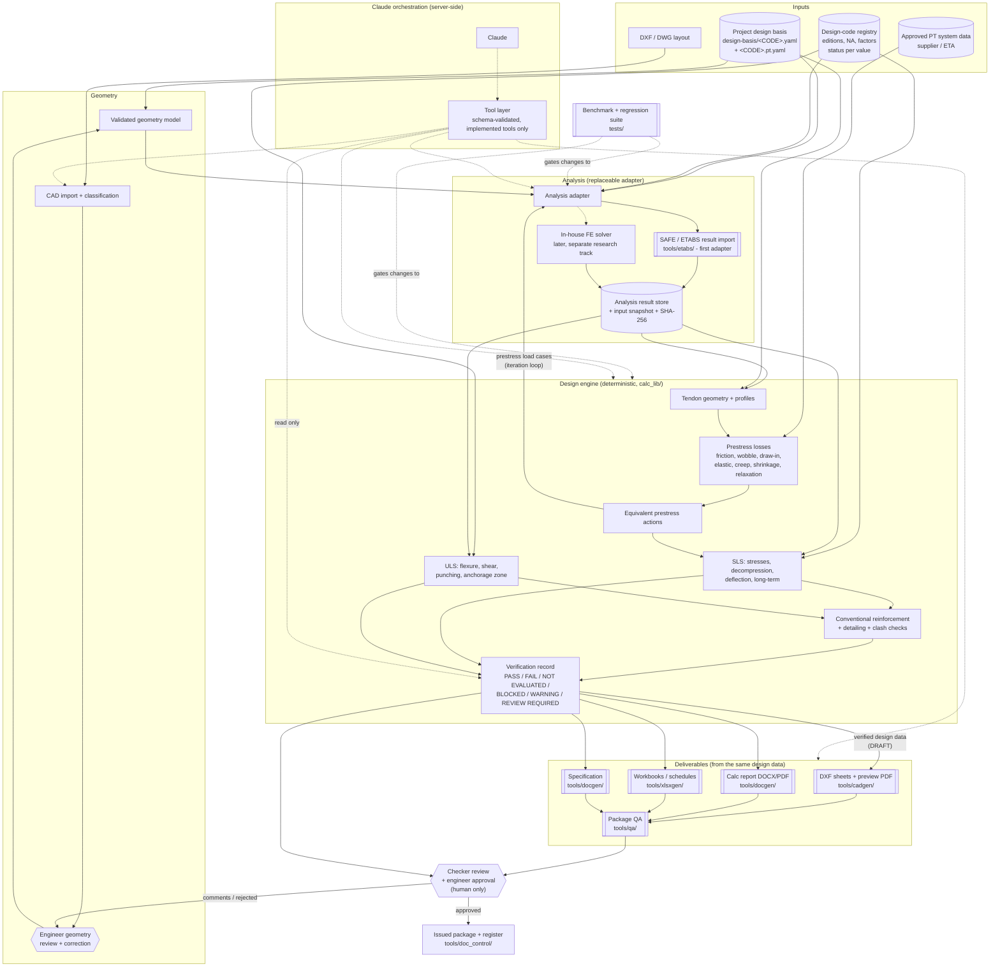
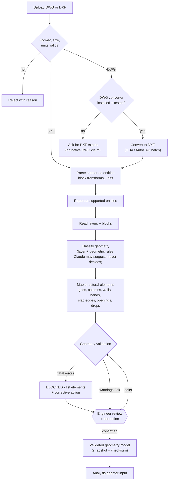
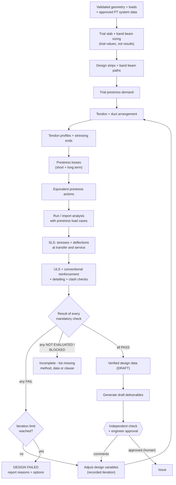

# Architecture v2 - Bonded PT Band Beam & Slab Designer

Status: PROPOSED (16-OCT-2026). Replaces `mermaid-diagram.png`, `Import pipeline.png` and `Tendon design workflow.png`.
Companion to [Development Plan v2.md](Development%20Plan%20v2.md).

Legend: solid arrow = data flow; dotted arrow = Claude tool call; `[[ ]]` = exists in this repo today; hexagon = human decision.

## 1. System architecture

Rules the diagram encodes:

- Claude reaches engines only through the tool layer. It has no path to `REV` or `ISS` and cannot write to `VER`.
- Deliverables are generated as DRAFT from verified data so the checker can review them; approval comes after, and only from a person.
- Prestress actions go back into the analysis (the iteration loop), they are not added on top of the results.
- Every review, run, check result, approval and issue goes to the audit log. Any change to the design basis, geometry, PT data or code registry marks downstream results and deliverables stale.
- The in-house FE solver is optional and sits behind the same adapter; v1 does not depend on it.

## 2. CAD import pipeline

Changes from `Import pipeline.png`: reject paths for invalid files and missing DWG converter; unsupported entities reported; validation is a gate with a BLOCKED path; review loops back through validation; geometry is snapshotted before analysis.

## 3. Tendon design workflow

Changes from `Tendon design workflow.png`: SLS and ULS are in sequence (the original jumped from deflections straight to the top of the ULS box); prestress feeds into the analysis; three outcomes instead of yes/no (FAIL, NOT EVALUATED/BLOCKED, PASS); iteration limit and a design-failed exit; deliverables are drafted before approval, and approval is a human step.
