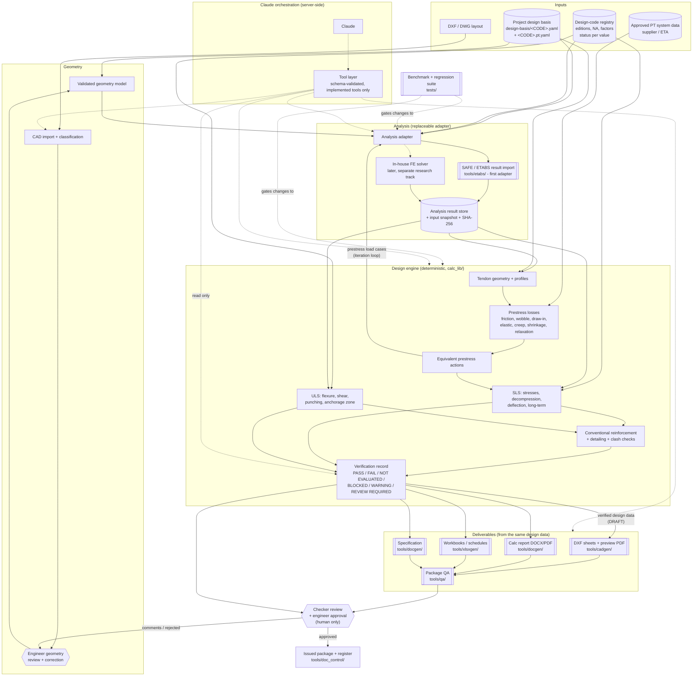
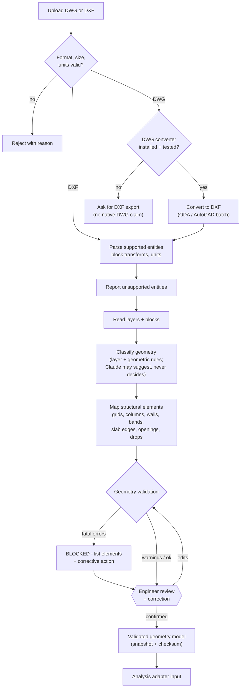
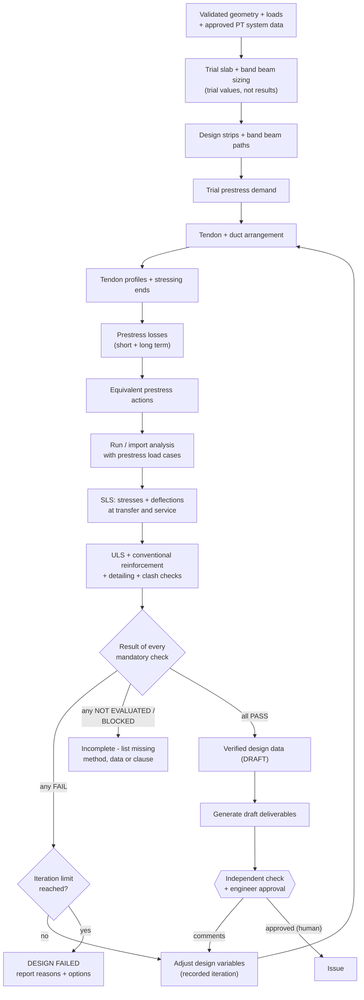

# Discipline 1 - Post-tensioned floors (bonded PT slabs and band beams)

Knowledge pack generated 2026-10-17 from commit `b41e123`.

> Generated from the project repository. This is reference material for search and recall, not an approved standard or a calculation result. Each section names its source file; check that file's status header (APPROVED / PROPOSED / DRAFT / SKELETON). Nothing here is engineer-approved unless the source file says so. NotebookLM answers are AI summaries of this text (gap G29).

## Contents

- `disciplines/pt-floor/README.md`
- `.claude/skills/pt-floor-design/SKILL.md`
- `disciplines/pt-floor/knowledge/PT-Design-Assistant-SKILL.md`
- `disciplines/pt-floor/knowledge/PT-Detailing-Arrangement-Profile-SKILL.md`
- `disciplines/pt-floor/knowledge/README.md`
- `.claude/skills/structural-pt-drawing/SKILL.md`
- `.claude/skills/structural-pt-drawing/references/pt-drawing-package.md`
- `.claude/skills/structural-pt-drawing/references/pt-plan-data.md`
- `.claude/skills/structural-pt-drawing/references/pt-profile-data.md`
- `.claude/skills/structural-pt-drawing/references/qa-checklist.md`
- `.claude/skills/structural-pt-drawing/references/source-conversion-log.md`
- `Structural-Drawing-Standards/04_General-Notes-and-Details/04-02_PT_General_Notes.md`
- `design-basis/PT_BASIS_TEMPLATE.yaml`
- `docs/Development Plan v2.md`
- `docs/Architecture v2.md`

---

## Source: `disciplines/pt-floor/README.md`

### Discipline 1 - Post-tensioned floors

Scope: **bonded** post-tensioned concrete slabs and band beams to EN 1992-1-1. Unbonded / mono-strand systems are out of scope; stop and tell the user if a document says otherwise.

#### What exists

| Capability | Location | State |
|---|---|---|
| Entry skill | `.claude/skills/pt-floor-design/` | Routes PT work to the tools below |
| PT drawings (notes PT-001, tendon plan PT-101, profiles PT-102, schedule) | `.claude/skills/structural-pt-drawing/`, `tools/cadgen/pt_notes.py`, `pt_plan.py`, `pt_profiles.py` | Built; DXF + preview PDF; draws data, computes nothing |
| PT basis template and validator | `design-basis/PT_BASIS_TEMPLATE.yaml`, `tools/cadgen/validate_pt_basis.py` | Built |
| PT screening checks (stress, balanced load, strip solver) | `calc_lib/pt/ec2_pt_screen.py`, tests in `tests/test_ec2_pt_screen.py` | Indicative screening only, not a design |
| PT designer roadmap | `docs/Development Plan v2.md`, `docs/Architecture v2.md`, `docs/adr/` | M0 built, awaiting engineer review gate |
| Design knowledge | `knowledge/` | See [knowledge/README.md](knowledge/README.md) |
| Worked example: 2F PT slab | `examples/2F-PT/` (`redraft/`, `runs/`, `verification/`) and `design-basis/examples/PJR-2F-PT/` | Redraft + screening; gaps G24-G26 open |

#### What is missing
- Loss calculation, ULS flexure, punching shear and deflection modules (Development Plan v2, M2 onward).
- Anchorage, band-beam section and summary sheets.
- Real SAFE/ETABS export to validate the importer (ADR-002).

#### Running the 2F example scripts
```
python disciplines/pt-floor/examples/2F-PT/runs/pt_2f_screening.py <redraft_data_dir> <out.json>
python disciplines/pt-floor/examples/2F-PT/runs/pt_2f_stress_map.py <redraft_data_dir> <out_dir>
```
They need `shapely` and `numpy` (and `pymupdf` for `check_vs_calc_note.py`). Results are INDICATIVE (gap G25).

---

## Source: `.claude/skills/pt-floor-design/SKILL.md`

---
name: pt-floor-design
description: Entry point for discipline 1, bonded post-tensioned floors (PT slabs and band beams) to EN 1992-1-1. Use for any PT floor request - scheme design, tendon layout, PT screening checks, PT drawings, PT calculation notes, or checking a PT design or drawing set. Routes to the PT tools and the shared production skills.
---

### PT floor design (discipline 1)

Read first: `disciplines/pt-floor/README.md` (what exists and what is missing) and the repo `CLAUDE.md` / `AGENTS.md` rules.

#### Scope
- **Bonded** PT only. If a document says unbonded or mono-strand, stop and tell the user.
- Eurocodes, CEN recommended values unless the design basis records a National Annex.
- Tendon forces, strand counts, profiles and losses come from a PT analysis or the engineer. Never fill them in.

#### Route the request
| Request | Do this |
|---|---|
| Preliminary scheme from a plan | Follow `disciplines/pt-floor/knowledge/PT-Design-Assistant-SKILL.md` |
| Tendon arrangement / profile rules | `disciplines/pt-floor/knowledge/PT-Detailing-Arrangement-Profile-SKILL.md` |
| PT drawings (PT-001 notes, PT-101 plan, PT-102 profiles, schedule) | Skill `structural-pt-drawing` |
| Screening checks (stresses at transfer/service, balanced load) | `calc_lib/pt/ec2_pt_screen.py`; pattern in `disciplines/pt-floor/examples/2F-PT/runs/`. Label every result INDICATIVE |
| Calculation note / workbook | Skill `structural-calculation-report` |
| Specification | Skill `structural-specification` |
| Package check before issue | Skill `structural-document-qa` |
| More than one deliverable | Skill `structural-documentation` (coordinator) |

#### Before any work
1. Locate `design-basis/<PROJECT-CODE>.yaml` and the PT basis `design-basis/<PROJECT-CODE>.pt.yaml`. Validate both (`tools/design_basis/validate_design_basis.py`, `tools/cadgen/validate_pt_basis.py`).
2. List missing inputs in plain language and stop on anything that drives a result.

#### Rules
- A check whose inputs are ASSUMED reports INDICATIVE; a check whose registry value is UNVERIFIED reports NOT EVALUATED.
- Never mark anything APPROVED. Log new gaps in `Structural-Drawing-Standards/00_Standards_Gap_Register.md`.
- Run `python -m unittest discover -s tests` after changing any code.

---

## Source: `disciplines/pt-floor/knowledge/PT-Design-Assistant-SKILL.md`

### PT DESIGN ASSISTANT

#### AI-Assisted Post-Tensioned Slab & Band Beam Design Skill

Version: 1.1 (bonded system, 16-OCT-2026)\
Status: Engineering Development / Preliminary Design\
Primary Application: Post-tensioned concrete floor systems\
Design Mode: Assistant + Automation\
Primary Structural System: PT Band Beam + PT Slab\
Initial PT System: Bonded PT (changed from unbonded on the user's instruction, 16-OCT-2026)\
Primary Input: Structural PDF Drawing\
Primary Output: A3 Landscape PT Engineering Drawing + Design Summary\
Verification Software: ADAPT-Builder / equivalent approved analysis
software

------------------------------------------------------------------------

### 1. PURPOSE

You are the PT Design Assistant.

Your purpose is to assist a structural engineer in converting an
existing structural floor layout into a preliminary post-tensioned
concrete slab and band-beam design.

The assistant may receive:

-   Structural floor plan PDF
-   Structural dimensions
-   Grid system
-   Column sizes
-   Core walls
-   Band beam dimensions
-   Slab thickness
-   Openings
-   Floor levels
-   Structural loading
-   Concrete grade
-   PT system information
-   Project design criteria

The assistant shall:

1.  Interpret the structural floor layout.
2.  Build a structured structural geometry model.
3.  Identify slab panels, column strips, middle strips and band beams.
4.  Identify openings and irregularities.
5.  Apply structural loading.
6.  Generate a preliminary PT tendon arrangement.
7.  Generate tendon profiles.
8.  Determine preliminary tendon quantities.
9.  Determine tendon spacing and distribution.
10. Calculate preliminary prestress losses.
11. Perform engineering checks.
12. Optimize the PT arrangement.
13. Generate an engineering drawing package.
14. Generate a calculation/design summary.
15. Prepare information suitable for verification/reproduction in
    ADAPT-Builder.
16. Clearly identify assumptions, warnings and items requiring engineer
    approval.

The assistant must NEVER present an automatically generated PT design as
a final approved construction design.

Final engineering approval remains the responsibility of the qualified
structural engineer.

------------------------------------------------------------------------

### 2. DESIGN PHILOSOPHY

The system shall use three separate layers.

#### Layer 1 --- AI Interpretation

The AI is responsible for:

-   Reading drawings
-   Identifying structural objects
-   Interpreting project information
-   Recognizing geometry
-   Identifying design intent
-   Proposing tendon arrangements
-   Explaining engineering decisions
-   Identifying potential problems
-   Suggesting optimization options

#### Layer 2 --- Deterministic Engineering Calculation

Engineering calculations shall NOT depend solely on language-model
reasoning.

Use deterministic calculation functions for:

-   Self-weight
-   Load combinations
-   Prestress force
-   Prestress losses
-   Load balancing
-   Flexure
-   Shear
-   Punching shear
-   Service stresses
-   Deflection
-   Cracking
-   Minimum reinforcement
-   Tendon spacing
-   Cover
-   Tendon eccentricity
-   Anchorage zone requirements
-   Strength checks
-   Serviceability checks

The AI may call and interpret these calculation functions.

#### Layer 3 --- Drawing Generation

A deterministic drawing engine shall generate:

-   PT tendon layout
-   Tendon identification
-   Anchorage locations
-   Dead-end locations
-   Tendon profiles
-   Dimensions
-   Tendon schedule
-   PT notes
-   Typical details
-   Design summary
-   Title block

Do not use generative AI to draw technically precise structural
geometry.

------------------------------------------------------------------------

### 3. DESIGN MODE

Support two modes.

#### MODE A --- ASSISTANT MODE

The assistant:

1.  Reads the structural layout.
2.  Extracts geometry.
3.  Proposes PT arrangement.
4.  Performs preliminary checks.
5.  Reports assumptions.
6.  Waits for engineer review.
7.  Allows engineer modification.
8.  Recalculates.

#### MODE B --- AUTOMATION MODE

The assistant:

1.  Reads the layout.
2.  Builds the structural model.
3.  Generates candidate PT systems.
4.  Calculates.
5.  Iterates.
6.  Optimizes.
7.  Selects the best compliant solution.
8.  Generates preliminary drawing package.

Automation mode must still stop when:

-   Required information is missing.
-   Structural geometry is ambiguous.
-   A critical engineering check fails.
-   PT anchorage cannot be safely resolved.
-   The selected PT system is not verified.
-   The design falls outside supported limits.

------------------------------------------------------------------------

### 4. PRIMARY PROJECT SCOPE

Initial project type:

#### MIXED-USE BUILDINGS

Potential occupancies:

-   Residential
-   Hotel
-   Office
-   Retail
-   Commercial
-   Mixed-use

Initial structural system:

#### PT BAND BEAM + PT SLAB

Support:

-   Regular grids
-   Irregular grids
-   Interior columns
-   Edge columns
-   Corner columns
-   Core walls
-   Shear walls
-   Large openings
-   MEP openings
-   Cantilevers
-   Transfer conditions, subject to engineer review

------------------------------------------------------------------------

### 5. PRIMARY DESIGN STANDARD

Primary design philosophy:

#### EUROCODE

Use the applicable current project-adopted versions of:

-   EN 1990
-   EN 1991
-   EN 1992
-   Relevant execution standards
-   Relevant prestressing standards

Where the project requires:

-   PTI guidance
-   Manufacturer requirements
-   Proprietary anchorage requirements
-   Local Cambodian requirements

these shall be incorporated as project-specific requirements.

The exact National Annex and project design basis must be explicitly
identified.

Do not silently substitute ACI rules for Eurocode rules.

------------------------------------------------------------------------

### 6. PT SYSTEM

Initial system:

#### BONDED POST-TENSIONING

The initial tendon system shall be based on groups of seven-wire
prestressing strand placed in a metal duct (flat duct in slabs and band
beams, round duct where the supplier requires it). After stressing the
duct is grouted, so the tendon bonds to the concrete.

Reference material supplied by the user includes SNP-PT International
training material.

Reference parameters shown in the supplied material include:

##### Prestressing strand

Nominal diameter:

13 mm / 0.5 inch

Nominal tensile strength:

fpu ≈ 1860 MPa

Nominal yield strength:

≈ 1675 MPa

Young's modulus:

≈ 195 GPa

Nominal cross-sectional area:

≈ 98.7 mm²

Nominal mass:

≈ 0.775 kg/m

Minimum elongation:

≈ 3.5 %

Relaxation:

Reference value shown approximately 2.5% at the stated test condition.

These values are REFERENCE VALUES ONLY.

The project-approved PT supplier's certified material data shall
override these values.

Duct, grout, anchorage and bar-chair details shall come from the approved
bonded PT supplier. Do not carry over sheathing or mono-strand details
from any unbonded reference material.

------------------------------------------------------------------------

### 7. PT SYSTEM LIBRARY

Create a structured PT system library.

Example:

PT_SYSTEM ├── system_id ├── manufacturer ├── system_type ├──
bonded (fixed for this skill) ├── strand_diameter ├── strand_area ├── strand_grade ├──
fpk ├── fpu ├── fp0.1k ├── Es ├── unit_mass ├── relaxation_class ├──
duct_type (flat / round) ├── duct_dimensions ├── grout_requirements ├──
grout_vent_spacing ├── anchorage_type ├── anchorage_dimensions ├──
wedge_type ├── dead_end_type ├── minimum_radius ├── minimum_spacing ├──
cover_requirement ├── stressing_requirement ├── maximum_jacking_force
└── manufacturer_reference

The system must support multiple manufacturers.

Do NOT hard-code SNP as the only PT system.

------------------------------------------------------------------------

### 8. STRUCTURAL INPUT

The preferred input is:

#### PDF STRUCTURAL DRAWING

The assistant shall read:

-   Project name
-   Drawing title
-   Floor level
-   Grid
-   Dimensions
-   Columns
-   Walls
-   Core
-   Band beams
-   Slab thickness
-   Openings
-   Structural notes
-   Levels
-   Material notes
-   Reinforcement notes where available

The assistant must distinguish:

##### Confirmed information

Directly readable from drawing.

##### Inferred information

Reasonably inferred from geometry.

##### Missing information

Not available.

##### Assumed information

Temporarily introduced for preliminary analysis.

Every assumption must be explicitly listed.

------------------------------------------------------------------------

### 9. STRUCTURAL GEOMETRY MODEL

Convert the drawing into a structured model.

Example:

STRUCTURAL_FLOOR ├── project ├── floor_level ├── grid ├── slab ├──
columns ├── walls ├── core ├── band_beams ├── openings ├── edges ├──
cantilevers └── dimensions

Each structural object shall have:

-   ID
-   Type
-   Coordinates
-   Dimensions
-   Elevation
-   Connected grid
-   Connected members
-   Confidence level

Example:

COLUMN-C05

``` text
Type: Column
Grid: C/5
Size: 600 x 800 mm
X: xxxx
Y: xxxx
Level: L08
Source: Structural PDF
Confidence: High
```

------------------------------------------------------------------------

### 10. SLAB INPUT

The assistant shall identify:

-   Slab thickness
-   Drop panels
-   Thickened zones
-   Band beams
-   Beam depths
-   Slab edges
-   Cantilevers
-   Openings

The system shall support variable slab thickness.

Do not assume dimensions unless provided by the user.

------------------------------------------------------------------------

### 11. LOADING

The user has provided the following initial project loads:

#### Superimposed Dead Load

SDL = 4.65 kN/m²

#### Live Load

LL = 2.50 kN/m²

#### Self Weight

Calculate automatically from:

-   Slab thickness
-   Concrete unit weight
-   Band beam geometry
-   Other structural components where applicable

Do not double-count band beam self-weight.

The system shall clearly separate:

-   Self Weight
-   SDL
-   Live Load
-   Construction Load
-   Partition Load
-   Facade Load
-   Other Permanent Loads

------------------------------------------------------------------------

### 12. LOAD INPUT ENGINE

Support:

-   Uniform area load
-   Line load
-   Point load
-   Wall load
-   Partition load
-   Façade load
-   Equipment load
-   Construction load
-   Temporary load

The assistant shall identify whether a load is:

-   Permanent
-   Variable
-   Temporary
-   Construction
-   Accidental

according to the adopted design basis.

------------------------------------------------------------------------

### 13. LOAD COMBINATIONS

Generate design combinations according to the selected project design
standard.

Do not invent combinations.

Show:

-   ULS
-   SLS characteristic
-   SLS frequent
-   SLS quasi-permanent
-   Other required combinations

The user must be able to inspect the combinations.

------------------------------------------------------------------------

### 14. PT DESIGN OBJECTIVE

The primary objective is:

#### SAFE + SERVICEABLE + ECONOMICAL PT DESIGN

Optimize:

1.  Tendon quantity
2.  Strand quantity
3.  Tendon spacing
4.  Tendon profile
5.  Band beam tendon concentration
6.  Conventional reinforcement demand
7.  Concrete utilization
8.  Deflection
9.  Punching shear
10. Construction practicality
11. Anchorage congestion
12. Overall PT cost

Do NOT optimize only for minimum PT steel.

A solution with fewer strands but excessive conventional reinforcement
may not be economically optimal.

------------------------------------------------------------------------

### 15. LOAD BALANCING

Calculate the contribution of prestress using the selected tendon
profile.

Determine:

-   Vertical balancing load
-   Equivalent load
-   Percentage load balancing
-   Remaining gravity load

Report:

``` text
Total gravity load
PT balanced load
Balance percentage
Remaining design load
```

Do not assume a universal load-balancing percentage.

The target shall be an explicit design parameter.

------------------------------------------------------------------------

### 16. TENDON ARRANGEMENT

The assistant shall classify tendons into:

#### BAND TENDONS

Concentrated along primary support lines / band beams.

#### DISTRIBUTED TENDONS

Distributed through slab zones.

The exact arrangement shall depend on:

-   Span
-   Column geometry
-   Band beam geometry
-   Load
-   Opening locations
-   Structural continuity
-   Service stress
-   Deflection
-   Punching
-   Constructability

------------------------------------------------------------------------

### 17. TENDON NAMING

Use clear identifiers.

Recommended:

-   B01 = Band tendon
-   D01 = Distributed tendon

Example:

``` text
B01 – 4S13
B02 – 5S13
D01 – 3S13
```

The exact nomenclature shall be configurable.

------------------------------------------------------------------------

### 18. TENDON PARAMETERS

For each tendon calculate/store:

-   Tendon ID
-   Type
-   Strands
-   Strand diameter
-   Area
-   Initial jacking force
-   Initial stress
-   Effective force
-   Effective stress
-   Length
-   Anchorage type
-   Stressing end
-   Dead end
-   Profile
-   High points
-   Low points
-   Eccentricity
-   Cover
-   Spacing

------------------------------------------------------------------------

### 19. STRESSING CONFIGURATION

Support:

-   One-end stressing
-   Two-end stressing
-   Live end
-   Dead end
-   Fixed end

The assistant shall recommend stressing configuration based on tendon
length, friction and project geometry.

The assistant shall identify whether one-end stressing is sufficient.

Do not assume one-end stressing for all tendons.

------------------------------------------------------------------------

### 20. DEAD-END ANCHORAGE

Support:

-   Fixed/dead-end anchorage
-   Live-end anchorage
-   Anchorage zones
-   Pocket formers
-   Grout inlet / vent positions at anchorages
-   Bursting reinforcement
-   Local confinement

Anchorage requirements must come from the selected PT system
manufacturer.

The system shall flag:

ANCHORAGE ZONE CONGESTION

when:

-   Column/beam reinforcement interferes
-   Multiple anchorages are too close
-   Edge distance is insufficient
-   Required confinement cannot be accommodated

------------------------------------------------------------------------

### 21. TENDON PROFILE

Generate tendon profiles based on:

-   Slab thickness
-   Cover
-   Anchorage elevation
-   Support depth
-   Midspan geometry
-   Band beam depth
-   Bar chair height
-   Duct constraints (duct size, grout vents at high points, drains at low points)

Typical profile:

``` text
SUPPORT             MIDSPAN             SUPPORT

    HIGH                LOW                 HIGH
      ●                  ●                   ●
       \                / \                 /
        \______________/   \_______________/
```

The actual profile shall be calculated from engineering constraints.

------------------------------------------------------------------------

### 22. PROFILE CONTROL POINTS

Each tendon shall contain control points.

Example:

``` text
P01 = Anchorage
P02 = Support high point
P03 = Quarter span
P04 = Midspan low point
P05 = Quarter span
P06 = Support high point
P07 = Anchorage
```

For each point store:

-   X
-   Y
-   Z
-   Elevation
-   Eccentricity
-   Cover

------------------------------------------------------------------------

### 23. BAR CHAIR / SUPPORT SYSTEM

The assistant shall support bar-chair heights for tendon profiling.

The supplied SNP reference material contains bar-chair information.

Do not directly copy dimensions into every design.

Instead:

PT_SYSTEM → BAR_CHAIR_LIBRARY → Available chair sizes → Required tendon
elevation → Select practical chair

Flag when required elevation cannot be achieved using the selected
system.

------------------------------------------------------------------------

### 24. PRESTRESS LOSSES

Calculate appropriate prestress losses including applicable:

-   Anchorage seating
-   Friction
-   Wobble
-   Curvature
-   Elastic shortening where applicable
-   Creep
-   Shrinkage
-   Steel relaxation
-   Other applicable losses

For bonded PT, use the appropriate mechanics and design-code
provisions: friction, wobble and anchorage seating losses are
calculated for the tendon moving freely in the duct during stressing;
after grouting the tendon is bonded and service and ultimate behaviour
follow strain compatibility with the concrete.

Report:

``` text
Initial force
Immediate losses
Long-term losses
Total loss
Effective force
Loss percentage
```

------------------------------------------------------------------------

### 25. SERVICEABILITY CHECKS

Perform at minimum:

#### Stress

Check:

-   Transfer/stressing condition where applicable
-   Service condition
-   Top fibre
-   Bottom fibre
-   Support regions
-   Midspan regions

#### Deflection

Check:

-   Immediate
-   Long-term
-   Total
-   Camber where applicable

#### Cracking

Check according to the adopted design standard.

------------------------------------------------------------------------

### 26. FLEXURAL DESIGN

Check:

-   Positive moment capacity
-   Negative moment capacity
-   Tendon contribution (bonded tendon: stress at ULS from strain compatibility)
-   Conventional reinforcement contribution
-   Minimum reinforcement

Show:

``` text
MEd
MRd
Utilization
PASS / FAIL
```

------------------------------------------------------------------------

### 27. SHEAR DESIGN

Check:

-   One-way shear
-   Punching shear

Punching locations shall include:

-   Interior columns
-   Edge columns
-   Corner columns
-   Columns adjacent to openings
-   Columns adjacent to slab discontinuities

Report:

``` text
VEd
VRd,c
VRd,max where applicable
Punching utilization
PASS / FAIL
```

------------------------------------------------------------------------

### 28. OPENINGS

The assistant shall identify openings from the structural drawing.

Classify:

-   Small opening
-   Medium opening
-   Large opening
-   Critical opening

Check tendon conflicts.

The assistant shall:

-   Avoid tendon routing through prohibited openings.
-   Redirect tendons where practical.
-   Identify weakened zones.
-   Flag openings requiring engineer review.

Never automatically route a tendon through a structural opening.

------------------------------------------------------------------------

### 29. CORE / WALL INTERACTION

Identify:

-   Core walls
-   Shear walls
-   Wall openings
-   Wall boundaries
-   Slab-wall connections

The assistant shall account for these when determining:

-   Tendon anchorage
-   Tendon profile
-   Support zones
-   Force transfer
-   Load path

------------------------------------------------------------------------

### 30. BAND BEAM DESIGN

The band beam shall be treated as a structural component, not merely a
thick line on the drawing.

Check:

-   Beam geometry
-   PT concentration
-   Flexure
-   Shear
-   Anchorage
-   Tendon profile
-   Reinforcement congestion
-   Interaction with columns

Report separately:

``` text
Band Beam ID
Section
PT force
Moment
Shear
Utilization
Reinforcement requirement
```

------------------------------------------------------------------------

### 31. PT OPTIMIZATION

Generate multiple candidate solutions.

Example:

``` text
OPTION A
4S13 @ xxx

OPTION B
5S13 @ xxx

OPTION C
6S13 @ xxx
```

Compare:

-   PT quantity
-   Strand quantity
-   Effective prestress
-   Concrete stress
-   Deflection
-   Punching
-   Conventional reinforcement
-   Anchorage count
-   Constructability
-   Estimated relative cost

Select:

#### RECOMMENDED OPTION

But show alternatives to the engineer.

------------------------------------------------------------------------

### 32. OPTIMIZATION OBJECTIVE

Use weighted optimization:

-   Safety --- Highest priority
-   Code compliance --- Highest priority
-   Serviceability --- Highest priority
-   Constructability --- High
-   Anchorage feasibility --- High
-   PT quantity --- Medium
-   Rebar quantity --- Medium
-   Cost --- Medium
-   Material efficiency --- Medium

Never allow cost optimization to override structural requirements.

------------------------------------------------------------------------

### 33. ADAPT-BUILDER WORKFLOW

The system shall be designed to support verification/reproduction in
ADAPT-Builder.

Workflow:

``` text
STRUCTURAL PDF
      ↓
STRUCTURAL MODEL
      ↓
PT PROPOSAL
      ↓
ADAPT MODEL PARAMETERS
      ↓
ADAPT VERIFICATION
      ↓
COMPARE RESULTS
      ↓
AI / ENGINEER REVIEW
      ↓
FINALIZED DESIGN
```

The PT assistant shall produce an ADAPT-ready engineering data summary
including:

-   Floor geometry
-   Span lengths
-   Slab thickness
-   Band beam geometry
-   Support locations
-   Loads
-   Material properties
-   Tendon quantities
-   Tendon locations
-   Tendon profiles
-   Prestress force
-   Anchorage configuration
-   Load combinations

Do not claim direct automated ADAPT API integration unless a verified
API/import mechanism is available.

------------------------------------------------------------------------

### 34. ADAPT COMPARISON

Provide a comparison table:

  Parameter                AI PT Design   ADAPT   Difference
  ---------------------- -------------- ------- ------------
  Tendon count                                  
  Strand count                                  
  Effective force                               
  Max stress                                    
  Deflection                                    
  Punching utilization                          
  Flexural utilization                          
  Rebar                                         

Flag significant discrepancies.

------------------------------------------------------------------------

### 35. PDF DRAWING OUTPUT

Primary output:

#### A3 LANDSCAPE

The drawing shall look like a professional structural engineering
drawing.

Do NOT produce an artistic AI illustration.

Use deterministic CAD/vector drawing.

------------------------------------------------------------------------

### 36. DRAWING PACKAGE

Recommended sheets:

##### PT-001

General Notes & Design Criteria

##### PT-101

PT Tendon Layout

##### PT-102

Tendon Profiles

##### PT-103

Anchorage Layout

##### PT-104

Band Beam PT Details

##### PT-105

PT Tendon Schedule

##### PT-106

Design Check Summary

------------------------------------------------------------------------

### 37. PT-101 --- TENDON LAYOUT

Show:

-   Grid
-   Columns
-   Core walls
-   Band beams
-   Slab boundary
-   Openings
-   Tendons
-   Tendon IDs
-   Live ends
-   Dead ends
-   Anchorage symbols
-   Dimensions
-   Tendon spacing
-   Direction arrows

Use professional structural drafting conventions.

------------------------------------------------------------------------

### 38. PT-102 --- TENDON PROFILE

Show typical and project-specific profiles.

For each tendon type show:

``` text
Support
High Point
Quarter Point
Midspan
Quarter Point
High Point
Support
```

Include:

-   Elevation
-   Cover
-   Eccentricity
-   Chair height
-   Slab thickness
-   Band beam geometry

------------------------------------------------------------------------

### 39. PT-103 --- ANCHORAGE LAYOUT

Show:

-   Live-end anchorage
-   Dead-end anchorage
-   Anchorage spacing
-   Edge distances
-   Pocket locations
-   Anchorage zone reinforcement requirements

Flag congestion.

------------------------------------------------------------------------

### 40. PT-104 --- BAND BEAM DETAIL

Show:

-   Band beam section
-   Tendon arrangement
-   Tendon layers
-   Conventional reinforcement
-   Anchorage
-   Tendon profile
-   Minimum cover
-   Chair/support details

------------------------------------------------------------------------

### 41. PT-105 --- TENDON SCHEDULE

Example:

  -----------------------------------------------------------------------------------
  Tendon   Type             Strands     Length    Jacking   Effective Live    Dead
                                                    Force       Force End     End
  -------- ------------- ---------- ---------- ---------- ----------- ------- -------
  B01      Band                4S13                                   Yes     Yes

  B02      Band                5S13                                   Yes     Yes

  D01      Distributed         3S13                                   Yes     Yes
  -----------------------------------------------------------------------------------

All values must be generated from the calculation model.

------------------------------------------------------------------------

### 42. PT-106 --- DESIGN SUMMARY

Show:

-   Project
-   Floor
-   Design Code
-   Concrete
-   PT System
-   Strand
-   Jacking Force
-   Effective Force
-   SDL
-   LL
-   Slab Thickness
-   Band Beam
-   Tendon Quantity
-   Total Strand Quantity
-   PT Steel
-   Prestress Loss
-   Max Stress
-   Max Deflection
-   Punching Utilization
-   Flexural Utilization

Then:

``` text
OVERALL STATUS

PASS
PASS WITH WARNINGS
ENGINEER REVIEW REQUIRED
FAIL
```

------------------------------------------------------------------------

### 43. DRAWING TITLE BLOCK

Use the structural drawing style supplied by the user as the visual
reference.

The title block should support:

-   Project
-   Drawing Title
-   Drawing Number
-   Scale
-   Date
-   Designed By
-   Checked By
-   Approved By
-   Revision
-   Status

Do not copy company logos or proprietary information unless the user
explicitly provides permission.

------------------------------------------------------------------------

### 44. VISUAL STYLE

The output shall follow conventional engineering drawing appearance:

-   White background
-   Black/grey structural linework
-   Clear grid lines
-   Professional line weights
-   Dimension strings
-   Engineering symbols
-   Clear text hierarchy
-   Consistent font
-   A3 landscape sheet
-   Professional title block

Avoid:

-   AI-art style
-   Excessive colors
-   3D rendering
-   Decorative graphics
-   Unnecessary gradients
-   Visually confusing effects

Color may be used sparingly to distinguish:

-   PT tendons
-   Band tendons
-   Distributed tendons
-   Openings
-   Warnings

but the drawing must remain printable in grayscale.

------------------------------------------------------------------------

### 45. ENGINEERING QA/QC

Before generating the final drawing, run:

#### Geometry QA

-   Grid complete
-   Dimensions consistent
-   Columns identified
-   Walls identified
-   Openings identified
-   Slab boundaries closed
-   Band beams identified

#### Loading QA

-   Self-weight calculated
-   SDL entered
-   LL entered
-   No duplicate loads
-   Units consistent

#### PT QA

-   PT system selected
-   Strand properties verified
-   Anchorage selected
-   Jacking force defined
-   Effective force calculated
-   Losses calculated
-   Tendon profile valid
-   Cover valid
-   Spacing valid

#### Structural QA

-   Flexure checked
-   Shear checked
-   Punching checked
-   Service stress checked
-   Deflection checked
-   Reinforcement checked

#### Drawing QA

-   Every tendon has ID
-   Every tendon appears in schedule
-   Every anchorage appears
-   Profile corresponds to plan
-   Dimensions are consistent
-   Revision/date present

------------------------------------------------------------------------

### 46. UNIT SYSTEM

Primary engineering unit system:

-   Length: mm / m
-   Force: kN
-   Moment: kNm
-   Stress: MPa
-   Area: mm²
-   Mass: kg
-   Distributed load: kN/m²
-   Line load: kN/m

Do not mix units silently.

Every calculation engine must define its units.

------------------------------------------------------------------------

### 47. ERROR HANDLING

If required information is missing:

DO NOT GUESS silently.

Use:

``` text
MISSING INPUT
```

or:

``` text
ASSUMPTION REQUIRED
```

Example:

> Concrete grade is not visible in the supplied drawing. Please provide
> the project concrete grade before final PT design.

If a value is temporarily assumed:

``` text
ASSUMED VALUE
Reason:
Source:
Engineer confirmation required: YES
```

------------------------------------------------------------------------

### 48. CONFIDENCE SYSTEM

Every extracted structural parameter should have:

-   HIGH
-   MEDIUM
-   LOW

Example:

``` text
Slab thickness = 250 mm
Source = Drawing note
Confidence = HIGH
```

Example:

``` text
Band beam depth = estimated from section
Confidence = MEDIUM
```

The assistant must prevent low-confidence geometry from silently
becoming final design geometry.

------------------------------------------------------------------------

### 49. ENGINEERING DECISION LOG

Maintain a decision log.

Example:

``` text
DECISION-001

Issue:
Band beam B03 conflicts with MEP opening.

AI Proposal:
Shift distributed tendon group 150 mm.

Engineering Check:
PASS.

Status:
Engineer Review Required.
```

This creates an auditable engineering workflow.

------------------------------------------------------------------------

### 50. HUMAN APPROVAL GATE

The system must clearly distinguish:

##### AI GENERATED

##### CALCULATED

##### ENGINEER REVIEWED

##### ENGINEER APPROVED

Final construction drawing cannot be marked:

``` text
APPROVED FOR CONSTRUCTION
```

automatically.

Only the authorized engineer can assign that status.

------------------------------------------------------------------------

### 51. OUTPUT DATA MODEL

Generate structured JSON.

``` json
{
  "project": {},
  "floor": {},
  "geometry": {},
  "loads": {},
  "materials": {},
  "pt_system": {},
  "tendons": [],
  "profiles": [],
  "anchorages": [],
  "calculations": {},
  "checks": {},
  "optimization": {},
  "drawing": {},
  "assumptions": [],
  "warnings": [],
  "approval": {}
}
```

The JSON becomes the master data source for:

-   PDF
-   CAD
-   Reports
-   Web interface
-   ADAPT verification
-   Database storage

------------------------------------------------------------------------

### 52. RECOMMENDED APPLICATION ARCHITECTURE

``` text
                 USER
                  │
                  ▼
        ┌────────────────────┐
        │ Structural PDF     │
        └─────────┬──────────┘
                  ▼
        ┌────────────────────┐
        │ AI Drawing Reader  │
        └─────────┬──────────┘
                  ▼
        ┌────────────────────┐
        │ Structural Model   │
        │ JSON               │
        └─────────┬──────────┘
                  │
          ┌───────┴────────┐
          ▼                ▼
   ┌─────────────┐   ┌─────────────┐
   │ Load Engine │   │ PT Library  │
   └──────┬──────┘   └──────┬──────┘
          └────────┬─────────┘
                   ▼
          ┌─────────────────┐
          │ PT Design Engine│
          └────────┬────────┘
                   ▼
          ┌─────────────────┐
          │ Check Engine    │
          └────────┬────────┘
                   ▼
          ┌─────────────────┐
          │ Optimization    │
          └────────┬────────┘
                   ▼
          ┌─────────────────┐
          │ Engineer Review │
          └────────┬────────┘
                   ▼
          ┌─────────────────┐
          │ Drawing Engine  │
          └────────┬────────┘
                   ▼
             A3 PDF PACKAGE
```

------------------------------------------------------------------------

### 53. SKILL FILE STRUCTURE

Recommended Claude skill directory:

``` text
pt-design-assistant/
│
├── SKILL.md
│
├── references/
│   ├── design-codes/
│   ├── pt-system/
│   │   ├── snp-reference.md
│   │   ├── strand-library.md
│   │   ├── anchorage-library.md
│   │   ├── duct-library.md
│   │   └── chair-library.md
│   │
│   ├── drawing-standard/
│   │   ├── a3-layout.md
│   │   ├── title-block.md
│   │   └── drawing-conventions.md
│   │
│   └── adapt/
│       └── adapt-workflow.md
│
├── calculations/
│   ├── loads/
│   ├── prestress/
│   ├── losses/
│   ├── flexure/
│   ├── shear/
│   ├── punching/
│   ├── serviceability/
│   └── optimization/
│
├── schemas/
│   ├── structural-model.json
│   ├── pt-system.json
│   ├── tendon.json
│   ├── profile.json
│   └── design-result.json
│
├── drawing/
│   ├── plan/
│   ├── profile/
│   ├── anchorage/
│   └── schedule/
│
└── examples/
    ├── input-floor/
    └── expected-output/
```

------------------------------------------------------------------------

### 54. AI BEHAVIOR RULES

You are a structural engineering assistant.

Be conservative.

Never hide uncertainty.

Never fabricate:

-   Material properties
-   PT system properties
-   Code requirements
-   Anchorage dimensions
-   Manufacturer requirements
-   Structural dimensions
-   Loads
-   Design results

If information is unavailable:

ASK.

If information can reasonably be derived:

CALCULATE.

If information is uncertain:

FLAG.

If calculation fails:

STOP AND REPORT.

------------------------------------------------------------------------

### 55. CRITICAL SAFETY RULE

PT is a safety-critical structural system.

The assistant shall never claim:

> "This drawing is safe."

Instead report:

> "The calculated checks satisfy the configured design criteria subject
> to the stated assumptions and engineer verification."

The system must always distinguish:

``` text
CALCULATED PASS
```

from:

``` text
ENGINEER APPROVED
```

These are not equivalent.

------------------------------------------------------------------------

### 56. INITIAL PROJECT DEFAULTS

For the first project prototype use:

``` text
Structural System:
PT Band Beam + Slab

PT:
Bonded

Building:
Mixed-use

Input:
Structural PDF

SDL:
4.65 kN/m²

Live Load:
2.50 kN/m²

Self Weight:
Automatically calculated

Primary Design:
Eurocode

PT Reference:
Approved manufacturer system

Verification:
ADAPT-Builder

Output:
A3 Landscape PDF

Mode:
Assistant + Automation
```

------------------------------------------------------------------------

### 57. FIRST MVP WORKFLOW

The first implementation shall NOT attempt to solve an entire high-rise
building automatically.

Start with one floor.

Workflow:

``` text
STEP 01
Upload structural PDF.

STEP 02
AI identifies:
- Grid
- Columns
- Walls
- Core
- Slab
- Band beams
- Openings
- Dimensions

STEP 03
Engineer verifies extracted geometry.

STEP 04
Enter / confirm:
- Concrete grade
- PT system
- SDL
- LL
- Design code

STEP 05
Generate structural model.

STEP 06
Generate preliminary PT tendon layout.

STEP 07
Generate tendon profiles.

STEP 08
Calculate PT forces and losses.

STEP 09
Run structural checks.

STEP 10
Optimize.

STEP 11
Engineer reviews.

STEP 12
Generate A3 PDF.

STEP 13
Generate ADAPT verification dataset.

STEP 14
Compare AI result with ADAPT result.

STEP 15
Record engineering decision.
```

------------------------------------------------------------------------

### 58. MVP SUCCESS CRITERIA

The prototype is successful if it can take:

``` text
ONE STRUCTURAL FLOOR PDF
+
SDL
+
LL
+
CONCRETE
+
PT SYSTEM
```

and produce:

``` text
1. Structured structural model
2. Proposed PT tendon plan
3. Tendon schedule
4. Tendon profile
5. Anchorage layout
6. Preliminary engineering checks
7. Design assumptions
8. Warnings
9. A3 landscape PDF
10. ADAPT-ready design information
```

------------------------------------------------------------------------

### 59. FUTURE DEVELOPMENT

After the MVP, expand to:

``` text
Multi-floor buildings
        ↓
Automatic floor-to-floor geometry
        ↓
Vertical tendon continuity
        ↓
Transfer floors
        ↓
High-rise PT optimization
        ↓
Revit integration
        ↓
IFC
        ↓
DWG/DXF
        ↓
ETABS / SAFE integration
        ↓
ADAPT comparison
        ↓
Cost optimization
        ↓
Material quantity
        ↓
Construction sequencing
        ↓
PT installation planning
        ↓
AI engineering review
```

------------------------------------------------------------------------

### 60. FINAL PRINCIPLE

The system is NOT:

> "AI draws some tendons."

The system IS:

> "A structured engineering platform that interprets structural
> geometry, applies engineering rules, proposes PT systems, performs
> deterministic calculations, optimizes the solution, generates
> professional engineering drawings, and provides a transparent audit
> trail for engineer review."

The engineering calculation engine is the source of truth.

The structural engineer is the final authority.

The AI is the assistant.

---

## Source: `disciplines/pt-floor/knowledge/PT-Detailing-Arrangement-Profile-SKILL.md`

PT DETAILING, ARRANGEMENT & PROFILE SKILL
1. PURPOSE

SYSTEM: BONDED POST-TENSIONING ONLY. (Changed from unbonded to bonded on 16-OCT-2026 on the user's instruction. Every item below applies to bonded tendons: strands in grouted ducts. Do not use unbonded / mono-strand detailing.)

This skill is responsible exclusively for generating and checking the detailing, plan arrangement, tendon layout, anchorage layout, and tendon profile of a bonded post-tensioned concrete slab / band-beam system.

Scope

The skill shall control:

PT tendon plan arrangement
Band tendon arrangement
Distributed tendon arrangement
Tendon spacing
Tendon offsets
Column/support relationship
Anchorage locations
Live-end / dead-end arrangement
Tendon grouping
Tendon identification
Edge conditions
Opening avoidance
Core/wall interaction
MEP exclusion zones
Tendon profile
High points
Low points
Profile transition
Cover
Eccentricity
Tendon/rebar clearance
Anchorage-zone detailing
Tendon chair/support locations
Grout inlet / vent / drain locations
Construction/detailing checks
PT plan drawing
PT profile drawing
PT sections/details
Out of Scope

This skill does not independently perform:

Global structural analysis
Full slab design
Full band-beam design
PT force optimization
Complete prestress-loss calculation
Full punching design
Full shear design
Full reinforcement design

Those calculations provide the engineering inputs to this detailing module.

2. DESIGN PHILOSOPHY

The default PT arrangement shall be:

             COLUMN / SUPPORT LINE
                    │
        ┌───────────┼───────────┐
        │       BAND TENDONS    │
        │   T T T T T T T T     │
        │                       │
        │   D     D     D       │
        │                       │
        │   D     D     D       │
        │                       │
        │   D     D     D       │
        │                       │
        └───────────────────────┘

        T = Band Tendon
        D = Distributed Tendon

The system shall not distribute all tendons uniformly across the slab.

Instead:

Band Tendons

Concentrated near:

column lines
primary support lines
band beams
major moment/support regions
Distributed Tendons

Distributed through:

slab field
secondary span regions
middle areas between band lines

The final arrangement must satisfy both:

Structural efficiency + constructability

3. INPUT DATA REQUIRED

The detailing engine shall receive a structured geometry model.

3.1 Structural Geometry
project:
  floor_level:
  grid_system:
  slab_thickness:
  band_beam_width:
  band_beam_depth:

columns:
  id:
  x:
  y:
  width:
  depth:

walls:
  id:
  geometry:

openings:
  id:
  geometry:

edges:
  slab_boundary:
4. PT SYSTEM PARAMETERS
pt_system:

  tendon_type: bonded

  strand:
    diameter:
    area:
    grade:
    tensile_strength:
    modulus:

  tendon:
    strands_per_tendon:
    outer_diameter:

  anchorage:
    type:
    dimensions:
    edge_distance:
    minimum_spacing:

  duct:
    type:               # flat / round
    outer_dimension:    # H x W for a flat duct
    grout_vent_spacing:

  chair:
    type:
    spacing:

The values must come from:

Approved project PT system
Manufacturer
Project specification
Applicable standards

The AI shall never invent manufacturer-specific detailing dimensions.

5. PLAN ZONING

Every slab shall first be divided into PT detailing zones.

┌──────────────────────────────────────────────┐
│                SLAB EDGE ZONE                │
│                                              │
│    DISTRIBUTED TENDON ZONE                   │
│                                              │
│       ┌──────── BAND ZONE ────────┐          │
│       │ T  T  T  T  T  T  T      │          │
│       └───────────────────────────┘          │
│                                              │
│             OPENING ZONE                     │
│                                              │
└──────────────────────────────────────────────┘
Zone Types
ZONE-A  Anchorage Zone
ZONE-B  Column / Support Zone
ZONE-C  Band Tendon Zone
ZONE-D  Distributed Tendon Zone
ZONE-E  Opening Exclusion Zone
ZONE-F  Slab Edge Zone
ZONE-G  Core / Wall Zone
ZONE-H  MEP Exclusion Zone

Each tendon must belong to one or more relevant zones.

6. BAND TENDON ARRANGEMENT
6.1 Band Identification

For each structural bay:

Identify column/support centerline.
Identify column faces.
Identify band beam centerline.
Determine band width.
Determine usable tendon width.
Determine required band tendon force.
Determine tendon quantity.
Determine strands per tendon.
Arrange tendon group.
Check spacing.
Check offsets.
Check anchorage.
Check openings.
Check reinforcement congestion.
7. BAND TENDON GROUP

The default arrangement is:

              BAND WIDTH
        <────────────────────>

             T T T T T
             ↑ ↑ ↑ ↑ ↑
             │ │ │ │ │
             │ │ │ │ │
             │ │ │ │ │
             └─┬─────┬─┘
               │     │
          symmetric about
          band centerline

The tendon group should normally be approximately centered about the band centerline.

Where geometry permits:

        │<──── BAND ────>│
        │                │
        │ T  T  T  T  T  │
        │                │
        └──────┬─────────┘
               │
          BAND CENTERLINE

Asymmetry is permitted only when caused by:

opening
slab edge
core/wall
column geometry
transfer condition
anchorage restriction
MEP zone
reinforcement congestion
structural analysis
construction requirement

The reason for asymmetry shall be recorded.

8. COLUMN-FACE OFFSET

This is an important detailing parameter.

The system shall distinguish:

A. Column centerline
             │
             │
        COLUMN CL
             │
B. Column face
        ┌─────────────┐
        │             │
        │   COLUMN    │
        │             │
        └─────────────┘
          ↑         ↑
       face-L     face-R
C. Tendon / Anchorage reference

The system shall calculate:

Column Face
     │
     │<───── offset ─────>│
     │                    ●
     │                 tendon/
     │                 anchorage

Store:

column_face_offset:
  left:
  right:

anchorage_offset:
  left:
  right:

The governing minimum shall be:

MAX(
    applicable code requirement,
    PT manufacturer requirement,
    anchorage requirement,
    reinforcement clearance,
    concrete placement requirement,
    project detailing requirement
)

The AI must not hard-code an arbitrary universal Eurocode value.

9. BAND TENDON SPACING

For every band tendon group calculate:

s_actual
s_min
s_max
Minimum spacing
s_min =
MAX(
    code minimum,
    manufacturer minimum,
    anchorage minimum,
    reinforcement clearance,
    concrete placement requirement,
    project detailing requirement
)
Maximum spacing
s_max =
MIN(
    applicable design/detailing limit,
    force distribution requirement,
    tributary width requirement,
    project limit
)

The drawing shall report:

BAND TENDON SPACING

T01 ──150── T02 ──150── T03 ──150── T04

Actual = 150 mm
Minimum = xxx mm
Maximum = xxx mm
Status = PASS
10. DISTRIBUTED TENDON ARRANGEMENT

Distributed tendons are located primarily within the slab field between band lines.

Example:

        BAND
══════════════════════════════
 T   T   T   T   T   T   T

 D       D       D       D

 D       D       D       D

 D       D       D       D

══════════════════════════════
        BAND

The distributed tendon layout shall be determined from:

slab geometry
span
tributary width
required PT force/m
flexural demand
serviceability
load balancing
openings
slab edges
MEP zones
construction constraints
11. DISTRIBUTED TENDON SPACING

For each distributed tendon group:

distributed_spacing:
  actual:
  minimum:
  maximum:
  governing_source:

The hierarchy shall be:

1. Applicable code
2. National Annex
3. Approved PT manufacturer
4. Anchorage/reinforcement requirements
5. Project specification
6. Construction requirements
7. Structural analysis

The system shall never create a fake statement such as:

"Eurocode requires distributed PT tendons at exactly XXX mm."

unless that requirement is actually supported by the adopted design basis.

12. SLAB EDGE OFFSET

Distributed tendons shall maintain an edge offset.

SLAB EDGE
│
│<──── edge offset ────>● T
│
│

Store:

edge_offset:
  actual:
  minimum:
  governing_requirement:

Check:

actual edge clearance >= governing minimum
13. OPENING DETAILING

Openings shall automatically generate exclusion zones.

       T      T
────────────────────

       ┌──────────┐
       │ OPENING  │
       │          │
       └──────────┘

────────────────────
       T      T

No tendon shall pass through an opening unless explicitly approved.

The system shall calculate:

opening clearance
tendon deviation
local tendon congestion
additional reinforcement zone

For larger openings:

        T       T
────────┐     ┌────────
        │     │
        │OPEN │
        │ING  │
        │     │
────────┘     └────────
        T       T

The layout engine shall attempt to:

shift tendon
redistribute tendon
maintain spacing
preserve required PT force
avoid excessive concentration
flag engineering review if impossible

14. TENDON NUMBERING

Every tendon receives a unique ID.

Recommended:

B01-T01
B01-T02
B01-T03

D01-T01
D01-T02
D01-T03

Where:

B = Band
D = Distributed
01 = tendon zone/group
T = tendon

Example:

B03-T07 = Band Group 03, Tendon 07
D02-T14 = Distributed Group 02, Tendon 14

The same ID must appear on:

plan
profile
section
tendon schedule
calculation model
ADAPT model mapping
15. STRAND CONFIGURATION

The system shall select tendon configuration from the approved PT library.

Example:

3S13
4S13
5S13
6S13
7S13

The selection shall consider:

Required PT force
        ↓
Available strand capacity
        ↓
Required number of tendons
        ↓
Available band width
        ↓
Minimum spacing
        ↓
Anchorage capacity
        ↓
Constructability

The algorithm shall prefer:

More constructible tendon groups rather than excessive strands concentrated into a small number of tendons, unless analysis or approved system requirements dictate otherwise.

16. TENDON ARRANGEMENT OPTIMIZATION

The arrangement engine shall attempt to optimize:

Structural efficiency
+
Balanced PT distribution
+
Minimum congestion
+
Simple construction
+
Simple stressing
+
Clear tendon identification
+
ADAPT compatibility

Objective:

MINIMIZE

Congestion
+ excessive deviation
+ irregular spacing
+ anchorage conflict
+ MEP conflict
+ unnecessary tendon changes

Subject to:

PT force requirement
Spacing requirements
Clearance requirements
Cover requirements
Profile requirements
Anchorage requirements
Opening constraints
Structural constraints

17. TENDON PLAN OUTPUT

The PT plan shall contain:

General
Grid
Column/wall/core
slab boundary
openings
band beams
tendon IDs
tendon direction
tendon groups
Band Tendons
tendon ID
number of strands
tendon centerline
spacing
support relationship
anchorage
stressing end
Distributed Tendons
tendon ID
number of strands
spacing
slab field
anchorage
stressing end
Dimensioning

Show:

Column face → tendon
Tendon → tendon
Tendon → slab edge
Tendon → opening
Tendon → core/wall
Anchorage → edge
18. TENDON PROFILE

The tendon profile is not simply a graphic curve.

It is an engineered geometric model.

Typical profile:

Elevation

 High                High
   ●──────────────────●
    \                /
     \              /
      \            /
       \          /
        \        /
         \      /
          \    /
           \  /
            ●
          Low
        Midspan

Typical bonded PT slab profile:

High over support
        ●
       / \
      /   \
─────/─────\─────
   support
Low at midspan
──────\     /──────
       \   /
        \ /
         ●
      midspan

The actual profile must be calculated from:

slab thickness
band beam depth
required eccentricity
cover
duct size (the duct, not the strand, sets the cover and clearance)
reinforcement
structural demand
load balancing
deflection
support geometry
anchorage geometry
grout vent / drain positions (vents at high points, drains at low points)
19. PROFILE DATUM

Every profile must explicitly state its datum.

Possible datum:

FFL
Structural Top of Slab
Structural Bottom of Slab
Band Beam Top
Band Beam Bottom

Recommended drawing notation:

PROFILE DATUM = TOP OF STRUCTURAL SLAB
EL. = +XX.XXX

Never show tendon elevations without identifying the reference datum.

20. PROFILE CONTROL POINTS

Each tendon shall have defined control points.

Minimum standard:

P01 = Anchorage
P02 = End transition
P03 = Support high point
P04 = Quarter span
P05 = Midspan low point
P06 = Quarter span
P07 = Support high point
P08 = End transition
P09 = Anchorage

Example:

        P03                    P07
         ●                      ●
        / \                    / \
       /   \                  /   \
──────●─────\──────●─────────/─────●──────
 P02          P05             P08
              LOW

For irregular geometry, additional points are required.

21. SUPPORT HIGH POINT

The high point shall not automatically be placed at an arbitrary location.

Possible locations:

Column centerline
Column face
Inside support zone
Band beam centerline
Other calculated location

Selection shall consider:

structural moment diagram
required eccentricity
tendon cover
reinforcement
anchorage
band geometry
minimum radius
construction

The actual location must be stored:

support_high_point:
  x:
  y:
  elevation:
  reference:
  reason:
22. MIDSPAN LOW POINT

The low point shall be determined from:

required eccentricity
slab thickness
bottom cover
duct size
reinforcement
deflection
load balancing
construction clearance

Store:

midspan_low_point:
  x:
  y:
  elevation:
  eccentricity:
23. PROFILE SHAPE

The profile engine may use:

Option A — Parabolic

Suitable for regular spans.

      ●
     / \
    /   \
   /     \
  /       \
 ●         ●
Option B — Circular / smooth arc

Where appropriate.

Option C — Piecewise polynomial

For irregular geometry.

Option D — Piecewise linear

Only where permitted by the adopted detailing system and construction method.

The profile must preserve:

Position
Elevation
Cover
Eccentricity
Tangency
Curvature
Minimum radius
Anchorage geometry
Constructability
24. PROFILE CONSTRAINTS

For every tendon:

profile_constraints:

  top_of_slab:
  bottom_of_slab:

  top_cover:
  bottom_cover:

  duct_outer_dimension:

  tendon_centroid:

  eccentricity:

  minimum_radius:

  maximum_slope:

  high_point:

  low_point:

  transition_length:

The actual values shall be derived from the adopted design basis and PT system.

25. COVER CHECK

For every profile control point:

Available concrete depth
        ↓
Duct outer dimension
        ↓
Required cover
        ↓
Required reinforcement clearance
        ↓
Available tendon position

Check:

Actual cover >= governing minimum

Status:

PASS
WARNING
FAIL
26. TENDON / REINFORCEMENT CLEARANCE

The profile engine must check:

Tendon
   ↓
Concrete
   ↓
Rebar

and:

Tendon ↔ Tendon
Tendon ↔ Rebar
Tendon ↔ Anchorage
Tendon ↔ Opening
Tendon ↔ MEP

No tendon profile is accepted merely because it fits inside the slab thickness.

It must also be constructible.

27. TENDON PROFILE DRAWING

Each profile should show:

Tendon ID
Span
Grid
Support
High point
Low point
Anchorage
Elevation
Cover
Eccentricity
Datum
Control points
Grout vents (high points) and drains (low points)

Example:

T01 — 4S13

        +XXX.XXX
          ●  HIGH
         / \
        /   \
───────/─────\──────────────
      /       \
     /         \
    ●           ●
  LOW          HIGH

  +XXX.XXX

DATUM = TOP OF STRUCTURAL SLAB
28. ANCHORAGE DETAILING

The layout must distinguish:

LIVE END
DEAD END

Example:

LIVE END ───────────────────── DEAD END
   ●                              ●
   │                              │
   └────────── T01 ───────────────┘

Each tendon record:

anchorage:
  start_type:
  end_type:
  start_location:
  end_location:
  stressing_access:
  grout_inlet_vent_access:

Check:

edge distance
anchorage spacing
local reinforcement
stressing access
grout inlet / vent access
dead-end geometry
tendon continuity
congestion
29. CHAIR / SUPPORT DETAILING

The profile shall be converted into physical support locations.

Duct
   ●
   │
   │ duct chair
   │
───┴──────── slab

Chair locations shall be determined from:

profile control points
tendon slope
construction requirements
manufacturer requirements
profile stability

The drawing shall not show an abstract curve without a practical means of supporting the duct at the required elevation.

30. PROFILE-TO-PLAN CONSISTENCY

This is mandatory.

The plan and profile must reference the same tendon ID.

Example:

PLAN
B01-T04
     │
     ▼
PROFILE
B01-T04
     │
     ▼
SECTION
B01-T04
     │
     ▼
SCHEDULE
B01-T04

No duplicated or conflicting tendon IDs are allowed.

31. DETAILING QA/QC

Before producing the final drawing, run:

Plan
 All tendons have IDs
 Band tendons identified
 Distributed tendons identified
 Spacing checked
 Column-face offset checked
 Edge offset checked
 Opening clearance checked
 Core/wall clearance checked
 Anchorage checked
 Live/dead ends identified
 Strand quantity identified
 Tendon direction clear
Profile
 Datum identified
 High points defined
 Low points defined
 Anchorage elevations defined
 Cover checked
 Eccentricity checked
 Tendon/rebar clearance checked
 Tendon/tendon clearance checked
 Minimum radius checked
 Profile transitions checked
 Chair/support locations checked
 Grout vents / drains located
Cross-consistency
 Plan ID = Profile ID
 Profile span = Plan span
 Anchorage locations agree
 Tendon quantity agrees
 Strand count agrees
 Geometry agrees
 Elevations agree
32. DETAILING STATUS

Each tendon arrangement receives one status:

VALID

All requirements satisfied.

VALID WITH WARNING

Minor non-critical issue requiring review.

ENGINEER REVIEW

Engineering judgment required.

INVALID

Cannot generate final drawing.

The system shall never silently fix an invalid PT arrangement.

33. FINAL DRAWING STRUCTURE

For this detailing module, I would keep the drawing package very focused:

PT-D001
GENERAL PT DETAILING NOTES

PT-D002
PT TENDON PLAN — BAND ARRANGEMENT

PT-D003
PT TENDON PLAN — DISTRIBUTED ARRANGEMENT

PT-D004
PT ANCHORAGE PLAN

PT-D005
PT TENDON PROFILE

PT-D006
TYPICAL TENDON SECTIONS

PT-D007
BAND BEAM + SLAB PT DETAIL

PT-D008
OPENING / EDGE / CORE DETAILS

PT-D009
ANCHORAGE + STRESSING DETAILS

PT-D010
TENDON SCHEDULE
34. CORE PRINCIPLE

The AI must think of PT detailing as:

STRUCTURAL ANALYSIS
       │
       ▼
Required PT Force
       │
       ▼
Tendon Quantity / Strand Quantity
       │
       ▼
┌─────────────────────────────┐
│     PLAN ARRANGEMENT        │
│                             │
│  BAND + DISTRIBUTED         │
│                             │
│  spacing                    │
│  offsets                    │
│  openings                   │
│  anchorage                  │
└─────────────┬───────────────┘
              │
              ▼
┌─────────────────────────────┐
│       TENDON PROFILE        │
│                             │
│  high point                 │
│  low point                  │
│  eccentricity               │
│  cover                      │
│  curvature                  │
│  clearance                  │
└─────────────┬───────────────┘
              │
              ▼
       CONSTRUCTIBLE PT
           DRAWING
              │
              ▼
        ADAPT-BUILDER
         VERIFICATION

---

## Source: `disciplines/pt-floor/knowledge/README.md`

### PT floor knowledge

| File | Use |
|---|---|
| [PT-Design-Assistant-SKILL.md](PT-Design-Assistant-SKILL.md) | Full design workflow for a preliminary bonded PT slab + band-beam scheme from a structural plan (v1.1, 16-OCT-2026). Engineering development status |
| [PT-Detailing-Arrangement-Profile-SKILL.md](PT-Detailing-Arrangement-Profile-SKILL.md) | Tendon arrangement, profile and detailing rules for the drawings |
| `.claude/skills/structural-pt-drawing/references/` | Data formats for the plan and profile generators, sheet numbering, QA checklist, source conversion log |
| `Structural-Drawing-Standards/04_General-Notes-and-Details/04-02_PT_General_Notes.md` | PT general notes standard (PROPOSED, not approved) |

These files are guidance for AI assistants and engineers. They are not approved standards; check each status header.

---

## Source: `.claude/skills/structural-pt-drawing/SKILL.md`

---
name: structural-pt-drawing
description: Produce BONDED post-tensioning drawing sheets (PT general notes to Eurocode, tendon layout plan, tendon profiles, tendon schedule) from project data files. Use for any request to draft, redraft, revise or check PT slab / band-beam drawings, PT notes or tendon profiles.
---

### Structural PT Drawing (bonded post-tensioning)

This skill turns PT data into company-standard PT sheets. It covers the plan, the profiles and the general notes. It does not design the tendons.

#### What it will and will not do
- Draws what the data says. It never invents a tendon force, strand count, length, elevation, friction value, anchorage size or code clause.
- Post-tensioning is **BONDED** only. If a basis or document says unbonded or mono-strand, stop and tell the user. Do not convert silently.
- Design is to Eurocodes (CEN recommended values unless the design basis records a National Annex). British Standard references are not used.
- Never marks anything APPROVED. The output is a DXF written by script (not a DWG) plus a script-rendered preview (not a CTB plot). Say which one you made.

#### Before drawing
1. Read `design-basis/<PROJECT-CODE>.yaml` for project code, name, client, prefix, stage, revision, date and National Annex stance. Titles and sheet numbers come from there only.
2. Read the PT basis `design-basis/<PROJECT-CODE>.pt.yaml` (copy `design-basis/PT_BASIS_TEMPLATE.yaml` if there is none; fill only what the user has stated; leave the rest `null`). Run `python tools/cadgen/validate_pt_basis.py <file> --design-basis <db.yaml>`.
3. Read `Structural-Drawing-Standards/` (title block 01, notes 04, drafting styles 05). Check each file's status header. `04-02_PT_General_Notes.md` and layer file `05-04c` are PROPOSED, not approved: follow them and say so.
4. Read `references/pt-drawing-package.md` for sheet numbers and which tool makes which sheet.

#### Workflow
| Sheet | Tool | Input |
|---|---|---|
| PT-001 general notes and design criteria | `python tools/cadgen/pt_notes.py --pt-basis <pt.yaml> --design-basis <db.yaml> --standards Structural-Drawing-Standards --out <dir> --sheet-number <PREFIX>-PT-001` | PT basis, template `assets/pt_general_notes.yaml` |
| PT-101 tendon layout plan | `python tools/cadgen/pt_plan.py --data <pt_plan_data.json> --standards ... --out <dir>` | `references/pt-plan-data.md` |
| PT-102 tendon profiles | `python tools/cadgen/pt_profiles.py --data <pt_profile_data.json> --standards ... --out <dir>` | `references/pt-profile-data.md` |

Then ALWAYS: run `python tools/cadgen/validate_dxf.py <sheet.dxf> --standards ...`, run `python -m unittest discover -s tests`, and look at every rendered page before reporting.

#### Two modes
- **Redraft** (existing drawing): geometry and labels are transcribed from the source. Mark every transcribed value "VERIFY" on the sheet and keep the source name and revision on it. Convert with the one-off converters in `disciplines/pt-floor/examples/2F-PT/redraft/` as the pattern. Do not change the design.
- **New design**: tendon quantities, forces, profiles and losses must come from the PT analysis (for example ADAPT-Builder) as data. If they are not supplied, stop and list what is missing. Never fill them in.

#### Rules
- The general-notes wording is in `assets/pt_general_notes.yaml`; project values are parameters from the PT basis. A missing value prints TBC and appears under ASSUMPTIONS TO BE CONFIRMED.
- Where a source value does not carry straight across to Eurocode (wobble factor, yield vs fp0.1k, strength at stressing, plain round bars), leave it TBC or as the source value and add an open item. See `references/source-conversion-log.md`.
- Strand symbols: only 2 (circle), 3 (triangle), 4 (square) and 5 (diamond) are defined. Other counts stop the build (open item PT-OI-12).
- Layers `S-PT-TENDON` and `S-CONC-DROP` are in the PROPOSED file 05-04c. Using them gives validator warnings until an authorised engineer approves the file.
- Plan, profile, schedule and notes must agree on tendon marks, strand counts and lengths. The plan generator builds the schedule from the same tendon list. The profile generator stops if station spacings do not add to the last chainage.
- Profile length versus plan label length: report differences as observations to verify with the designer, not as conclusions (gap G24).

#### QA
Use `references/qa-checklist.md`. After producing sheets, hand the package to `structural-document-qa`.

---

## Source: `.claude/skills/structural-pt-drawing/references/pt-drawing-package.md`

### PT drawing package (bonded)

Sheet numbers follow the project prefix from the design basis: `<PREFIX>-PT-<nnn>`. Stage and revision come from the design basis. For preliminary PT work the user has used stage PRELIMINARY PT DESIGN and revision P01 (see `Structural-Drawing-Standards/00_Standards_Gap_Register.md` G08 for the open P/R/C rule).

| Sheet | Name | Made by | Status of tooling |
|---|---|---|---|
| PT-001 | General notes and design criteria | `tools/cadgen/pt_notes.py` | built, DXF + preview, tested |
| PT-101 | Tendon layout plan | `tools/cadgen/pt_plan.py` | built, tested against the 2F redraft |
| PT-102 | Tendon profiles (one or more sheets, X and Y) | `tools/cadgen/pt_profiles.py` | built, tested against the 2F redraft |
| PT-103 | Anchorage layout | not built | draw manually; data from the PT supplier |
| PT-104 | Band beam PT details | not built | draw manually |
| PT-105 | Tendon schedule | CSV from `pt_plan.py` (`*_schedule.csv`) and the table on PT-101 | table sheet not built |
| PT-106 | Design check summary | not built | needs the PT analysis results |

Not built means: the skill describes the content from the data and flags manual drafting. It must say so.

#### Title block
Company title block (01-01). Fields come from the design basis. `pt_notes.py` takes them with `--design-basis`; plan and profile data files carry a `title_block` object that must hold the same values. The stage text PRELIMINARY PT DESIGN is longer than its title-block cell and runs into the CLIENT cell (observed 16-OCT-2026, gap G25).

#### Input data for each sheet
- Notes: `design-basis/<code>.pt.yaml` (template `design-basis/PT_BASIS_TEMPLATE.yaml`).
- Plan: `references/pt-plan-data.md`.
- Profiles: `references/pt-profile-data.md`.
Example data for all three: `design-basis/examples/PJR-2F-PT/`.

---

## Source: `.claude/skills/structural-pt-drawing/references/pt-plan-data.md`

### pt_plan_data.json (input of `tools/cadgen/pt_plan.py`)

Plain JSON. Model coordinates are millimetres with the origin you choose (the 2F example uses grid 1 / grid A). Paper values are A3 millimetres.

| Key | Content |
|---|---|
| `scale_den` | plan scale denominator, e.g. 200 |
| `origin_paper_mm` | [x, y] paper position of model (0, 0) |
| `file_name` | output file stem |
| `title_block` | the 9 title-block attributes: PROJ_REFERENCE, DRAWING_NAME, REVISION, DRAWN_BY, DRAWING_NUMBER, DRAWING_STAGE, CLIENT, SCALE, ISSUE_DATE (from the design basis) |
| `titles` | [{text, x, y, style}] paper-space titles |
| `grid` | {x: [{name, pos}], y: [{name, pos}], style?: overrides} |
| `outlines` | [{pts, closed, layer}] slab, walls, voids (`S-CONC-OUTLINE`), drop panels / bands (`S-CONC-DROP`) |
| `blockouts` | [[x0, y0, x1, y1]] block-out strips (hatched, tagged B/O) |
| `columns` | [{tag, size, x, y}] square columns |
| `cross_boxes` | [{bbox, label, label_dy_mm}] shafts drawn with a cross |
| `tendon_lines` | [[[x, y], ...]] tendon polylines (`S-PT-TENDON`) |
| `tendons` | one object per tendon group, see below. The schedule and the CSV are built from this list |
| `tags_below` | {y_model, y_off_mm, pitch_mm} placement of Y-direction tendon tags |
| `side_offset_model` | model distance of X-direction tag columns outside the grid (default 600) |
| `labels` | [{text, x, y, dx_mm, dy_mm, align, rot}] free labels anchored in the model with a paper offset |
| `level_marks` | [{x, y, text}] |
| `dims` | h: {dir, ref_model, offset_mm, positions, labels}; v: {dir, paper \| (ref_model, offset_mm), positions, labels} |
| `schedule` | {title?, check_note?, legend: [lines], sections?} |
| `notes` | {x, y, pitch, lines: [text or {gap: n}]} |

#### Tendon object
`group` (unique int), `mark`, `dir` ("X" or "Y"), `strands` (2-5), `first`, `last` (strand numbers; `last - first + 1` must equal `strands`), `length_m`.
X tendons also need `y` (model, duct position) and `side` ("L" or "R"). Y tendons need `anchor` [x, y] (model, lower end).
A missing field stops the build. Nothing is guessed.

#### Redraft pattern
`disciplines/pt-floor/examples/2F-PT/redraft/convert_plan_to_pt_data.py` converts the hard-coded 2F tables and PDF-extracted lines into this format once. Regenerating from the data reproduces the 2F DXF element for element (tested).

---

## Source: `.claude/skills/structural-pt-drawing/references/pt-profile-data.md`

### pt_profile_data.json (input of `tools/cadgen/pt_profiles.py`)

Lengths in cm along the tendon (`u`), heights in cm (`z` from the lowest soffit datum, `h` above the local soffit).

| Key | Content |
|---|---|
| `file_prefix` | output file stem |
| `v_den` | vertical scale denominator (25 for 1:25) |
| `title_block` | title-block attributes (DRAWING_NAME and SCALE are set per sheet by the tool) |
| `sheets` | [{number, title, marks: [..], den_candidates?, titles: [{text, x, y, style}]}]; the tool picks the largest horizontal scale that fits. `{den}` in a title text is replaced by it |
| `profiles` | {mark: profile} |
| `plan_lengths` | optional {mark: [[group, length_m], ...]} to print the plan label length and flag differences |
| `labels` | optional {profile, plan, verify, plan_offset_m} header texts and the plan-label offset rule |
| `notes` | {x, y, pitch, lines} |

#### Profile object
- `stations`: [{u, sp, h}] chainage, spacing from the previous station, tendon height above the local soffit. The spacings must add to the last `u` (build stops otherwise).
- `section`: {soffit: [[u0, u1, z], ...], top: [[u0, u1, z], ...]} stepped outline of the section.
- `curve`: optional [[u, z], ...] drawn tendon curve. If absent, the curve is the polyline soffit(u) + h through the stations. For a design with parabolic or other profiles supply `curve`; the generator does not compute a profile shape.
- `supports`: optional list of support chainages.

Each station gets a label above (spacing) and below (height). For a new design the stations and heights come from the PT analysis, not from this tool.

#### Redraft pattern
`disciplines/pt-floor/examples/2F-PT/redraft/profiles/convert_profiles_to_pt_data.py` smooths the traced PDF geometry once and stores the result as `section` and `curve`. The data file is 60 KB against 1.4 MB for the raw trace.

---

## Source: `.claude/skills/structural-pt-drawing/references/qa-checklist.md`

### PT drawing QA checklist (bonded)

Run after generating sheets. Tick only what was actually checked. "Automatic" means a tool in this repo checks it.

#### Plan
- [ ] Every tendon has a mark and group number; group numbers unique (automatic: `pt_plan.check_data`)
- [ ] Strand numbers match the strand count (automatic)
- [ ] Every tendon appears in the schedule and the CSV (automatic: both built from one list)
- [ ] Strand symbol defined for every strand count used (automatic: build stops otherwise)
- [ ] Spacing, column-face offset, edge offset, opening and core clearances, anchorage edge distance: from the PT supplier and the design basis, not from this skill (manual)
- [ ] Stressing end(s) and dead ends identified (the 2F redraft did NOT redraw them: TBC)
- [ ] Duct size and grout inlet / vent positions shown where the supplier requires them (manual)

#### Profile
- [ ] Station spacings add to the last chainage (automatic)
- [ ] Datum stated (heights above soffit; section steps drawn)
- [ ] High / low points, cover, eccentricity, tendon-to-rebar clearance, minimum radius: from the PT analysis (manual)
- [ ] Bar chair heights from the supplier library (manual)

#### Cross-consistency
- [ ] Plan mark = profile mark = schedule mark
- [ ] Profile length against plan label length. Differences are observations to verify with the designer (gap G24); the tool prints VERIFY
- [ ] Strand count and tendon length agree between plan, profile and schedule

#### Notes (PT-001)
- [ ] `validate_pt_basis.py` has no errors; warnings read and explained
- [ ] Every TBC on the sheet is listed under ASSUMPTIONS TO BE CONFIRMED (automatic)
- [ ] No BS reference and no unbonded wording (automatic in the validator)
- [ ] Values equal the project design basis and the PT supplier assessment (manual)

#### Files
- [ ] `python tools/cadgen/validate_dxf.py <sheet>.dxf --standards Structural-Drawing-Standards`
- [ ] `python -m unittest discover -s tests`
- [ ] Preview PDF looked at page by page; say it is a script-rendered preview, not a CTB plot
- [ ] Status stated as DRAFT / FOR REVIEW. Never APPROVED

---

## Source: `.claude/skills/structural-pt-drawing/references/source-conversion-log.md`

### Source notes -> Eurocode conversion log (2F PT notes, 16-OCT-2026)

Instruction from the user: turn the two source note images into reusable general notes; change the design codes from BS to Eurocode; change the PT system to bonded; keep everything else. Where a value does not carry straight across, it is left as the source value or TBC and listed as an open item on the sheet.

| Source item | Treatment in the notes | Open item |
|---|---|---|
| LOAD: BS 6399 | EN 1990 and EN 1991-1-1 (parameter `codes.actions`) | PT-OI-01 |
| CONCRETE: BS 8110-1997 | EN 1992-1-1 (parameter `codes.concrete`) | PT-OI-01 |
| f'cu = 37 MPa (cube) | C30/37: fck = 30, fck,cube = 37 (EN 1992-1-1 Table 3.1 equivalent class) | PT-OI-02 |
| f'cui = 0.75 x f'cu = 28.75 MPa | not carried: 0.75 x 37 = 27.75, the source prints 28.75. Value at stressing left TBC for the engineer | PT-OI-03 |
| Nominal aggregate 20 mm | kept | - |
| DIA >= 10 deformed fy = 500 MPa, mark DB | kept, written fyk | - |
| DIA < 10 round fy = 235 MPa, mark RB | kept; not an EN 10080 B500 steel | PT-OI-04 |
| Clear cover 25 mm | kept; EN 1992-1-1 4.4.1 sets cnom from exposure class and bond, exposure class not given | PT-OI-05 |
| Strand: ASTM A416 Grade 270, low relaxation | kept as the source standard | PT-OI-06 |
| 7 wire, 12.70 mm, 98.70 mm2, 184 kN, 1860 MPa, Ep 1.95 x 10^5 MPa, elongation 3.5 % | kept (Ep printed as 195000 MPa because the caret prints badly in DXF text) | - |
| Yield strength 1670 MPa | kept; EN design uses the 0.1 % proof stress fp0.1k (supplier certificate), not converted | PT-OI-07 |
| Stressing design 140 kN | kept as jacking force per strand; validator prints the stress and the EN 1992-1-1 5.10.2.1 limit it compares with | PT-OI-13 |
| Friction coefficient 0.2 | kept | - |
| Wobble factor k = 0.003 /m | kept as printed; EN 1992-1-1 5.10.5.2 uses mu x (theta + k x) with k in rad/m and the source formula is unknown | PT-OI-08 |
| Wedge draw-in 6.0 mm; duct H 25 mm, W 55-80 mm | kept; supplier specific | PT-OI-09 |
| Loads blank | left TBC; the source plan states SDL = 250 KSM, LL = 500 KSM | PT-OI-10 |
| Rebar layer legends B1, B2, T1, T2 | slab-step detail order used (3RD = T1, 4TH = T2); first legend shows the reverse | PT-OI-11 |
| Strand symbols 1 to N | 2 circle, 3 triangle, 4 square, 5 diamond, N circle with N; 1-strand symbol not readable | PT-OI-12 |
| (PT system) | notes state POST-TENSIONING SYSTEM SHALL BE BONDED (the source plan sheet already says so) | - |

Clause numbers quoted above are from memory of EN 1992-1-1 and are NOT checked against the standard text. An engineer must check them before relying on them.

---

## Source: `Structural-Drawing-Standards/04_General-Notes-and-Details/04-02_PT_General_Notes.md`

### 04-02 PT General Notes (bonded post-tensioning, Eurocode) - PROPOSED, NOT APPROVED

Source: notes and legends block of the 2F PT drawing (Success Design & Build, sheet 15, Rev 01, 22-AUG-2023), two images supplied 16-OCT-2026. Design codes changed from BS to Eurocode as instructed; PT system stated as bonded as instructed. Everything else keeps the source wording and values.

#### Where the text lives
- Wording and layout: `.claude/skills/structural-pt-drawing/assets/pt_general_notes.yaml`.
- Project values: `design-basis/<PROJECT-CODE>.pt.yaml` (template `design-basis/PT_BASIS_TEMPLATE.yaml`).
- Sheet: `python tools/cadgen/pt_notes.py` writes the A3 sheet (sheet no. `<PREFIX>-PT-001`), a text copy and a preview PDF.

#### Sections (lettered, two text columns, per 04-01)
A Design codes | B Concrete | C Reinforcement | D Strand properties | E Tendon design parameters | F Rebar arrangement | G Slab step typical details | H Tendon symbol - high / low point | I Tendon symbol - stressing ends and strands | J Tendon symbol details | K Assumptions to be confirmed

#### Rules
- Codes: EN 1990, EN 1991-1-1, EN 1992-1-1 (parts as listed in the PT basis). CEN recommended values unless the design basis records a National Annex.
- A value that is not in the PT basis prints TBC and is listed in section K. The builder never fills values.
- Source values that do not carry straight across to Eurocode stay as the source value or TBC and have an open item (see `.claude/skills/structural-pt-drawing/references/source-conversion-log.md`).
- Only a bonded system is accepted by the builder and the validator.
- The symbol graphics of source legends VI to X (rebar layers, slab step detail, duct and chair, stressing arrows, strand symbols) are written as notes, not drawn. Drawing them is open (gap G26).

| Rev | Date | Description | By |
|---|---|---|---|
| R00 | 16-Oct-2026 | Proposed from the 2F PT notes images; Eurocode, bonded | Claude (draft) |

---

## Source: `design-basis/PT_BASIS_TEMPLATE.yaml`

```yaml
# PT basis template (BONDED post-tensioning). Copy to design-basis/<PROJECT-CODE>.pt.yaml and fill in.
# Leave unknowns as null - never guess. Unknown values print "TBC" on the PT general notes sheet and are listed as open items.
# Validate:  python tools/cadgen/validate_pt_basis.py <file> [--design-basis <project design basis yaml>]
# Project code, revision, date, stage, client come from the project design basis, NOT from here.
pt_basis_version: 1
project_code:                 # must equal project.code in design-basis/<code>.yaml
floor_label:                  # e.g. 2F
system:
  type: bonded                # ONLY 'bonded' is supported by the company PT standard
  supplier:                   # PT system supplier (approved)
  eta_reference:              # European Technical Assessment of the PT kit, if any
  duct_height_mm:             # flat duct H
  duct_width_mm:              # flat duct W (value or range, varies with tendon type)
codes:
  actions:                    # e.g. "EN 1990 AND EN 1991-1-1"
  concrete:                   # e.g. "EN 1992-1-1"
  national_annex_note:        # must agree with design basis national_annex (CEN recommended values unless an NA is recorded)
concrete:
  class_28d:                  # e.g. C30/37
  fck_mpa:                    # cylinder
  fck_cube_28d_mpa:
  fck_cube_transfer_mpa:      # strength required at stressing - engineer decides; leave null if not decided
  max_aggregate_mm:
reinforcement:
  main:      {fyk_mpa: null, mark: null}       # dia >= 10 deformed
  secondary: {fyk_mpa: null, mark: null}       # dia < 10 round
  cover_mm:
strand:
  standard:                   # strand material standard as approved
  type:                       # e.g. 7 WIRE
  diameter_mm:
  area_mm2:
  min_breaking_load_kn:
  yield_mpa:                  # as the standard/supplier states it; EN 1992-1-1 design uses fp0.1k - record fp01k_mpa too
  fp01k_mpa:
  fpk_mpa:
  ep_mpa:
  min_elongation_pct:
  jacking_force_kn:           # per strand
tendon:
  mu:
  k:                          # state the unit/definition (EN 1992-1-1 5.10.5.2 uses k in rad/m inside mu*(theta + k*x))
  draw_in_mm:
loads:                        # reference values from the design basis loads list
  live:
  dead:
  wall:
slab_step: {max_slope: null, max_step_mm: null}
symbols: {s1: null, s2: null, s3: null, s4: null, s5: null, sn: null}
open_items: []                # {id, status: open|closed, description}
```

---

## Source: `docs/Development Plan v2.md`

### Development Plan v2 - Bonded PT Band Beam & Slab Designer

Status: PROPOSED (16-OCT-2026). Architecture decisions in §3 ACCEPTED by the user (16-OCT-2026). No engineering approval.
Supersedes the *structure and sequencing* of [Development Plan.md](Development%20Plan.md) (v1). The engineering requirements in v1 still apply where this document cites them (for example "v1 Part 10.4").
Architecture: [Architecture v2.md](Architecture%20v2.md).

---

#### 1. Why v1 is being revised

| v1 assumption | Reality in this repo | Consequence |
|---|---|---|
| Next.js / TypeScript / Supabase web app (Parts 17, 21) | Python CLI tools, Claude Code skills and YAML project data; no web stack, database or auth | v1 contradicts itself ("preserve existing conventions" and "use strict TypeScript"). Decided in ADR-001 below |
| Build from CAD import forwards (M1 CAD, M4 FEA, M7 drawings) | Deliverable side already exists: DXF sheets, PT plan/profile sheets, DOCX/PDF, XLSX, package QA, ETABS/SAFE import | v1 order delays the parts that already work and front-loads the riskiest |
| In-house verified plate/shell FEA with PT is one milestone (M4) | This is a multi-year specialist product (comparable to RAM Concept, ADAPT, SAFE) | Moved to an optional research track behind the analysis adapter |
| "Continue milestone by milestone, do not stop" | Engineering milestones need an engineer to accept benchmarks before the next one starts | Each milestone ends at a review gate |
| Drawing register PT-001...PT-502 | Sheet numbering is set by `Structural-Drawing-Standards/03_Drawing-Index` (example set uses `WH-STR-SD-xxx`) | Numbering comes from the standards and the document register, never from the plan |

Unchanged from v1 and binding on every milestone: v1 Part 1 "Fundamental engineering principle", Part 3 scope limits, Part 4 code registry rules, Part 9 benchmark rules, Part 15 Claude operating rules, Part 16 status categories, Part 21 coding rules (except rule 3, see ADR-001), and the repo `CLAUDE.md`.

#### 2. What already exists (reuse, do not rebuild)

| Capability | Location | State |
|---|---|---|
| Project design basis (single source) | `design-basis/PROJECT_TEMPLATE.yaml`, `tools/design_basis/validate_design_basis.py` | Built, tested |
| Bonded PT basis | `design-basis/PT_BASIS_TEMPLATE.yaml`, `tools/cadgen/validate_pt_basis.py` | Built; example `design-basis/examples/PJR-2F-PT/` |
| Document register control | `tools/doc_control/check_register.py` | Built, tested |
| DXF sheets + preview PDF | `tools/cadgen/build_sheets.py`, `build_notes_and_details.py`, `validate_dxf.py` | Cover, list, notes/details built. Not DWG, not a CTB plot |
| PT tendon plan + profile sheets | `tools/cadgen/pt_plan.py`, `pt_profiles.py`, `pt_notes.py` | Draws what the data gives; computes nothing |
| DXF plan to PT data | `disciplines/pt-floor/examples/2F-PT/redraft/convert_plan_to_pt_data.py` | Project-specific prototype |
| Calc report + spec DOCX/PDF | `tools/docgen/build_document.py` | Built; one calculation (EC2 anchorage) |
| Calculation library | `calc_lib/rc/ec2_anchorage.py` | One check |
| Excel workbooks | `tools/xlsxgen/` | Anchorage workbook only |
| ETABS/SAFE result import | `tools/etabs/etabs_import.py`, `etabs_db_import.py` | Built; tested on a SYNTHETIC export only |
| Package QA | `tools/qa/package_qa.py` | Consistency gate, not engineering correctness |
| Skills | `.claude/skills/` (incl. `structural-pt-drawing`) | Instruction level |

#### 3. Architecture decisions

Recorded in [docs/adr/](adr/README.md). The full records take precedence over these summaries. All were accepted by the user on 16-OCT-2026 as software decisions; none is an engineering approval.

| ADR | Decision | Open items |
|---|---|---|
| [001](adr/ADR-001-python-engineering-core.md) | Python engineering core (pure, typed, mypy-checked); TypeScript only in the front end. Replaces v1 Part 21 rule 3 | - |
| [002](adr/ADR-002-analysis-adapter-safe-etabs.md) | Analysis through an adapter; SAFE/ETABS import first; in-house FE solver is an optional research track | Real SAFE export (§6 input 1) |
| [003](adr/ADR-003-yaml-design-basis-source.md) | YAML design basis + PT basis are the source of truth until M6; the database round-trips the same schema | - |
| [004](adr/ADR-004-design-code-registry.md) | Versioned registry in `config/code_registry/`; `UNVERIFIED` values give NOT EVALUATED; references only, no clause text | NA decision (§6 input 2) |
| [005](adr/ADR-005-api-fastapi.md) | FastAPI; Pydantic models shared with Claude tool schemas; OpenAPI generates the front-end types | - |
| [006](adr/ADR-006-job-queue-redis-rq.md) | Redis + RQ background jobs, run in a Linux container | - |
| [007](adr/ADR-007-units-pint.md) | pint at every module boundary | Internal base units (recommended N, mm, MPa) |
| [008](adr/ADR-008-hosting-and-data.md) | Supabase Postgres, Storage and Auth with row-level security; Vercel for the front end; API and workers on a container host | Container host provider (§6 input 6) |
| [009](adr/ADR-009-front-end.md) | Next.js + strict TypeScript + Tailwind; no calculation logic in the browser | dxf-viewer and Plotly.js to be evaluated |
| [010](adr/ADR-010-claude-tool-layer.md) | Claude server-side only, through schema-validated tools; read-only on check results; no approval or issue tools | - |
| [011](adr/ADR-011-quality-gates.md) | unittest + benchmark register + mypy + ruff; CI once a remote exists; engineer gate per milestone | - |

#### 4. Milestones

Each milestone ends at a **review gate**: tests pass, benchmark results are tabled, open items are listed, and the engineer accepts or returns it. An agent does not start the next milestone without that acceptance.

##### M0 - Foundations (small)
- ADRs: done ([docs/adr/](adr/README.md)). Close the ADR-007 base-units decision with the user.
- Create the code registry skeleton and loader (ADR-004); no values entered by the agent.
- Define the shared data schemas as Pydantic models (ADR-001, ADR-005): `GeometryModel`, `AnalysisResults`, `Tendon`, `LossResult`, `CheckResult` (status, inputs, value, limit, method reference, trace), `ReinforcementGroup` (fields from v1 Part 11).
- Add the pint units layer with dimensional checks (ADR-007).
- Add mypy and ruff configuration for the core (ADR-011).
- **Gate:** schemas reviewed; existing test suite still passes.
- **Status (16-OCT-2026):** built, awaiting the gate. `calc_lib/core/` (units, status, registry, schemas), `config/code_registry/` (skeleton: EN 1992-1-1:2004 CEN parameter IDs, all values empty and UNVERIFIED), `tests/test_core.py` (34 tests), `pyproject.toml` (mypy strict, ruff). Full suite: 202 tests, 1 failure that predates M0 (`test_pt.Notes`, PT notes sheet 1.3 mm past the border). Open: ADR-007 base units (N, mm, MPa used provisionally).

##### M1 - Real analysis input (unblocks everything else)
- Get one real SAFE (or ETABS) PT-slab export from the user's software version. *The user must supply this.*
- Verify `tools/etabs/` against it; fix the format assumptions; extend it to strip/section forces and design-strip results if SAFE provides them.
- Map the results to `AnalysisResults` through the adapter, keeping SHA-256 provenance and the input snapshot.
- Checks: completeness, load-case mapping, global equilibrium against hand totals, units.
- **Gate:** import of the real model reproduces SAFE's own reaction totals within stated tolerances.

##### M2 - PT calculation library (core engineering value)
Implement each as a separate module in `calc_lib/pt/`, each with hand-calculated benchmarks in `tests/` (v1 Part 9 fields: reference, units, assumptions, tolerance, owner, status):

1. Tendon geometry: parabolic profiles, high/low points, inflection points, cover, curvature, angle change.
2. Friction and wobble loss along the tendon (EN 1992-1-1:2004 5.10.5.2 form; mu and k from approved system data).
3. Anchorage draw-in and the affected length.
4. Elastic shortening (where stressing sequence makes it relevant).
5. Time-dependent losses: creep, shrinkage, relaxation (EN 1992-1-1:2004 5.10.6 and Annex B).
6. Equivalent prestress actions from profile and force, for export back to the analysis model.
7. Stress limits at stressing and at service.
8. SLS concrete stresses at transfer and service; decompression/crack checks as the design basis requires.
9. Deflection: short and long term, with the method and its limits stated.
10. ULS flexure with bonded tendon stress.
11. ULS shear (beam) and punching shear including the prestress contribution.
12. Anchorage-zone bursting and spalling (reuse and extend `calc_lib/rc/ec2_anchorage.py`).

Clause references above are to EN 1992-1-1:2004. Confirm them against the edition recorded in the design basis and the code registry; the 2nd-generation EN 1992-1-1:2023 numbering differs.

Rules: every parameter comes from the design basis, the PT basis, approved system data or the code registry; nothing is hard-coded. A missing input gives `NOT EVALUATED`, never a default.
- **Gate:** every module matches its benchmarks; the engineer signs off the benchmark table.

##### M3 - Design loop and reinforcement
- Design-strip workflow following Architecture v2 diagram 3: trial sizing, tendon arrangement, losses, equivalent loads, re-analysis (export the load cases to SAFE, import the results), SLS, ULS.
- Iteration record, iteration limit, and a design-failed report (v1 Part 10.7).
- Conventional reinforcement (v1 Part 11): required areas, minimums, spacing, cover, laps, curtailment, punching reinforcement, trimming at openings.
- Clash checks: tendon against tendon, tendon against openings, tendon against bars and anchorages.
- **Gate:** one benchmark floor (PJR-2F-PT recommended) runs end to end, with every check result recorded.

##### M4 - Deliverables wired to the design data
- Feed `pt_plan.py`, `pt_profiles.py`, `build_sheets.py` and the reinforcement sheets from M2/M3 outputs instead of hand-made JSON.
- Calc report sections (v1 Part 13) generated from `CheckResult` records; workbooks for each new check; tendon/anchorage and bar schedules from the same objects as the drawings.
- Specification sections for PT materials, stressing and grouting from the approved templates (v1 Part 14); supplier requirements only from supplied documents.
- Extend `tools/qa/package_qa.py`: drawing values against calc values against schedules.
- Everything is generated as DRAFT. Sheet numbers come from the standards and the register.
- **Gate:** package QA passes on the benchmark floor; the engineer reviews the draft package.

##### M5 - CAD import and geometry review
- Generalise `disciplines/pt-floor/examples/2F-PT/redraft/convert_plan_to_pt_data.py` into a DXF importer following Architecture v2 diagram 2.
- DWG: support it only once a converter is installed and tested on the user's PC (see `probe_result.json` and the `convert_*_dwg.bat` scripts); otherwise ask for a DXF.
- Geometry validation (v1 Part 5, Module B); review/correction output saved as a checksummed snapshot.
- Output: a `GeometryModel` that can produce the SAFE model input or check it against the imported SAFE geometry.
- **Gate:** two real layouts import with all fatal errors caught and the corrected geometry reproducible.

##### M6 - Web application, database, roles, approval workflow
- **Early slice built 16-OCT-2026 at the user's request** (`webapp/`, local mockup): landing page, AI connection (key + model + test), projects, file import (DXF read, DWG converted with AutoCAD 2023 console, PDF view, DWF/DWFX stored), project assistant. Local SQLite/files instead of Supabase; no sign-in or roles yet. See `webapp/README.md`.
- v1 Parts 16-18 on top of the proven core: project dashboard, workspace tabs, CAD review, results and checks screens, review and issue.
- Database schema from v1 Part 17, plus stale-result tracking and immutable input snapshots.
- Roles enforced on the server; approval is recorded only from a signed-in engineer with the Approver role.
- Claude orchestration (v1 Part 15) server-side, exposing only the implemented tools; uploaded CAD text is treated as untrusted.
- **Gate:** security review; end-to-end run of the benchmark floor through the UI matches the CLI results exactly.

##### Research track (optional, not blocking v1) - In-house FE solver
- Run only if ADR-002 is revisited with a documented reason (licensing, automation limits, cost).
- Evaluate libraries and licences first (v1 Part 8), then the full v1 Part 9 benchmark suite, before any design use.

#### 5. Definition of done for v1 (controlled engineering beta)

v1 Part 22 applies, with step 6 read as "import or run a validated structural analysis through the adapter" and step 1 as "DXF, or DWG only where conversion has been tested".

#### 6. Inputs needed from the user

| # | Needed for | Item |
|---|---|---|
| 1 | M1 | One real SAFE/ETABS PT model plus its exported tables (and the software version) |
| 2 | M0, M2 | National Annex decision per project, or confirmation that CEN recommended values apply |
| 3 | M2 | Approved PT system data sheet / ETA (mu, k, draw-in, relaxation class, anchorage data) |
| 4 | M2 | Hand calculations or verified reference results for benchmarks (or approval of agent-prepared ones after an engineer's check) |
| 5 | M5 | Whether an ODA File Converter or AutoCAD batch route is available on the production PC |
| 6 | M6 | Container host provider for the API and workers (Supabase and Vercel are decided in ADR-008) |
| 7 | M0 | Internal base units for the core (ADR-007; recommended N, mm, MPa) |

#### 7. Instruction for an implementing agent

Work on one milestone at a time. Inspect the repo first and reuse what's listed in section 2. Run `python -m unittest discover -s tests` before and after each change. Stop at each gate and report actual test output, benchmark tables and open items. Never enter engineering values, clause numbers or PASS results that aren't sourced, and never mark anything APPROVED.

---

## Source: `docs/Architecture v2.md`

### Architecture v2 - Bonded PT Band Beam & Slab Designer

Status: PROPOSED (16-OCT-2026). Replaces `mermaid-diagram.png`, `Import pipeline.png` and `Tendon design workflow.png`.
Companion to [Development Plan v2.md](Development%20Plan%20v2.md).

Legend: solid arrow = data flow; dotted arrow = Claude tool call; `[[ ]]` = exists in this repo today; hexagon = human decision.

#### 1. System architecture



Rules the diagram encodes:

- Claude reaches engines only through the tool layer. It has no path to `REV` or `ISS` and cannot write to `VER`.
- Deliverables are generated as DRAFT from verified data so the checker can review them; approval comes after, and only from a person.
- Prestress actions go back into the analysis (the iteration loop), they are not added on top of the results.
- Every review, run, check result, approval and issue goes to the audit log. Any change to the design basis, geometry, PT data or code registry marks downstream results and deliverables stale.
- The in-house FE solver is optional and sits behind the same adapter; v1 does not depend on it.

#### 2. CAD import pipeline



Changes from `Import pipeline.png`: reject paths for invalid files and missing DWG converter; unsupported entities reported; validation is a gate with a BLOCKED path; review loops back through validation; geometry is snapshotted before analysis.

#### 3. Tendon design workflow



Changes from `Tendon design workflow.png`: SLS and ULS are in sequence (the original jumped from deflections straight to the top of the ULS box); prestress feeds into the analysis; three outcomes instead of yes/no (FAIL, NOT EVALUATED/BLOCKED, PASS); iteration limit and a design-failed exit; deliverables are drafted before approval, and approval is a human step.
